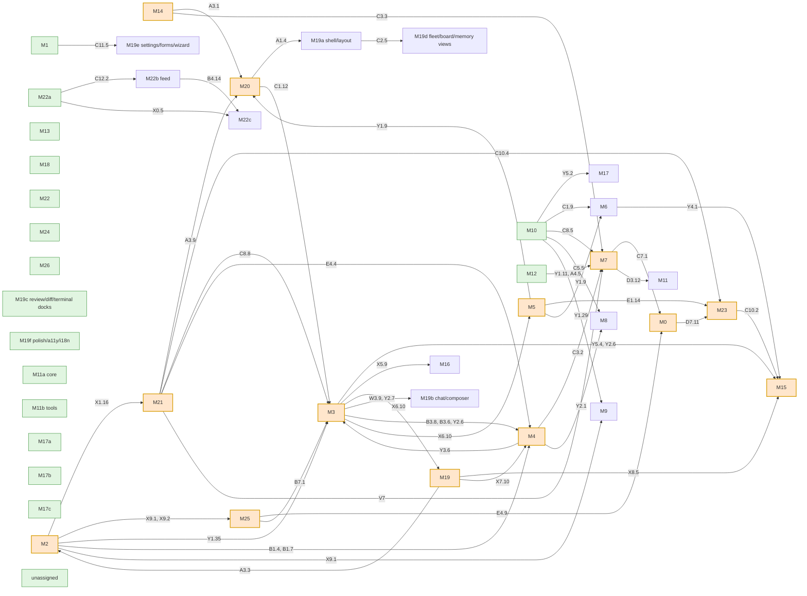

# Milestone dependency graph and critical path

> Generated by `keel/scripts/build_dependency_graph.py`. Regenerate with
> `python keel/scripts/build_dependency_graph.py --plan <path>`; verify with `--check`.

## 1. Provenance and scope

- Registry: `C:\Users\Admin\Desktop\Claude clone\PLAN-INDEX.json` — SHA-256 `f322269379539e90fab3bedd4c80b14f35dc61fcf8fa106eb267f653cc6fb360`.
- Rows: **865** (status: verified 276, not_started 587, blocked 2).
- Decomposition source: `C:\Users\Admin\Desktop\Claude clone\plan-extract\addendum3.json` if found, otherwise built-in X0.2/X0.2b labels.
- Stated dependency references: **144**;
  **122** rows declare at least one dependency.
- Graph nodes: **42** (27 canonical milestones + 14 X0.2/X0.2b split nodes + 1 unassigned).
- Graph edges: **47** distinct milestone-level edges from stated row dependencies (76 intra-node edges ignored).
- Unresolved dependency tokens: **14** references (not used as edges).

## 2. Assumptions (important)

1. **Only stated dependencies become edges.** The registry has no `deps` field with
   milestone-level links, so edges are derived by resolving each row's `dependencies`
   feature IDs to their owning milestone/split node. No dependency is inferred from
   milestone numbering, source order, or priority.
2. **Milestone numbers are labels, not a topological order.**
   21 edges point from a higher-numbered milestone to a lower-numbered one
   (e.g. an M0 row depending on an M7 row). Cyclic groups are collapsed with Tarjan
   strongly-connected components before computing the critical path; the length below
   counts SCC members, so a cycle involving several milestones counts each once.
3. **Split nodes are derived, not stated in the registry.** X0.2/X0.2b require M19a-f,
   M11a-b, M17a-c and M22a-c, but rows remain tagged with the parent milestone. A
   deterministic keyword classifier over title+detail assigns each row; unclassifiable
   rows stay on the parent Mxx roll-up node. No synthetic parent→child edges are added,
   so every reported path edge is backed by real stated dependencies.
4. **Unresolved tokens are reported, never guessed.** They are listed in §7.
5. **The critical path is a dependency chain, not a schedule.** It assumes unlimited
   capacity; it does not model owner gates, blocked external prerequisites or effort.

## 3. Critical path

**Critical path length: 13 milestone-nodes** in the full (split-expanded) graph.
At canonical M-level (splits rolled up) the longest chain is **13 milestone-nodes**.

Full-graph chain (dependency → dependent):

1. **M14** — 15 rows in cycle/group (verified 9, not_started 6)
2. **M19 ⟷ M2 ⟷ M20 ⟷ M21 ⟷ M25 ⟷ M3 ⟷ M4 ⟷ M5** — 333 rows in cycle/group (verified 107, not_started 226)
   - edge evidence: `C3.2` → `W2.4`
3. **M7** — 56 rows in cycle/group (verified 22, not_started 34)
   - edge evidence: `C7.1` → `W1.13`
4. **M0** — 61 rows in cycle/group (verified 6, not_started 55)
   - edge evidence: `D7.11` → `V19`
5. **M23** — 19 rows in cycle/group (verified 10, not_started 9)
   - edge evidence: `C10.2` → `Y5.8`
6. **M15** — 27 rows in cycle/group (verified 13, not_started 14)

Canonical chain:

M1 → M19 ⟷ M2 ⟷ M20 ⟷ M21 ⟷ M25 ⟷ M3 ⟷ M4 ⟷ M5 → M7 → M0 → M23 → M15

## 4. Which feature groups must complete first

Root nodes (no incoming stated dependency) are the first groups that can start;
the bottleneck table ranks nodes by how many distinct groups depend on them.

| Root node | Rows | Status mix | Directly blocks | Downstream reach |
| :- | :-: | :- | :-: | :-: |
| M1 | 11 | verified 3, not_started 6, blocked 2 | 1 | 1 |
| M10 | 33 | verified 7, not_started 26 | 5 | 9 |
| M11a core | 11 | verified 5, not_started 6 | 0 | 0 |
| M11b tools | 16 | verified 8, not_started 8 | 0 | 0 |
| M12 | 31 | verified 10, not_started 21 | 1 | 5 |
| M13 | 19 | verified 11, not_started 8 | 0 | 0 |
| M14 | 15 | verified 9, not_started 6 | 2 | 20 |
| M17a | 10 | verified 3, not_started 7 | 0 | 0 |
| M17b | 10 | verified 3, not_started 7 | 0 | 0 |
| M17c | 2 | verified 1, not_started 1 | 0 | 0 |
| M18 | 2 | verified 1, not_started 1 | 0 | 0 |
| M19c review/diff/terminal docks | 6 | verified 2, not_started 4 | 0 | 0 |
| M19f polish/a11y/i18n | 8 | verified 1, not_started 7 | 0 | 0 |
| M22 | 5 | verified 2, not_started 3 | 0 | 0 |
| M22a | 37 | verified 9, not_started 28 | 2 | 2 |
| M24 | 8 | verified 6, not_started 2 | 0 | 0 |
| M26 | 4 | verified 1, not_started 3 | 0 | 0 |
| unassigned | 3 | not_started 3 | 0 | 0 |

| Bottleneck node | Rows | Status mix | Directly blocks | Downstream reach |
| :- | :-: | :- | :-: | :-: |
| M3 | 61 | verified 16, not_started 45 | 6 | 20 |
| M2 | 52 | verified 18, not_started 34 | 5 | 20 |
| M21 | 29 | verified 15, not_started 14 | 5 | 20 |
| M10 | 33 | verified 7, not_started 26 | 5 | 9 |
| M19 | 14 | verified 2, not_started 12 | 3 | 20 |
| M4 | 50 | verified 6, not_started 44 | 3 | 20 |
| M5 | 59 | verified 27, not_started 32 | 3 | 20 |
| M14 | 15 | verified 9, not_started 6 | 2 | 20 |
| M20 | 40 | verified 12, not_started 28 | 2 | 20 |
| M25 | 28 | verified 11, not_started 17 | 2 | 20 |
| M7 | 56 | verified 22, not_started 34 | 2 | 4 |
| M22a | 37 | verified 9, not_started 28 | 2 | 2 |
| M12 | 31 | verified 10, not_started 21 | 1 | 5 |
| M0 | 61 | verified 6, not_started 55 | 1 | 2 |
| M1 | 11 | verified 3, not_started 6, blocked 2 | 1 | 1 |

Nodes on the critical path with non-green rows: **M14, M19, M2, M20, M21, M25, M3, M4, M5, M7, M0, M23, M15**.

## 5. Mermaid graph

Legend: orange = on the critical path; green = root (no stated prerequisite);
edge labels are the contributing row dependency IDs.

## 6. Readiness gate (X0.3)

X0.3 says a builder may not start a row whose dependencies are not green.
- `not_started` rows that declare dependencies: **114**.
- Of those, rows with at least one dependency not `verified`: **64**.
- Rows depending on a `blocked` row: **1**.

| Not-started row | Node | Unmet dependency | Dependency status |
| :- | :- | :- | :- |
| D1.1 | M10 | W1.1 | not_started |
| D1.1 | M10 | V1 | not_started |
| D1.5 | M2 | X6.8 | not_started |
| D2.1 | M8 | Y2.1 | not_started |
| D2.13 | M4 | Master 10 | unresolved token |
| D2.9 | M4 | Y2.4 | not_started |
| D3.8 | M15 | Y5.4 | not_started |
| D3.8 | M15 | V9 | not_started |
| D7.14 | M25 | W1.5 | not_started |
| D7.14 | M25 | X9.1 | not_started |
| D7.14 | M25 | X9.2 | not_started |
| E3.7 | M12 | V8 | not_started |
| E5.5 | M10 | D1.11 | not_started |
| E7.13 | M4 | E4.4 | not_started |
| E7.20 | M3 | V5 | not_started |
| E7.37 | M10 | V23 | not_started |
| E7.39 | M15 | D3.8 | not_started |
| E7.43 | M16 | X5.9 | not_started |
| E7.5 | M11 | D3.12 | not_started |
| V1 | M10 | W1.1 | not_started |
| V1 | M10 | Y1.31 | not_started |
| V10 | M0 | W1.7 | not_started |
| V15 | M10 | V1 | not_started |
| V15 | M10 | X6.1 | not_started |
| V19 | M23 | D7.11 | not_started |
| V2 | M3 | C-1 | unresolved token |
| V24 | M5 | E1.x | unresolved token |
| V24 | M5 | E2.x | unresolved token |
| V27 | M22a | E5.14 | not_started |
| V27 | M22a | E5.15 | not_started |
| V28 | M23 | E6.11 | not_started |
| V3 | M3 | X5.7 | not_started |
| V4 | M19b chat/composer | W3.9 | not_started |
| V4 | M19b chat/composer | Y2.7 | not_started |
| V9 | M15 | W7.17 | not_started |
| V9 | M15 | Y2.6 | not_started |
| V9 | M15 | X8.5 | not_started |
| W1.1 | M10 | V1 | not_started |
| W1.11 | M19 | X6.10 | not_started |
| W1.14 | M10 | G7 | unresolved token |
| W1.15 | M20 | X6.3 | not_started |
| W1.8 | M1 | C11.1 | blocked |
| W3.10 | M3 | Y1.17 | not_started |
| W3.2 | M3 | C-1 | unresolved token |
| W4.12 | M6 | Y1.9 | not_started |
| W4.13 | M6 | V6 | not_started |
| W5.6 | M7 | Y1.11 | not_started |
| W6.1 | M7 | V7 | not_started |
| W6.4 | M12 | V8 | not_started |
| W7.14 | M19a shell/layout | X9.x | unresolved token |
| W7.15 | M4 | Z3 | not_started |
| W7.17 | M15 | V9 | not_started |
| W7.20 | M23 | X10 | unresolved token |
| W7.3 | M3 | Y3.6 | not_started |
| W7.4 | M3 | Z30 | unresolved token |
| W7.7 | M20 | Y3.8 | not_started |
| Y1.13 | M11b tools | X2.6 | not_started |
| Y1.15 | M17 | Y5.2 | not_started |
| Y1.19 | M2 | X6.8 | not_started |
| Y1.29 | M10 | G7 | unresolved token |
| Y1.33 | M5 | X6.10 | not_started |
| Y1.37 | M22c | X0.5 | not_started |
| Y2.19 | M4 | X9.7 | not_started |
| Y3.18 | M4 | X7.10 | not_started |
| Y4.9 | M7 | X1 | unresolved token |
| Y6.3 | M19d fleet/board/memory views | D5 | unresolved token |
| Y6.4 | M1 | G1 | unresolved token |
| Z1 | M9 | Y1.29 | not_started |
| Z10 | M21 | X1.16 | not_started |
| Z11 | M15 | Y4.1 | not_started |
| Z13 | M19 | Y3.1 | not_started |
| Z2 | M9 | X9.1 | not_started |
| Z4 | M4 | Y2.4 | not_started |
| Z4 | M4 | Y2.6 | not_started |
| Z5 | M20 | Y1.9 | not_started |
| Z9 | M3 | Y1.35 | not_started |

## 7. Unresolved dependency tokens

These tokens appear in `dependencies` but do not resolve to a registry ID.
They are recorded as assumptions and excluded from the graph and critical path.

| Row | Node | Token |
| :- | :- | :- |
| D2.13 | M4 | Master 10 |
| E1.5 | M3 | W3.x |
| V2 | M3 | C-1 |
| V24 | M5 | E1.x |
| V24 | M5 | E2.x |
| W1.14 | M10 | G7 |
| W3.2 | M3 | C-1 |
| W7.14 | M19a shell/layout | X9.x |
| W7.20 | M23 | X10 |
| W7.4 | M3 | Z30 |
| Y1.29 | M10 | G7 |
| Y4.9 | M7 | X1 |
| Y6.3 | M19d fleet/board/memory views | D5 |
| Y6.4 | M1 | G1 |

## 8. All stated milestone-level edges

| From (prerequisite) | To (dependent) | Contributing row dependencies |
| :- | :- | :- |
| M0 | M23 | D7.11→V19 |
| M1 | M19e settings/forms/wizard | C11.5→W1.10 |
| M10 | M17 | Y5.2→Y1.15 |
| M10 | M6 | C1.9→Y4.14 |
| M10 | M7 | C8.5→V11 |
| M10 | M8 | C5.5→D2.1 |
| M10 | M9 | Y1.29→Z1 |
| M12 | M7 | Y1.11→W5.6, A4.5→Y4.9 |
| M14 | M20 | A3.1→Y3.16 |
| M14 | M7 | C3.3→D2.17 |
| M19 | M15 | X8.5→V9 |
| M19 | M2 | A3.3→Y3.11 |
| M19 | M4 | X7.10→Y3.18 |
| M19a shell/layout | M19d fleet/board/memory views | C2.5→Y6.3 |
| M2 | M21 | X1.16→Z10 |
| M2 | M25 | X9.1→D7.14, X9.2→D7.14 |
| M2 | M3 | Y1.35→Z9 |
| M2 | M4 | B1.4→D2.6, B1.7→Y3.5 |
| M2 | M9 | X9.1→Z2 |
| M20 | M19a shell/layout | A1.4→W1.4 |
| M20 | M3 | C1.12→Y2.20 |
| M21 | M20 | A3.9→Y3.16 |
| M21 | M23 | C10.4→W1.17 |
| M21 | M3 | C8.8→Z15 |
| M21 | M4 | E4.4→E7.13 |
| M21 | M7 | V7→W6.1 |
| M22a | M22b feed | C12.2→Z12 |
| M22a | M22c | X0.5→Y1.37 |
| M22b feed | M22c | B4.14→Y1.37 |
| M23 | M15 | C10.2→Y5.8 |
| M25 | M0 | E4.9→V30 |
| M25 | M3 | B7.1→W3.3 |
| M3 | M15 | Y5.4→D3.8, Y2.6→V9 |
| M3 | M16 | X5.9→E7.43 |
| M3 | M19 | X6.10→W1.11 |
| M3 | M19b chat/composer | W3.9→V4, Y2.7→V4 |
| M3 | M4 | B3.8→Z3, B3.6→Z3, Y2.6→Z4 |
| M3 | M5 | X6.10→Y1.33 |
| M4 | M3 | Y3.6→W7.3 |
| M4 | M7 | C3.2→W2.4 |
| M4 | M8 | Y2.1→D2.1 |
| M5 | M20 | Y1.9→Z5 |
| M5 | M23 | E1.14→V28 |
| M5 | M6 | Y1.9→W4.12 |
| M6 | M15 | Y4.1→Z11 |
| M7 | M0 | C7.1→W1.13 |
| M7 | M11 | D3.12→E7.5 |

