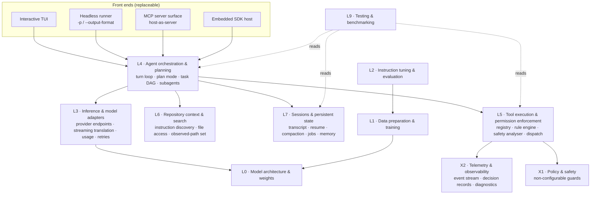
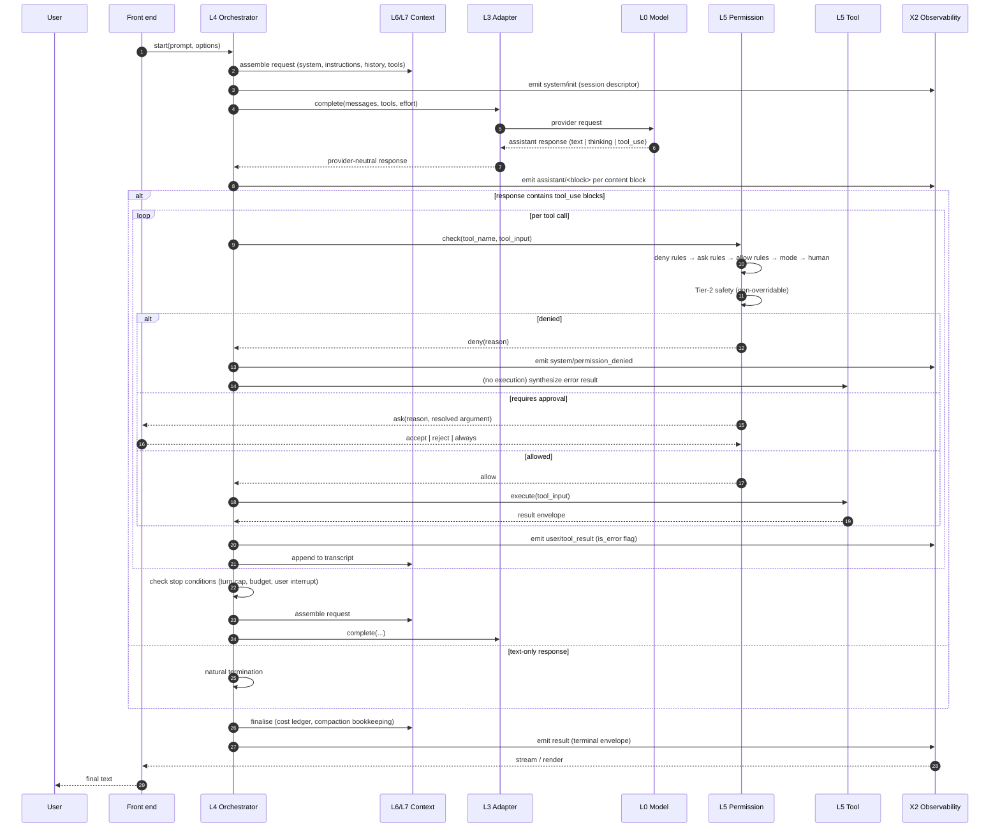
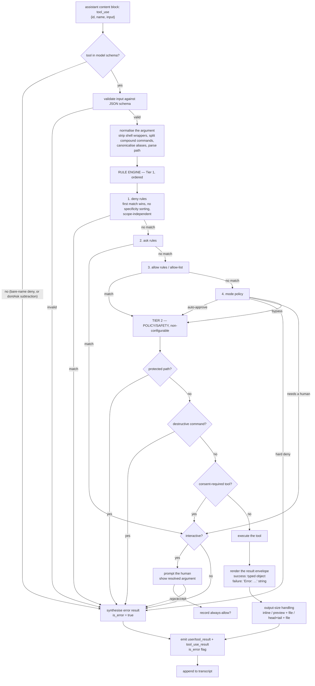
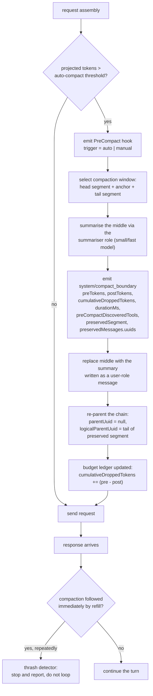
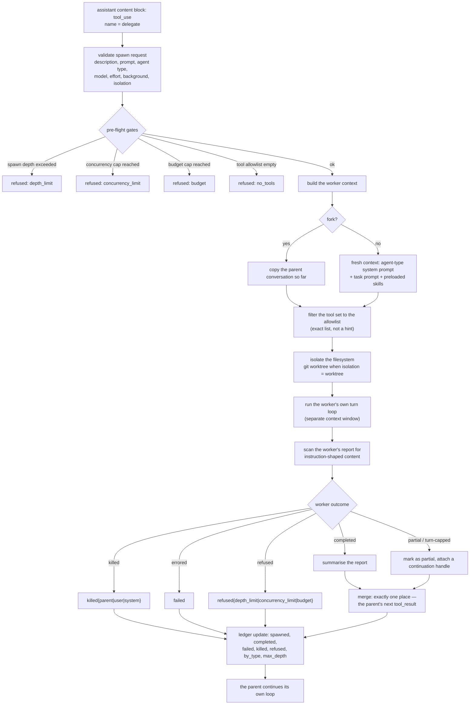
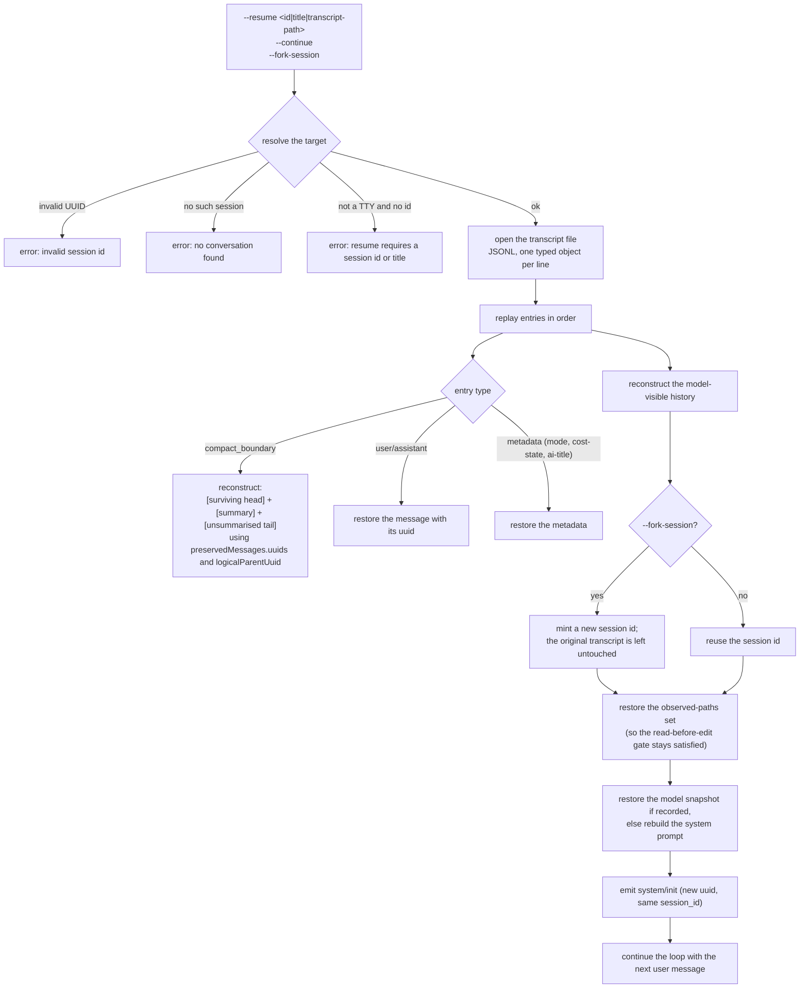

# Architecture — Clean-Room Reimplementation of an Observable Agentic Coding Harness

**Document status:** planning deliverable. No source code in this repository is derived from the reference product.
**Evidence base:** `agent-evidence.md` (primary), `agent-reference-shots/areas/*.md` (deep reports), `agent-reference-shots/docs-cache/*.md` (official documentation captures), and the observed protocol captures (`stream-json-basic.jsonl`, `tool-error-contract.json`, `denied-tool-results.json`, `tool-result-dual-representation.json`, `print-mode-json-result.json`, `cli-reference/*.json`, `PROTOCOL-NOTES.md`).
**Companion document:** `interface-spec.md` — the normative interface contract this architecture implements.

---

## 1. Scope and intent

This document specifies the architecture of an independent, clean-room implementation of an **agentic coding harness**: a host process that owns a tool-execution security boundary, a context-budget manager, a session/transcript store, a configuration-resolution engine, and an extensible instruction/tool surface, with a language model dropped into the middle.

**What is in scope.** The harness: the agent loop, the tool subsystem and its permission gate, repository context and search, session persistence and resume, context compaction, subagent delegation, extensibility surfaces (skills, hooks, MCP, commands, plugins, agents), configuration resolution, the headless/programmatic surface, and the event stream.

**What is out of scope.** Anything that would require the reference product's private assets: its system-prompt text, its tool-description prose, its binary, its proprietary model weights, its training data, or its internal (non-published) APIs. Model *capability* is out of scope for the harness — the harness talks to a provider through an adapter and never assumes what the model can do.

### 1.1 Guiding constraints

| # | Constraint | Consequence in this design |
| :- | :- | :- |
| C1 | **Clean-room.** The implementation is written from public documentation and black-box observation only. No decompilation, no binary modification, no source recovery. | All prose in this repository is original. Interface *facts* (event names, settings keys, file formats, exit codes) are reproduced because a compatible implementation must interoperate; interface *descriptions* are rewritten in our own engineering language. |
| C2 | **Original code and assets.** The implementation, its branding, its prompts, its tool descriptions, its UI, and its documentation are ours. | The architecture defines our own prompt-assembly, our own tool set, and our own visual identity. Where the reference's shape is reproduced, the reason is behavioural compatibility, not copied expression. |
| C3 | **Model-provider independence.** The harness must run against a reference provider today and against our own model later, without changing any layer above the adapter. | Every layer above the adapter consumes a provider-neutral message model, a provider-neutral tool schema, and a provider-neutral usage record. The adapter boundary is a hard architectural line (see §5). |
| C4 | **Interface compatibility is a surface, not a dependency.** Matching a wire format does not grant a licence to copy implementation. | Compatibility targets are enumerated in `interface-spec.md` § "Compatibility matrix" and pinned by contract tests, not by source similarity. |
| C5 | **The observable contract is the specification.** Where behaviour is ambiguous, we prefer the behaviour a black-box observer can see over any hypothetical internal structure. | The event stream, the result envelope, the tool-result envelope, and the permission-decision record are the load-bearing public surfaces. |
| C6 | **Fail closed, fail visibly.** Security-relevant checks cannot be configured off, and a diagnostic is never silently swallowed. | Tier-2 safety checks live in a separate non-configurable layer (§7.4). Settings diagnostics always reach stderr, including in headless mode. |

### 1.2 Relationship to the reference product

This is an independent implementation. Where we deliberately differ from the reference, the difference is recorded as an **ORIGINAL DESIGN DECISION** with a rationale and at least one alternative considered. The main deliberate differences are:

| Difference | Rationale | Alternative considered |
| :- | :- | :- |
| Every overflow path (success *and* failure) returns a file pointer alongside the inline excerpt. | The reference returns a head-and-tail excerpt with no file pointer on the failure path, which makes a failing build's output unrecoverable except by re-running the command. | (a) Match the reference exactly (recoverability loss); (b) Return only a preview (no large-output capability at all). |
| Invalid settings in headless mode are ignored **and** reported on stderr. | The reference fails open in headless mode with no diagnostic, so a typo in a permission rule silently leaves the rule unenforced. | (a) Match the reference (silent footgun); (b) Fail the run (breaks CI on a harmless typo). |
| A forked skill is counted in the subagent ledger. | The reference does not count it, which understates real inference spend. | (a) Match the reference (miscounted spend). |
| Injected shell commands inside a skill body are gated by an explicit policy that defaults to *deny* for untrusted skill sources and always logs. | The reference executes them silently at render time, which is remote code execution through a repository. | (a) Match the reference (silent RCE-by-repository); (b) Prompt (annoying, but honest). |
| A `plan`-mode session that lacks an approval tool degrades to *no plan submission path at all* is a bug we avoid: we always ship the plan-submission tool. | The reference omits it in some configurations, leaving the agent in a prose-only state. | (a) Match the reference (degraded agent). |

---

## 2. Layered architecture

The system is a stack of layers. A layer may only depend on layers below it. Each layer has a **must not know about** column — this is the enforcement mechanism for C3, and it is the first thing a reviewer should check in a change.

### 2.1 Layer table

| # | Layer | Responsibility | Owns | Must not know about |
| :- | :- | :- | :- | :- |
| L0 | **Model architecture & weights** | The trained model's internal computation: tokenisation, attention, output distribution, reasoning-token generation, context-window capacity. | Weights, quantisation format, KV cache, sampling kernels, the model's own tool-calling competence. | The harness. The model does not know it is inside an agent; it sees tokens. |
| L1 | **Data preparation & training** | Producing and curating the corpora, instruction mixtures, preference pairs, and evaluation sets that shape L0's behaviour. | Datasets, mix weights, RL/pretraining pipelines, safety fine-tuning. | The harness's runtime; the tool protocol; the permission system. |
| L2 | **Instruction tuning & evaluation** | Turning L0/L1 into a model that follows instructions, emits structured tool calls, and behaves under a harness contract. | SFT/RL curricula, tool-use training mixes, held-out eval suites, regression gates. | The specific harness implementation — training targets *capabilities*, not our wire format. |
| L3 | **Inference & model adapters** | Serving a model and translating its I/O into the provider-neutral message/tool/usage model the harness speaks. | Provider endpoints, auth, streaming translation, token accounting, effort/reasoning controls, retry policy, model registry, capability matrix. | Permissions, tools, sessions, compaction, the UI, the transcript format. |
| L4 | **Agent orchestration & planning** | The turn loop: assemble a request, consume a response, dispatch tool calls, decide when to stop, plan-mode gating, task decomposition, subagent delegation, budgets and turn caps. | The turn state machine, the plan artifact, the task DAG, the subagent supervisor. | How a tool executes; how a permission decision is reached; how bytes are written to disk. |
| L5 | **Tool execution & permission enforcement** | Defining tools, validating their inputs, gating them through the rule engine and the non-configurable safety layer, executing them, and rendering their results. | The tool registry, the schema validator, the rule engine, the safety analyser, the shell front-ends, the result renderer, the output-persistence writer. | The provider; the transcript format; the subagent supervisor. It may be called by L4 but knows nothing of turns. |
| L6 | **Repository context & search** | Discovering the project, reading and searching files, loading instruction files, and maintaining the "what has the model actually seen" set. | The instruction-file walk, the lazy subdirectory index, path-scoped rules, `Read`/`Glob`/`Grep` semantics, the observed-paths set, the file-history store. | The provider; the permission rule syntax (it reports *requests*, L5 decides). |
| L7 | **Sessions & persistent state** | Session identity, the append-only transcript, resume, compaction history, the cost ledger, checkpoints, job and task stores, the memory index. | The JSONL transcript writer/reader, the compaction boundary records, the cost accumulator, the snapshot store, the file-backed job registry, the memory directory. | The provider; the permission rules; the renderer. |
| L8 | **REA-based investigation workflows** | Structured, evidence-driven investigation of an unfamiliar artefact or codebase: hypothesis → targeted probe → evidence → conclusion, with every conclusion tied to an observation. | Probe planning, evidence capture, an observation ledger, replayable probe scripts, the report assembler. | The provider's wire format; the TUI. It consumes tools through L5 and records into L7. |
| L9 | **Testing & benchmarking** | Verifying that the harness behaves as specified, and measuring the quality of the agentic loop itself. | Contract tests per interface, golden transcripts, permission-matrix fixtures, regression suites, loop-quality benchmarks. | Nothing — it may read every layer, and every layer must be testable without it. |
| X1 | **Policy & safety** (cross-cutting) | The checks that no configuration, rule, hook, or mode can bypass. | The protected-path table, the destructive-command analyser, the consent-required tool flag, the dangerous-mode interlock, the workspace-trust gate. | Nothing above it may override it. It must be unreachable from the settings resolver. |
| X2 | **Telemetry & observability** (cross-cutting) | The event stream, the decision records, the cost ledger, and the diagnostic channel. | The event union, the event emitter, the stderr diagnostic format, the usage accumulator. | Business logic. It observes; it never decides (except that it is the *record* of decisions). |

Layer count: **12** (10 required + 2 cross-cutting).

### 2.2 Dependency diagram



**Two structural rules are load-bearing.**

1. **The core is front-end agnostic.** L4–L7 contain no terminal rendering, no ANSI, no prompt layout. This is what allows the same core to be driven by a TUI, a headless runner, an MCP server, and an embedding host. It is also the cheapest architectural decision with the largest future payoff, and it is directly supported by the reference's own behaviour (the reference exposes its own tool surface over MCP while serving the same core).
2. **The model is a leaf.** L0–L2 sit *below* the harness, and the harness never reaches past L3. The harness supplies messages, tools, and constraints; the model supplies decisions.

### 2.3 Where the reference's "model stack" fits

Layers L0–L2 are outside the harness. We do not build them in the first instance; we consume a reference provider's model through L3. They are specified here because the architecture must remain honest about where model capability comes from and because the roadmap in §16 requires a self-hosted model path.

- **ORIGINAL DESIGN DECISION (L0–L2 are a separate workstream).** We do not attempt to train a model as part of the harness delivery. Rationale: model training is a multi-quarter, multi-GPU programme with a very different risk profile, and the harness — not the model — is where the reproducible, verifiable contract lives. Alternative considered: (a) train a small task model in parallel — rejected for schedule and because it would couple harness milestones to training milestones; (b) fine-tune a partner model — viable as a *later* L2 activity once the harness is stable, and explicitly enabled by keeping the L3 interface provider-neutral.

---

## 3. Process and data flow

### 3.1 The agent loop



**Turn structure.** One *turn* is one evaluate/execute round trip: the model produces output containing tool calls, the harness executes them, and the results feed back automatically without yielding to the caller. The final text-only assistant message is **not** a turn. A run terminates naturally only when the model produces a response with no tool calls. Every other exit is an injected limit (turn cap, budget cap, crash, structured-output retry exhaustion) or an error.

**Continuation semantics.**

- *Mid-turn steering.* A user message arriving while the model is mid-tool-execution is queued and injected **between tool executions, within the same turn**, not only between turns. The queue depth is reported in the result envelope (`queued_turn_count`).
- *Turn-cap stop with queued input.* When the turn cap is reached, a still-queued message stays queued, the turn counter resets for that message's new turn, and the **budget total keeps accumulating**. The budget is not reset by a turn-cap stop; only an explicit `/clear` resets it.
- *The "never re-send a partially delivered response" rule.* This is the single most safety-critical rule in the error path and is specified normatively in §10.3 and in `interface-spec.md` § "Agent turn interface".

**Stop conditions.**

| Condition | Terminal subtype | Notes |
| :- | :- | :- |
| Model produced a text-only response | `success` | The only natural exit. |
| Turn cap reached | `error_max_turns` | Counted post-response; the triggering response completes and is counted. |
| Spend cap reached | `error_max_budget_usd` | Checked post-response; overshoot by up to one response is documented and expected. |
| Execution error (cancel, provider failure) | `error_during_execution` | `stop_reason` is `null` when synthesised after a crash. |
| Structured-output validation exhausted | `error_max_structured_output_retries` | Distinct from a generic failure. |

The result event is a **terminal-state marker inside a continuing stream**, not a stream terminator: trailing observability events may follow it, and a consumer must drain the stream.

### 3.2 The tool-call path with the permission gate



Two properties are worth stating because they are easy to get wrong:

- **Schema filtering and dispatch gating are different subsystems.** A bare-name deny removes the tool from the model's schema before the model ever sees it (capability removal). A scoped deny keeps the tool visible and blocks matching calls at dispatch time (call filter). Both are needed: the first is a stronger guarantee, the second is necessary for tools with both safe and unsafe uses.
- **The permission gate sits between validation and execution, and the Tier-2 safety check sits *after* the rule engine and cannot be configured off.** An allow rule or a hook returning "allow" cannot bypass Tier 2.

### 3.3 The compaction path



**The compaction boundary is a structured, addressable record, not a summary blob.** It names the UUIDs of the messages that survived, plus a head/anchor/tail triple. A resume reconstructs the conversation as:

```
[surviving head messages] + [summary] + [unsummarised tail] + [messages since the boundary]
```

**The boundary deliberately breaks the ordinary parent chain** (`parentUuid: null`) and supplies a `logicalParentUuid` instead. A resume implementation that follows only `parentUuid` loses the connection across a compaction boundary — this is a concrete, observable trap.

Three customisation routes are provided: a project-instruction section the compactor reads, a pre-compaction hook with a `trigger` field distinguishing `manual` from `auto`, and a manual compaction command.

### 3.4 The subagent spawn and merge path



**Merge happens in exactly one place.** The parent never sees the worker's intermediate tool calls or outputs — only its final report, reduced to a summary. The report is scanned for instruction-shaped content before it is handed up: a subagent is a **trust boundary**, and its output is untrusted input to the parent.

**Concurrency caps** are named, documented, and overridable, but overridable only within limits:

| Cap | Default | Notes |
| :- | :- | :- |
| Concurrent subagents per session | 20 | A spawn beyond the cap is *refused*, not queued. |
| Subagent spawn depth below the main conversation | 3 | Depth 1 is the main conversation's direct children. |
| Concurrent workflow agents per run | 16 (range 1–256) | Lowered automatically when fewer CPUs are available. |
| Combined subagent description tokens | 15,000 | Context-budget guard on the agent listing. |

**Worktree isolation is a filesystem concern, not a process concern**, and it is enforced at four points: the file-edit path, the command working directory, git redirects, and command shape. It is **not optional** — retrofitting it means auditing every write path that already exists.

**ORIGINAL DESIGN DECISION (the coordination store is file-backed).** Worker coordination uses plain JSON on disk (`<state-root>/tasks/<team>/<n>.json` with a `.lock` for claiming; `<state-root>/teams/<team>/inboxes/<agent>.json` for mailboxes) rather than an in-memory channel or a broker. Rationale: the state is then restart-tolerant, human-inspectable, and pollable by a script — a crash recovers because the state was never only in memory. Alternative considered: (a) an in-process event bus with a supervisor — simpler, but a crash loses the plan and the state is invisible to a human; (b) a socket-based broker — fast, but adds a running service to supervise and to secure.

### 3.5 The session resume path



Three resume error paths are distinct and each exits non-zero with a message on stderr. The interrupted-turn behaviour is explicit: on resume, the interrupted turn is left as it is and the next prompt drives the conversation, unless the operator has opted into resuming the interrupted turn.

---

## 4. The event model

### 4.1 Taxonomy

The stream is newline-delimited JSON. Every event carries a `type` discriminator, and most carry a `subtype`. A `type`/`subtype` pair is the *only* discriminator; there is no third kind of tag.

| `type` | `subtype` | Producer | Key payload fields | Consumer |
| :- | :- | :- | :- | :- |
| `system` | `init` | L4 at session start | `cwd`, `original_cwd`, `additional_directories`, `session_id`, `uuid`, `tools[]`, `mcp_servers[]`, `model`, `permissionMode`, `slash_commands[]`, `terminal_slash_commands[]`, `agents[]`, `skills[]`, `plugins[]`, `capabilities[]`, `output_style`, `memory_paths`, `apiKeySource`, `claude_code_version`, `fast_mode_state`, `fast_mode_disabled_reason`, `per_turn_effort_active`, `view_mode`, `messaging_socket_path`, `powershell_path` | TUI, headless consumer, MCP client, embedder |
| `system` | `hook_started` / `hook_response` | L5 hook runner | `hook_event_name`, `hook_name`, `status` | TUI, log consumer |
| `system` | `permission_denied` | L5 permission engine | `tool_name`, `tool_use_id`, `tool_input`, `decision_reason_type`, `decision_reason` | operator UI, audit log, model (via the paired tool result) |
| `system` | `task_started` | L4 subagent/job supervisor | `task_id`, `run_id`, `tool_use_id`, `description`, `subagent_type`, `is_backgrounded`, `spawn_depth`, `task_type`, `prompt` | TUI, job roster |
| `system` | `task_progress` | L4 supervisor | `task_id`, `description`, `usage{total_tokens,tool_uses,duration_ms}`, `last_tool_name` | TUI, job roster |
| `system` | `task_notification` | L4 supervisor | `task_id`, `status`, `result summary` | TUI, parent conversation |
| `system` | `compact_boundary` | L7 context manager | `content`, `level`, `compactMetadata{trigger, preTokens, postTokens, cumulativeDroppedTokens, durationMs, preCompactDiscoveredTools, preservedSegment{headUuid,anchorUuid,tailUuid}, preservedMessages{anchorUuid,uuids[]}}`, `parentUuid`, `logicalParentUuid` | transcript, resume, context ledger, TUI |
| `system` | `turn_duration` | L4 orchestrator | `durationMs`, `messageCount`, `entrypoint`, `cwd`, `gitBranch`, `slug` | telemetry, statusline |
| `system` | `api_retry` | L3 adapter | `attempt`, `max_retries`, `retry_delay_ms`, `error_status`, optional `no_response{waited_ms,retry_wait_ms}`, `error` (category), `uuid`, `session_id` | telemetry, TUI, supervisor |
| `system` | `thinking_tokens` | L3 adapter | `estimated_tokens`, `estimated_tokens_delta`, `session_id`, `uuid` | statusline, TUI |
| `system` | `informational` | any | plain text banner | TUI |
| `system` | `worker_shutting_down` | L4 | reason | TUI, embedder |
| `assistant` | — (content block discriminates) | L3/L4 | `message{ id, type, role, content[], model, stop_reason, usage, provider }`, `parent_tool_use_id`, `session_id`, `uuid`, `timestamp`, `request_id`, optional `wire_tool_inputs`, optional `thinking_duration_ms`, `thinking_display` | TUI, transcript, embedder |
| `user` | — (content block discriminates) | L4/L5 | `message{ role, content[] }`, `parent_tool_use_id`, `session_id`, `uuid`, `timestamp`, `tool_use_result`, `tool_result_meta[]` | TUI, transcript, model request assembly |
| `user` | — (compaction summary) | L7 | `isCompactSummary: true` | transcript, resume |
| `result` | — (terminal envelope) | L4 | see §4.3 | headless consumer, CI gate, TUI |

**Assistant content blocks** (inside `assistant.message.content[]`): `text` · `thinking` · `tool_use`. One assistant event is emitted **per content block**; blocks belonging to the same model response share the same `message.id` and `request_id`.

**User content blocks**: `tool_result` (carrying `tool_use_id`) · `text` (a user input or injected instruction) · `attachment` (a labelled instruction or environment attachment).

### 4.2 Invariants

These are non-negotiable and each is pinned by a contract test.

1. **One assistant event per content block**, with a shared `message.id` across the blocks of one response, so a consumer can reassemble a response.
2. **Correlation is by `tool_use_id`, never by position.** A result may arrive before the sibling result that was requested first.
3. **A denied call still occupies a `tool_result` slot**, with `is_error: true` and the rejection text as content. A denial is *data*, never an exception out of the dispatcher.
4. **`system/permission_denied` precedes the corresponding `user/tool_result`.**
5. **The `result` event does not end the stream.** Consumers must drain it.
6. **`result` (the text field) is populated only on the `success` subtype.** Every other subtype omits it.
7. **Cost, usage, turn count, and session id are present on every result subtype**, including error ones, so a caller can bill and resume after a failure.
8. **The init manifest is emitted after any startup-hook lifecycle events.**
9. **Diagnostics go to stderr, never to stdout.** A headless consumer that pipes stdout to a JSON parser must not have to filter.
10. **Subagent activity is attributed** with `parent_tool_use_id` on every nested message, plus `agent_id`, `subagent_type`, `task_description`. A single stream is a complete transcript of the whole tree.

### 4.3 The terminal result envelope

```jsonc
{
  "type": "result",
  "subtype": "success",              // success | error_max_turns | error_max_budget_usd
                                     // | error_during_execution | error_max_structured_output_retries
  "is_error": false,
  "result": "<final assistant text>", // present only on `success`
  "session_id": "<uuid>",
  "uuid": "<uuid>",
  "num_turns": 5,
  "stop_reason": "end_turn",         // end_turn | max_tokens | refusal | null
  "terminal_reason": "completed",
  "duration_ms": 5902, "duration_api_ms": 5902,
  "ttft_ms": 0, "ttft_stream_ms": 0, "time_to_request_ms": 0, "first_content_frame_ms": 0,
  "api_error_status": null,
  "total_cost_usd": 0.0193,
  "usage": { "input_tokens": 0, "output_tokens": 0,
             "cache_creation_input_tokens": 0, "cache_read_input_tokens": 0,
             "output_tokens_details": { "thinking_tokens": 0 },
             "server_tool_use": { "web_search_requests": 0, "web_fetch_requests": 0 },
             "cache_creation": { "ephemeral_1h_input_tokens": 0, "ephemeral_5m_input_tokens": 0 } },
  "modelUsage": { "<model-id>": { "inputTokens": 0, "outputTokens": 0,
      "cacheReadInputTokens": 0, "cacheCreationInputTokens": 0, "webSearchRequests": 0,
      "costUSD": 0.0, "contextWindow": 200000, "maxOutputTokens": 32000,
      "thinkingTokens": 0, "canonicalModel": "<model-id>", "provider": "<provider>",
      "costBasis": "unknown" } },
  "permission_denials": [ { "tool_name": "Write", "tool_use_id": "<id>", "tool_input": { } } ],
  "safety_stops": 0,
  "queued_turn_count": 0,
  "result_index": 0,
  "subagent_stats": {
    "spawned": 0,
    "requested": { "background": 0, "foreground": 0, "unset": 0 },
    "started_in_background": 0, "max_depth": 0, "spawned_by_subagents": 0,
    "completed": 0, "failed": 0,
    "killed":  { "parent": 0, "user": 0, "system": 0 },
    "refused": { "depth_limit": 0, "concurrency_limit": 0, "budget": 0 },
    "by_type": { }
  },
  "fast_mode_state": "off", "fast_mode_disabled_reason": "sdk_opt_in_required",
  "per_turn_effort_active": false,
  "structured_output": null            // present when --json-schema was supplied
}
```

**Note on `usage` vs `modelUsage`.** `usage` accounts for the main loop only. `modelUsage` is the whole tree, keyed by model. Whole-tree accounting requires `modelUsage`; a naive consumer that reads `usage` will under-report whenever a subagent ran.

**Note on the subagent ledger.** `killed`, `refused`, and `failed` are three distinct outcomes, and the distinction is worth preserving: "we chose not to spawn" ≠ "it was terminated" ≠ "it errored". A refusal is a *policy outcome*, not a failure.

---

## 5. Provider abstraction

### 5.1 The adapter interface

```ts
// Provider-neutral. No layer above L3 may see a provider-specific type.
type ProviderRequest = {
  model: string;
  messages: ProviderNeutralMessage[];
  tools: ToolSchema[];              // name + description + JSON schema
  maxOutputTokens: number;
  effort?: EffortLevel;             // low | medium | high | xhigh | max
  reasoning?: { enabled: boolean; display: 'hidden' | 'summarized' | 'full' };
  stopSequences?: string[];
  metadata?: Record<string, string>; // opaque pass-through
};

type ProviderResponse = {
  responseId: string;
  blocks: ResponseBlock[];          // text | thinking | tool_use
  stopReason: 'end_turn' | 'tool_use' | 'max_tokens' | 'refusal' | 'other';
  usage: Usage;                      // provider-neutral
  modelId: string;
  provider: string;
};

interface ModelAdapter {
  readonly id: string;
  readonly capabilities: AdapterCapabilities;
  complete(req: ProviderRequest, signal: AbortSignal): Promise<ProviderResponse>;
  stream(req: ProviderRequest, signal: AbortSignal): AsyncIterable<StreamChunk>;
  // The adapter owns: endpoints, auth, transport, retries, token accounting,
  // streaming-fragment translation, and the mapping of provider errors into
  // our provider-independent error-category enum.
}
```

**Two hard rules at this boundary.**

1. **An adapter is not model intelligence.** The adapter translates bytes into a message model. It does not decide what the model should do, it does not repair a malformed tool call, and it does not paper over a model that will not emit a tool call. Any behaviour in the adapter that is not a pure translation of the provider's wire format is a bug.
2. **The harness must not require a provider to support any particular capability.** Tool calling, thinking blocks, effort control, and streaming are each optional. A provider that supports none of them still gets a working harness (no tools → a text-only agent; no streaming → a buffered agent).

### 5.2 The model-resolution chain

Resolution is **per role**, not per session. Highest priority first:

| Level | Source | Notes |
| :- | :- | :- |
| 1 | CLI flag `--model <alias-or-full-id>` | Highest user-level precedence. Outranked only by managed policy. |
| 2 | Per-role / per-session override map | Fields: model, effort, fast mode, fallback model. Applies to a named role. |
| 3 | Environment variable (e.g. `ANTHROPIC_MODEL`) | Not a precedence level in the settings lattice; each key has explicit env binding. |
| 4 | Settings file top-level `model` key | An *initial selection*, not enforcement. |
| 5 | Default | The newest alias the build knows. |

**Roles** (at minimum): `main`, `summariser` (compaction), `title` (session naming), `classifier` (risk classification), `advisor`. The classifier and title roles exist because a harness that classifies its own tool calls for risk needs a cheap, low-latency model; putting that on the main model would add seconds to every gated call. This is a genuine architectural insight worth copying.

**Governance keys** (settings layer, surfaced in the model picker and enforced by the resolver):

| Key | Effect |
| :- | :- |
| `availableModels` | Restrict which models the picker offers and which may be named. |
| `enforceAvailableModels` | Extend the allowlist to the *default* resolution, so "default" cannot resolve outside the list. |
| `deniedModels` | Block specific model IDs or versions outright. |
| `modelOverrides` | Per-role model, effort, fast mode, fallback model. |
| `modelPicker` | Configure or remove the picker. |
| `fallbackModel` | Automatic fallback chain; **at most three** entries. |
| `maxEffortLevel` | Cap the effort slider. |

**Effort is a first-class, validated axis.** The levels are `low | medium | high | xhigh | max`. An unrecognised effort value is a **warning that is ignored** — the run continues at the current effort, because an unknown effort has a safe default. Contrast the auto-compact window, where an invalid value is a **hard error** — it has no safe default, and silently mis-sizing the context budget is worse than refusing to start.

**An unrecognised model ID is handled, not crashed.** The harness assumes a 200k context window, emits a machine-readable diagnostic on stderr with a stable event name and a `query_source` field, and continues. A graceful assumption plus a visible diagnostic beats a hard failure.

### 5.3 Swapping the reference provider for our own model

The swap is a **registry change, not a code change**, provided the adapter is written to the interface above:

1. Implement `ModelAdapter` for our own serving stack.
2. Register it in the adapter registry with its `capabilities` (tool calling, thinking, effort, streaming, cost table).
3. Point the model-resolution chain at it (settings `model` key, or the environment binding for the `main` role).
4. Publish the cost table so `modelUsage[...].costUSD` and `total_cost_usd` are real rather than `unknown`.

Nothing above L3 changes. The tool schema, the message model, the permission engine, the transcript, and the event stream are all provider-neutral by construction. This is the payoff of the layer boundary and the reason it is worth the discipline.

### 5.4 The self-hosted model adapter specification

A self-hosted adapter differs from a hosted one in four ways, and the interface must absorb all four without a special case.

| Concern | Hosted adapter | Self-hosted adapter requirement |
| :- | :- | :- |
| Endpoint | A fixed, authenticated HTTPS base URL | A configurable base URL, including loopback and RFC-1918 addresses; TLS verification configurable but defaulting to on. |
| Authentication | A managed token | A local token file, or a helper command invoked per connection, with a documented cache TTL. |
| Model identity | A vendor-controlled model ID | A locally assigned ID. The harness must accept an ID it does not recognise, assume a default window, and emit a diagnostic. |
| Cost | A vendor price table | **No price table.** `costBasis` becomes `"unknown"` and `costUSD` is `0` or absent. The cost ledger must remain meaningful with an unknown price: token counts stay authoritative, and the budget cap falls back to a token-based estimate. |
| Capability discovery | The provider advertises | The deployment declares its capability set out of band, at registration time, in the adapter's `capabilities`. |

**The `costBasis: "unknown"` case is not an edge case; it is the normal case for a self-hosted model, and the whole accounting path must survive it.** A budget cap expressed in dollars against a model with no price table must degrade to a token-count cap with an explicit note that the monetary cap is not enforceable, rather than silently allowing unlimited spend.

**ORIGINAL DESIGN DECISION (the budget cap has a token-denominated fallback).** Rationale: a self-hosted model has no price, so a purely monetary cap is unenforceable — but an unbounded run is a worse failure than a slightly imprecise one. Alternative considered: (a) refuse to start a budgeted run on an unpriced model — safe but blocks the primary use case of running our own model; (b) silently ignore the monetary cap — rejected, because the operator asked for a limit.

---

## 6. Tool subsystem

### 6.1 The tool contract

Every tool is a record with the following shape.

```ts
type ToolDefinition = {
  name: string;                    // globally unique, stable
  description: string;             // our own prose
  inputSchema: JSONSchema;         // strict; additionalProperties: false
  annotations: {
    readOnly: boolean;             // drives the concurrency class
    destructive: boolean;
    idempotent: boolean;
    openWorld: boolean;            // touches the network
    requiresUserInteraction?: boolean;  // consent-required; see §6.5
  };
  execute(ctx: ToolContext, input: unknown): Promise<ToolResult>;
};

type ToolResult = {
  isError: boolean;
  content: string;                 // what the model sees
  toolUseResult: unknown;          // the structured payload the operator/UI sees
  meta?: { permissionDecision?: PermissionDecision };
  nonExecutionKind?: 'user-rejected' | 'pre-parse-failure';
};
```

**The dual representation is deliberate and is one of the highest-value contracts in the system.** A single result carries two renderings:

- `content` — a **string** the model receives as the tool result. This is the model's only view of what happened.
- `toolUseResult` — a **typed payload** the operator UI, the transcript, and the audit log consume.

On success the typed payload is structured (`{stdout, stderr, interrupted, isImage, noOutputExpected}` for a shell command; `{filePath, content, numLines, startLine, totalLines}` for a file read; `{filenames[], durationMs, numFiles, truncated, totalMatches, countIsComplete}` for a glob) and `content` is the flattened text form. On failure the typed payload is the string `"Error: <message>"` and `content` is `<message>` without the prefix. The prefix is the audit copy; the content is the model's copy.

**Why this matters.** A renderer that only sees the flattened string cannot show a structured diff. A model that only sees the typed object would receive a JSON blob in a text channel, which is worse for it. Both audiences need different shapes, and the contract supplies both from one execution.

### 6.2 The output-size ladder

| Path | Inline limit | On overflow |
| :- | :- | :- |
| Success | ~30,000 characters | A file path inside the session directory plus a preview of the first ~2,000 characters, wrapped in literal `<persisted-output>` tags. |
| Failure | ~10,000 characters | A head-and-tail excerpt of that size. **Plus a file path** (our deliberate improvement). |
| Absolute | — | A hard kill at 5 GB of streamed output. |

The overflow notice is wrapped in literal `<persisted-output>` tags so a consumer can find it without parsing prose. The overflow file lives **inside the session directory** so it survives with the transcript and is addressable by the file-read tool. Sizes are reported in KB/MB with one decimal.

**Original improvement (documented in §1.2): the failure path also returns a file pointer.** The result payload on every path is:

```jsonc
{
  "inline_preview": "…",
  "output_file_path": "<session-dir>/tool-results/<id>.txt",
  "total_bytes": 2621440,
  "truncated": true
}
```

A model reading this knows the full output exists and where; it does not have to re-run the command to recover it.

### 6.3 The permission-gate placement

The gate is in the **dispatch path**, not in the tool implementations. A tool implementation never asks "am I allowed?"; it assumes it has been called. This has three benefits: the gate is in exactly one place, so it cannot be bypassed by a new tool; the gate sees the *resolved* argument (after wrapper stripping, compound splitting, and alias canonicalisation), so the human approves what will actually run; and tools remain testable without a permission harness.

The order inside the gate is fixed and written down:

1. **Schema-level check** — is this tool present in the model's schema at all? If a bare-name deny removed it, the call is impossible; if `dontAsk` subtraction removed it, the call is impossible.
2. **Input validation** against the tool's JSON schema. A validation failure is a *tool error* (`is_error: true`), not a permission decision.
3. **Tier 1 — the rule engine** (see §7.3).
4. **Tier 2 — the safety layer** (see §7.4), which no rule, mode, or hook can bypass.

### 6.4 The rule engine

**Evaluation order: deny → ask → allow. First match within a category wins. There is no specificity sorting. Scope is not a factor.**

- A `Bash(aws *)` deny shadows a `Bash(aws s3 ls)` allow, because the deny is encountered first.
- A deny in a user-scope file beats an allow in a project-scope file.
- The absence of specificity sorting is a deliberate simplification with a security bias: it is fail-closed by construction, provided the rule author is careful. Our documentation must state the shadowing consequence as loudly as the reference does.

**Rule syntax.**

| Form | Meaning | Match scope |
| :- | :- | :- |
| `Tool` | Any call to that tool | tool |
| `Tool(specifier)` | A named sub-entity (MCP server, agent type) | tool + entity |
| `Tool(pattern)` | Glob over the entity's name | tool + entity |
| `Bash(cmd prefix)` | The command starts with the prefix | command, after wrapper/env stripping and compound splitting |
| `Read(path)` / `Edit(path)` / `Write(path)` | Path glob | path, gitignore-style |
| `WebFetch(domain:host)` | Domain glob | target host |

**Normalisation precedes matching.** Shell wrappers (`env`, `sudo`, `nice`, `time`, `xargs`, `bash -c`, `sh -c`, `cmd /c`) and `VAR=value` assignments are stripped, so `FOO=1 git status` matches `Bash(git status)`. A compound command is **split**, and every part must be independently allowed. Aliases are canonicalised per shell (`ls` → `Get-ChildItem`, `rm` → `Remove-Item`, `%` → `ForEach-Object`, and so on).

**ORIGINAL DESIGN DECISION (Windows shell matching is AST-based, not string-based).** Rationale: on Windows, `rm` and `Remove-Item` are the same operation, and a string-matching engine is a security hole. A string matcher would also make `sh -c 'rm -rf /'` invisible to a `Bash(rm *)` deny. Alternative considered: (a) string matching on all platforms — rejected: it is a real bypass on the platform we run on; (b) AST matching on every platform including POSIX — accepted as the target state, but POSIX shells have no first-party parser in the runtime, so the POSIX front-end normalises to a command/argument structure using a shell-aware tokenizer.

**Documented limitation to reproduce honestly.** A Bash deny rule matches the command *as the model wrote it*, so it does not stop an absolute-path invocation (`/usr/bin/curl`) or an arbitrary subprocess. Our documentation must point the operator at the OS sandbox for that, exactly as the reference does — a rule-only system is a rule-only system.

### 6.5 Consent-required tools

A tool may declare that it requires explicit human interaction on **every** call, in **every** mode, with **no** "don't ask again" affordance, and with **no allow rule able to bypass it**. In a non-interactive mode it is **denied**, not auto-approved.

This is the primitive that makes auto-approval safe for high-consequence actions: OAuth grants, access approvals, payment authorisation. The two properties that carry the safety value are *no allow rule can bypass it* and *non-interactive denies rather than auto-approves*.

### 6.6 The tool set

We ship our own tool set. It is **not** a copy of the reference's 27 names. The design rule we follow is the one the reference's own tool set demonstrates: the set is the union of (a) the minimum an agent needs to act, (b) the minimum a harness needs to observe itself, and (c) platform escape hatches.

| Category | Our tools (working names) | Class |
| :- | :- | :- |
| Files | `read_file`, `write_file`, `edit_file`, `notebook_edit` | read-only / mutating |
| Search | `list_files`, `search_text` | read-only |
| Shell | `run_shell` (Bash), `run_powershell` (Windows) | mutating |
| Delegation | `delegate` | orchestrator |
| Orchestration | `list_agents`, `send_message`, `stop_task`, `watch_condition`, `schedule_wakeup` | orchestrator |
| Isolation | `enter_worktree`, `exit_worktree` | mutating |
| Discovery | `load_tool` (deferred tool loading) | read-only |
| Plan | `submit_plan`, `ask_user` | read-only (but gated) |
| Review | `report_findings` | read-only |
| Extensibility | `run_skill` | read-only |

We deliberately ship `submit_plan` and `ask_user` **always**. The reference omits them in some configurations, which leaves the agent in a prose-only degraded state.

**ORIGINAL DESIGN DECISION (our tool names are our own; we accept the reference's names as aliases on ingest).** Rationale: our tool names are part of our own product surface and our own branding, and a renamed tool set keeps the implementation genuinely independent. We still accept the reference's tool names in transcripts and permission rules, because permission rules are user-authored text and a user migrating a rule set should not have to rename every tool. Alternative considered: (a) use the reference's names verbatim — rejected, it makes the implementation a look-alike rather than an independent product; (b) use our names and reject foreign ones — rejected, it breaks rule migration and third-party integrations for no benefit.

### 6.7 The file-edit contract

Three tools, three different contracts, unified by one internal patch record.

| Tool | Semantics | Atomicity | Produces a diff? |
| :- | :- | :- | :- |
| `edit_file` | Exact string replacement, `old` → `new` | One occurrence, or all with `replace_all` | Yes |
| `write_file` | Whole-file create or **overwrite**; never appends, never merges | Whole file | Yes (empty for a create) |
| `notebook_edit` | Cell-targeted `replace` / `insert` / `delete` | One cell | No — `original_file` / `updated_file` |

**The edit gate is exact-match, not fuzzy.** The replacement is a **literal substring** search on the raw bytes: no regex, no trimming, no whitespace collapsing, no CRLF→LF coercion. A single character of whitespace difference is enough to miss. Three gates apply in order: read-deny → read-before-edit → match → uniqueness.

- **Read-deny** refuses the path, *including creating a new file there*.
- **Read-before-edit** is satisfied by *any* observed read of that path — including a shell `cat`/`head` on a single file — and a **partial** read does not count. The abstraction is over *observed paths*, not over tool names.
- **Uniqueness** failure produces a **recoverable, actionable** error naming both remedies: set `replace_all`, or provide more context to identify the instance uniquely.
- **Stale file:** the file is re-read at edit time and matched against **current** disk content; a flag marks that the model's held copy was stale. Diffing against a cached view would produce a different patch.
- **Read-relaxation tracking:** when the model does *not* hold the file's bytes, the result is flagged and the "your context is current" suffix is **omitted**, so the model knows whether it needs to re-read.

The diff record is a unified-diff-shaped structure: `oldStart`, `oldLines`, `newStart`, `newLines`, `lines[]` with a leading space for context, `-` for removal, `+` for addition. A `replace_all` merges into a single hunk.

### 6.8 Encoding safety

Refuse to write a non-UTF-8 file rather than replacing undecodable bytes with the replacement character. The refusal is a model-directed message naming the two remedies (use a shell command that preserves the encoding, or ask the user about conversion). **Never write lossy.**

---

## 7. Policy and safety (cross-cutting layer X1)

### 7.1 The two-tier model

| Tier | What it covers | Can it be overridden? |
| :- | :- | :- |
| **Tier 1** | Permission rules, hooks, permission modes, the workspace-trust gate | Yes, by a Tier-1 mechanism (an allow rule, a hook decision, a mode). |
| **Tier 2** | The protected-path list, the destructive-command analyser, the consent-required flag, the dangerous-mode interlock | **No.** Not by an allow rule, not by a hook returning "allow", not by a mode, not by a setting. |

Tier 2 is a **separate, non-configurable check that runs after the rule engine**. It must be physically unreachable from the settings resolver — the settings registry must have no key that maps to it, and the resolver must not be able to construct a Tier-2 configuration object.

### 7.2 The protected-path list

A hardcoded set of paths that may not be read, written, or executed against: SSH material, cloud credential files, the harness's own settings files, and version-control internals. Observed reference members we reproduce the *shape* of: `~/.ssh`, `~/.aws/credentials`, the harness's own `settings.json`, and `.git` internals.

**ORIGINAL DESIGN DECISION (the protected-path list is a compiled, per-platform table with a test that fails when a path is added to it).** Rationale: a list maintained only in documentation drifts out of sync with the code. Making the table a compiled artefact with a test that asserts its contents makes an accidental removal a build failure rather than a silent hole. Alternative considered: (a) a plain source list — rejected, it is exactly the drift failure mode; (b) making the list user-extensible — rejected, it would let a repository widen its own boundary.

### 7.3 The rule engine (Tier 1)

Specified in §6.4. The engine is a pure function:

```
decide(call: ToolCall, context: DecisionContext) -> Decision
```

with `Decision = { decision: 'allow' | 'ask' | 'deny', reason: string, source: string, reasonType: string, scope?: string }`.

**`source` and `reasonType` together answer "who decided, and on what grounds"**, which is exactly what an audit UI or a "why did it do that?" panel needs. The `reasonType` vocabulary we use: `rule` · `mode` · `classifier` · `subcommand` · `consent_required` · `safety_tier2` · `policy`.

### 7.4 The destructive-command analyser

A pattern analysis over the **resolved command AST** that flags irreversible local destruction, credential access, and exfiltration-shaped operations. It is Tier 2: it cannot be configured off, and its verdict overrides a Tier-1 allow.

**The exact algorithm is not established by the evidence** — the reference's analyser is documented as a concept but its rules are not published. We therefore design our own:

- **Detection is structural, not lexical.** A command is dangerous if its *resolved* operation is destructive, regardless of how it is spelled. `rm -rf /tmp/x`, `Remove-Item -Recurse /tmp/x`, and `find . -delete` are three spellings of one operation.
- **Every finding is explainable.** The analyser returns the matched rule id, the matched span, and a one-line human explanation. An unexplained denial is a bug.
- **The rules are data, and the data is inspectable.** `auto-mode defaults`-style dumping of the rule set is a first-class CLI surface (§14), so an operator can see exactly what will be blocked.
- **The analyser is platform-aware.** The POSIX and Windows rule sets are separate, because the operations differ.

Alternative considered: a purely lexical blacklist — rejected, it is trivially evaded by quoting, variable expansion, or a different tool; a purely semantic model-based analyser — rejected as the primary mechanism, because it adds a model call to every gated action and can be unavailable precisely when it is needed; the model classifier is kept as an *additional* Tier-1 signal, never as the last line of defence.

### 7.5 The dangerous-mode interlock

A mode that disables all prompting must not be reachable by a single string. It requires a **second, separate opt-in flag**, and it refuses to activate when running as a superuser. It is also refused when a setting disables the mode outright, and when the operator has not granted workspace trust.

### 7.6 The workspace-trust gate

Trust gates **grants**, not **restrictions**. An untrusted workspace blocks a repository's settings from *granting* permission, but its deny rules still apply. The asymmetry is correct: trust is about whether the repository may *ask* for capability, not whether it may *deny*.

---

## 8. Repository context and search

### 8.1 Instruction discovery

A pure **root → cwd walk** that returns an ordered list of instruction records, each carrying `(path, kind, content)`. Files are **concatenated, never overridden**; content is ordered from the filesystem root down to the working directory.

| Scope | Location |
| :- | :- |
| Managed policy | An OS-anchored, administrator-owned directory. |
| User | `~/.claude/CLAUDE.md` (our own path convention) |
| Project | `./CLAUDE.md` **or** `./.claude/CLAUDE.md` |
| Local | `./CLAUDE.local.md` |

**ORIGINAL DESIGN DECISION (a project instruction file named `AGENTS.md` is merged, not suppressed).** Rationale: the reference suppresses `AGENTS.md` entirely when a `CLAUDE.md` exists anywhere above the working directory — a *presence*-based switch, not a precedence-based merge. That silently drops instructions the user believed were active, which is a correctness problem, not a stylistic one. Merging both, with a deterministic order and a diagnostic naming both sources, removes the trap. Alternative considered: (a) match the reference's suppression — rejected, it is a silent-instruction-loss bug; (b) merge with the project file winning — rejected, "winning" implies a content conflict that concatenation does not have; we concatenate and report.

### 8.2 Instruction delivery

Instructions are delivered as **user-role attachments**, not as part of the system prompt. The system prompt stays byte-stable across turns and across resumes, and the project rules ride in the user role where they can be re-injected cheaply.

The attachment is wrapped in a labelled envelope that names the source file and the scope. A `user`-role attachment is a distinct content-block type from a tool result, so a consumer can tell "the model was told something" from "a tool returned something".

**`@path` imports become their own entries**, not inlined text, so the origin of every instruction byte remains addressable. Import depth is capped (4 hops) and cycles are detected. A path outside the working directory requires an explicit approval, recorded.

### 8.3 Lazy loading

Subdirectory instructions and path-scoped rules load **on demand**, when the agent first touches a file in that subtree — not at launch. A path→ancestor index with an "already loaded" set drives the trigger. A file read through a shell command (`cat`/`head` on a single file) counts as a read and triggers the load.

### 8.4 The file and search tools

| Tool | Contract |
| :- | :- |
| `read_file` | Absolute paths. Line-numbered output with `offset`/`limit` paging. Default page ≈ 25,000 tokens. A 256 KB whole-file refusal and a 128 MB image refusal, with the remedy in the message. A **partial** read is visibly marked as partial and does not satisfy the read-before-edit gate. |
| `write_file` | Whole-file create or overwrite. Refuses to overwrite a file that changed since the last read. Reports create vs update distinctly. |
| `edit_file` | Exact-match replacement (§6.7). |
| `notebook_edit` | Cell-addressed tri-modal editor against a notebook's stable cell IDs. |
| `list_files` | Glob enumeration. |
| `search_text` | Content search with a head limit. |

**The ignore semantics of the two search tools are deliberately asymmetric, and the asymmetry is a design decision, not an oversight:** filename enumeration ignores the ignore-file (and so traverses vendored directories the user may well want to see), while content search respects it. We make the asymmetry explicit in the tool descriptions so the model can choose correctly.

**ORIGINAL DESIGN DECISION (the asymmetry is stated in the tool description and in our docs).** Rationale: the reference's asymmetry is real and useful, but an undocumented asymmetry is a trap. Alternative considered: (a) make both respect the ignore-file — rejected, it hides vendored trees from filename discovery; (b) make both ignore it — rejected, it makes content search scan build output.

### 8.5 The observed-paths set

A single set of paths the model has actually observed. The read-before-edit gate consults it. It is populated by the file-read tool *and* by recognised read-shaped shell commands, and it is restored on session resume so the gate stays satisfied across a restart.

---

## 9. Context and memory management

### 9.1 The context lifecycle

Five sources consume context, each with a distinct load time. This table is effectively the budget specification.

| Source | Load time | Impact |
| :- | :- | :- |
| System prompt | Every request | Small, fixed, always present. |
| Project instructions | Session start (plus lazy loads) | Full content in every request, but cacheable. |
| Tool definitions | Every request for core tools; on demand for deferred tools | Every schema in the cases above loads upfront. |
| Conversation history | Accumulates over turns | Grows with prompts, responses, tool inputs, tool outputs. |
| Skill and command descriptions | Session start | Short summaries; the full body loads only on invocation. |

The two-tier skill/tool design — **descriptions at session start, bodies on invocation** — is what keeps a large extension surface affordable.

### 9.2 The compaction boundary

Specified in §3.3. The metadata is auditable: `preTokens`, `postTokens`, a monotonic `cumulativeDroppedTokens` session-lifetime counter, `durationMs`, a snapshot of the tool surface known at compaction time, and the UUIDs of the surviving messages.

**The cumulative counter is the honest measure.** The per-event drop understates the total work compacted away; a session that compacts five times has lost far more than any single event's delta. A monotonic session-lifetime counter is therefore the number we surface.

**The context-overflow diagnosis is a three-rung ladder** rather than a single "prompt too long" message, because the remedies differ:

1. Reduce the output cap and retry.
2. Compact, when no smaller output cap can fit.
3. Fail with a diagnostic that names **which part of the request dominates** — the conversation's own content (which may be uncompilable, because a single-exchange conversation has nothing to summarise) versus the system prompt, tool definitions, and attachments (which can be reduced).

A **thrash detector** stops the loop when compaction is immediately followed by a refill: automatic compaction succeeded, then a file or tool output refilled the window again, several times in a row. The harness stops and reports rather than spending API calls on a loop that makes no progress.

### 9.3 File-backed memory

A per-project memory directory, derived from the repository so that worktrees and subdirectories of one repository share it. Structure:

```
<state-root>/projects/<project-slug>/memory/
├── MEMORY.md          # index, one line per memory
├── <topic-1>.md
└── <topic-2>.md
```

- The index is loaded at session start, truncated at whichever of **200 lines or 25 KB** comes first. Content past the threshold is not loaded.
- The memory files are **excluded from the transcript retention sweep**; they persist until edited or deleted.
- After the model writes to the index, the harness measures it against the limits. Near a limit, it prompts the model to shorten it; over a limit, the write still succeeds but the harness returns an error telling the model to rewrite, because everything past the limit is dropped on the next load.
- This limit applies only to the index. Instruction files are loaded in full up to a much larger cap, and a larger one is skipped with a diagnostic.

### 9.4 The session store

An **append-only JSONL transcript**: one typed JSON object per line, with metadata entry types interleaved with the conversation. This is trivially streamable, trivially greppable, and survives a partial write.

Entry types: `user` · `assistant` · `attachment` · `system` · `mode` · `permission-mode` · `last-prompt` · `title` · `cost-state` · `queue-operation` · `file-history-snapshot` · `file-history-delta` · `request-shape` · `request-blob` · `request` · `mode-latch`.

The path is `<state-root>/projects/<sanitised-cwd>/<session-id>.jsonl`, where the sanitised cwd replaces every non-alphanumeric character with `-`.

**The transcript is the source of truth for the cost ledger**, which is a session-lifetime accumulator: total cost, API duration, tool duration, total duration, per-model token and cost breakdown, and — a small but telling choice — **lines added and lines removed**. The session is measured in both money and in lines of code changed, and the second is the metric a user actually judges it by.

### 9.5 Checkpoints

A **content-addressed snapshot store** with a bounded retention window (100 checkpoints per session), keyed by path and content hash, with delta chains. Recovery offers: restore code and conversation, restore conversation only, restore code only, summarise from here, summarise up to here.

Checkpointing covers **only** changes made by the file-editing tools — not changes made by shell commands — and it skips symlinked and hard-linked files. **Remote side effects are not undoable**, and the UI must say so verbatim: it is the user's only cue that undo is partial.

### 9.6 The resume path

Specified in §3.5. The resumed session restores: the model-visible history (reconstructed across compaction boundaries using the preserved-message UUIDs and the logical parent), the observed-paths set, the cost ledger, the permission mode, the model snapshot if one was recorded, and the checkpoint store.

**ORIGINAL DESIGN DECISION (the system prompt is snapshotted per conversation and reused verbatim on resume, with an opt-out).** Rationale: a byte-stable system prompt is what makes prompt caching work across resumes and makes transcripts comparable; rebuilding it on every request costs tokens and changes the cache prefix. Alternative considered: (a) always rebuild — rejected, it defeats caching and makes resume non-deterministic; (b) never snapshot — rejected, a resumed session must not silently change its instructions.

---

## 10. Failure model and error taxonomy

### 10.1 Error categories

**Tool errors are data, not exceptions.** A failed tool call produces a `user/tool_result` with `is_error: true` and a diagnostic message. The turn continues; the model sees the failure and adapts. This is the observable form of a gather → act → verify loop.

**A denied call is also data**, with the same shape, and additionally produces an operator-facing `system/permission_denied` carrying the full tool input.

**Tool-error marker:** a machine-parseable `<tool_use_error>` prefix on the error text, so a consumer (and the model) can distinguish a tool fault from a policy refusal without parsing prose.

### 10.2 The taxonomy

| Category | Example | Recovery policy |
| :- | :- | :- |
| **Tool input invalid** | Schema validation failure | Return `<tool_use_error>…` as a tool result. The model corrects and retries. No run-level failure. |
| **Tool execution failed** | Exit code 7 | Return `"Error: Exit code 7\n<interleaved output>"`. The model diagnoses. Non-zero exit does **not** abort the turn. |
| **Benign non-zero exit** | Exit 1 from a search/diff command | Treated as a **successful** result, because exit 1 is a valid outcome for a fixed command table. The table is user-visible so the permission dialog can explain why a command was treated as a failure. |
| **Permission denied** | Rule match, mode, consent requirement | Return the rejection as a tool result. Record it in `permission_denials[]` with the full tool input. The run may still succeed. |
| **Pre-parse failure** | The command could not be parsed | Annotated `nonExecutionKind: "pre-parse-failure"`. The command never ran. |
| **Provider transient** | 429, 529, network drop | Retry with backoff. Emit a typed retry event with a **provider-independent** error category. |
| **Provider terminal** | Auth failure, billing, invalid request, model not found | **Never retried.** Fail the run with `error_during_execution`. |
| **Mid-response stream failure** | 5xx after content was committed | **Never re-sent.** Preserve the committed output and say so explicitly. |
| **Context overflow** | Request exceeds the window | Three-rung ladder (§9.2). |
| **Disk full** | Three distinguishable classes | (a) the command never started; (b) it ran and the output was lost; (c) the temp directory was refused on an ownership check. Each names a different remedy. |
| **MCP connection failure** | Server unreachable | Three channels (see below). The model is told to treat it as a connection failure, not as an absent capability. |
| **Delegated agent failure** | Subagent errored or was killed | Four-way degradation ladder, with partial output never lost. |
| **Hook failure** | Hook exited non-zero, non-2 | Proceed, but report the first line of stderr. |
| **Unsupported operation** | The model asked for something unavailable | The capability is **absent** from the tool schema, so this is not normally reachable. If reached, it is a tool error. |

### 10.3 The never-resend rule — normative

> If a failure occurs **after any content block of the current response has been committed** — a text block or a tool-call block — the request is **never re-sent**. The committed output is preserved and the run reports: *"the response above may be incomplete."*
>
> If the failure occurs **before any content is committed**, the request is retried normally (a bounded number of times, quickly).

**Rationale.** The hazard is not a duplicated message; it is a **duplicated tool call**. A naive retry after a committed tool-call block executes that tool again: a second delete, a second push, a second deploy. The message is a warning to the *model* that the visible transcript and the actual world state may have diverged, so it re-reads before acting.

**Implementation.** A single boolean on the response stream — "has committed content been emitted?" — branches the retry policy. This is a handful of lines of state and the highest consequence-per-line item in the whole system.

### 10.4 Provider-independent error categories

A provider-independent category enum, so a host can branch on **meaning** (surface an auth problem, back off from a capacity problem) independently of the provider:

`authentication_failed` · `organization_not_allowed` · `account_on_hold` · `billing_error` · `rate_limit` · `overloaded` · `invalid_request` · `model_not_found` · `server_error` · `max_output_tokens` · `credential_error` · `unknown`

The HTTP status is carried **separately** from the category. Two of the categories (`account_on_hold`, `billing_error`) are account-state conditions that no amount of retrying can fix, which is why the indefinite-retry watchdog is scoped to the capacity classes only.

### 10.5 MCP failure isolation — three channels

| Channel | Audience | Content |
| :- | :- | :- |
| `init.mcp_servers[].status` | Operator | Per-server status. |
| `mcp_server_errors[]` | Operator | Typed per-server errors: `{name, type, message}`. |
| The tool result text | The model | An explicit statement that this is a **connection failure** and the capability may still be present, plus guidance to retry. |

The third channel is a **grounding guardrail**, not just a report: without it, a model concludes the feature is absent from a transient error and reimplements it by hand. One bad tool does not take down its server; other servers keep working.

---

## 11. Subagent orchestration

### 11.1 The delegation model

A single spawn tool with a mode flag. The spawn request carries: `description`, `prompt`, `subagent_type`, `model`, `effort`, `run_in_background`, `name` (when teams are enabled), and `isolation` (`worktree` | `remote`).

| Mode | Context window | Tool set | Result |
| :- | :- | :- | :- |
| Subagent | **Fresh** (or forked, which copies the parent conversation so far) | An **exact** allowlist — a subagent with `tools: Read, Grep` has exactly those two tools | A **summary** only |
| Teammate | Fresh, plus the team's shared task list and mailbox | Inherited plus the team's | Reported to the lead; teammates can message each other |
| Workflow agent | Fresh, inside a script-held plan | Inherited | Reported to the script |

**A fork is the default** when the parent has context worth inheriting.

**The tool allowlist is exact, not a hint.** It restricts the worker's pool precisely; the model-visible agent registry renders the list as an explicit *exclusion* list when the agent inherits most tools and an *inclusion* list when it is restricted, which keeps the line short in the common case while staying unambiguous.

**The subagent report is scanned for instruction-shaped content** before it is handed up. A subagent is a trust boundary.

**The delegation tool is named consistently** in our registry, in the model schema, and in transcripts. The reference uses two names for the same tool in different surfaces; we do not.

### 11.2 The agent registry

A structured, **incremental** attachment describing the available agent types: added types, removed types, built-in types, user/project/plugin types, and a stable one-line-per-type rendering. Removal is supported mid-session, and the first payload is distinguishable from a delta.

### 11.3 The file-backed job registry

Background work is a **file-backed state machine**, not an in-memory scheduler:

```
<state-root>/jobs/<short-id>/
├── state.json      # the live state
├── timeline.jsonl  # the append-only event log
└── tmp/            # working files, including captured output
```

`state.json` persists the **intent** — a natural-language statement of what the job is for — separately from the mechanical command, so a roster can be read by a human without parsing a command line. It also persists the launch-time model selection and provider environment so the job can be restarted onto the same model after an upgrade, and both the current session id and the resume session id so a restarted job links back to its original transcript.

A supervisor roster is a versioned file: `{"proto": 1, "supervisorPid": …, "updatedAt": …, "workers": {}}`. The `proto` field is a **format version**; on-disk coordination structures are versioned so a future format change is detectable.

The observable surface is small and well-specified: `claude agents --json` returns an array of sessions with `pid`, `cwd`, `kind` (`interactive` | `background`), `startedAt` (Unix ms), `sessionId`, `name`, `status` (`busy` | `waiting` | `idle`), and for background entries `id` and `state` (`working` | `blocked` | `done` | `failed` | `stopped`). This is *the* supported scripting interface.

### 11.4 Worker coordination

| Primitive | Location | Purpose |
| :- | :- | :- |
| Shared task list | `<state-root>/tasks/<team>/<n>.json` | `id`, `subject`, `description`, `status`, `blocks`, `blockedBy`; a `.lock` file is the claiming primitive. |
| Mailboxes | `<state-root>/teams/<team>/inboxes/<agent>.json` | Direct worker-to-worker messages. |

The task model is a **DAG with dependency edges**, not a flat checklist: `blocks` and `blockedBy` express ordering, which a checklist cannot.

**ORIGINAL DESIGN DECISION (agent teams are the last parallelism surface we build).** Rationale: teams are the only mechanism where workers talk to each other, and the only one where the coordination protocol must be *designed* rather than copied, because the reference's own team protocol is only partially published. Subagents, the agent view, and workflows all have a single parent, and the simpler model covers most use. Alternative considered: (a) build teams first — rejected, it is the highest coordination cost for the least-covered case; (b) skip teams entirely — rejected, the shared-task-list-and-mailbox primitives are cheap once the job registry exists.

---

## 12. Data and state layout

All state lives under a single state root, which is configurable and defaults to a per-user directory.

| Path | Format | Owner | Lifecycle |
| :- | :- | :- | :- |
| `<root>/projects/<cwd-slug>/<session-id>.jsonl` | JSONL, one typed object per line | L7 session store | Created at session start; append-only; swept by the retention policy; excluded for the memory sub-tree. |
| `<root>/projects/<cwd-slug>/memory/MEMORY.md` | Markdown | L7 / L6 | Excluded from the retention sweep; edited by the agent or the user. |
| `<root>/projects/<cwd-slug>/memory/<topic>.md` | Markdown | L7 / L6 | Same. |
| `<root>/file-history/<session-id>/<hash>@v<N>` | Raw content snapshot | L7 checkpoint store | Bounded to the 100 most recent checkpoints; swept with the session. |
| `<root>/tasks/<team>/<n>.json` + `.lock` | JSON | L4 job supervisor | Per-team; survives restarts; released by a stale-lock sweep. |
| `<root>/teams/<team>/inboxes/<agent>.json` | JSON | L4 job supervisor | Per-team; survives restarts. |
| `<root>/jobs/<id>/state.json` | JSON | L4 job supervisor | Per-job; updated live; survives restarts. |
| `<root>/jobs/<id>/timeline.jsonl` | JSONL | L4 job supervisor | Append-only per job. |
| `<root>/jobs/<id>/tmp/` | mixed | L4 job supervisor | Working files; captured command output lives here. |
| `<root>/daemon/roster.json` | JSON with `proto` version | L4 supervisor | Replaced atomically; freshness is reported by a status command. |
| `<root>/plans/<slug>.md` | Markdown | L4 planning | One file per plan; retained after the plan is accepted or abandoned. |
| `<root>/tool-results/<id>.txt` | Text | L5 output persistence | Per overflow; lives with the session so it survives and is addressable. |
| `<root>/settings.json` | JSON | L9 config | User scope. |
| `<root>/settings.local.json` | JSON | L9 config | Project-local scope; git-ignored by convention. |
| `<root>/.mcp.json` (project root) | JSON | L9 config | Project scope; committed; inert until approved. |
| `<root>/config.json` (global) | JSON | L9 config | Global state; the only home for a small set of keys. |

**Every on-disk format is plain JSON or JSONL** — human-readable, scriptable, and recoverable. The state root is versioned as a whole, and each on-disk structure carries its own format version where the shape is non-trivial.

---

## 13. Extensibility surfaces

| Surface | What it contributes | Where it sits |
| :- | :- | :- |
| **Instruction files** | Repository and user instructions, delivered as user-role attachments | L6 discovery → L4 request assembly |
| **Path-scoped rules** | Conditional instructions injected on file access | L6 conditional channel |
| **Skills** | A named, invocable instruction bundle with a frontmatter contract, a template language, an optional forked context, and per-scope discovery | L9 discovery → L4 skill runner |
| **Commands** | A prefix-of-the-first-message dispatch to a local handler or to the model | L4 dispatcher |
| **Hooks** | Out-of-band interception points that can allow, deny, ask, or rewrite | L5 hook runner, hosted by the application process |
| **MCP** | Externally-provided tools, resources, and prompts | L3-adjacent client; the tool surface is projected into L5 |
| **Plugins** | A packaging format that bundles skills, commands, agents, hooks, and MCP servers | L9 packaging → the surfaces above |
| **Agents** | Reusable subagent definitions with an exact tool allowlist, a model, a permission mode, a turn cap, and a memory scope | L9 discovery → L4 subagent supervisor |
| **Output styles** | A named, switchable instruction bundle | L4 request assembly |
| **Worktrees** | Filesystem isolation for parallel editors | L4/L6 — a filesystem concern, not a process concern |

**Six principles govern all of them.**

1. **Instructions are concatenated, never overridden.** Every file keeps its identity (`path`, `kind`, `content`) through the whole pipeline, so the origin of every instruction byte remains addressable.
2. **Scope precedence is applied at name resolution, not at load time.** The *loaded* set (every candidate, with a scope tag) and the *resolved* set (one winner per name) are different sets, and the diagnostics report the loaded set while the model sees the resolved set. A same-named skill is counted twice and resolved once.
3. **Invocation control has two independent booleans, not one.** "The model may not invoke this" hides the *description*; "the user may not invoke this" hides the *command*. A third, four-state override can layer on top and affects three surfaces (the listing, the menu, and the tool permission) uniformly. These are not opposites.
4. **Descriptions at session start, bodies on invocation.** The listing is a budgeted, name-inclusive channel: names are always kept, descriptions are truncated to fit, and truncation is least-used-first. A digest sidecar records the full set.
5. **The body is a template language with a documented expansion order.** Placeholders for arguments, indexed arguments, declared named arguments, and a small set of session-scoped variables are substituted in the body **and** in the tool-allow rules. **Substituted values are never re-scanned** — that is a security property, not an implementation detail.
6. **Every file-format contract has a machine-readable validator.** A validator that can be pointed at a *directory*, not just a manifest, and that emits a stable JSON envelope for CI.

**The injected-command safety policy.** A skill body may embed shell commands that the loader runs at render time, before the content reaches the model. We treat this as a **code-execution surface** and implement it accordingly: the default policy for an untrusted skill source is **deny** (or prompt, in an interactive session), every executed command is logged with its resolved pattern, the policy is settable from managed configuration, the substitution runs exactly once so command output is never re-scanned, and a failed or denied injected command aborts the invocation rather than producing a partial render.

**ORIGINAL DESIGN DECISION (the default for injected commands is deny for untrusted sources, not silent execution).** Rationale: a skill in a repository is code that the repository ships. Executing it silently at render time is remote code execution by repository, and the only thing guarding it in the reference is an opt-in policy setting. Alternative considered: (a) prompt on every injection — safe, but it makes the feature unusable in a headless run and creates a prompt-storm; (b) match the reference's silent default — rejected on the grounds above; (c) deny only for project-scope skills and allow for user-scope — rejected, a user-scope skill can be planted by a malicious plugin; we classify by **trust of the source**, and the trust table is a managed setting.

---

## 14. CLI surface

The CLI is a thin front end over the core. It owns argument parsing, the flag-combination validation pass, the output-mode selection, and the exit code.

**Flag-combination validation happens before any model call.** An invalid combination is rejected with a non-zero exit and a diagnostic on stderr, so a bad invocation never reaches the model and never costs a token.

| Mode | stdout | Exit |
| :- | :- | :- |
| `text` (default) | The final assistant text | 0 on success |
| `json` | **Exactly one** JSON object (the terminal envelope) | 0 on success, non-zero on failure |
| `stream-json` | Newline-delimited JSON events; the last is the terminal envelope | 0 on success, non-zero on failure |

**Exit codes.**

| Code | Meaning |
| :- | :- |
| 0 | Success. **Note:** a run in which every tool call was denied still exits 0 — the denial is a policy outcome, not a failure. A CI gate must inspect `permission_denials`, not the exit code. |
| 1 | Startup, flag, or limit failure: an unknown option, an invalid flag combination, an invalid session id, no such session, a limit reached. |
| 143 | Terminated by SIGTERM. The in-progress turn is left unfinished and records no result. |

**A semantic failure is reported in-band**, via `is_error: true` and a machine-readable `subtype` in the envelope. The `subtype` enum is the authoritative discriminator; the exit code is a coarse signal. Checking `result != null` does **not** work — on the budget-exhausted path `result` is absent while `errors[]` carries the reason.

**Diagnostics never touch stdout.** A structured diagnostic on stderr with a stable `[harness:<event>]` prefix and a JSON payload. This is a deliberate fix for a real papercut: a diagnostic on stdout breaks every consumer that pipes stdout to a JSON parser.

**The command dispatcher.** A command is a **prefix of the first user message** — there is no separate command channel. A slash command *is* a message. Up to six skills may be chained in one message.

The dispatcher has exactly three outcomes, and the local/model split is **observable in the envelope** so it is testable without a model:

| Outcome | When | Envelope |
| :- | :- | :- |
| **Local handler** | The command can be satisfied without the model | `local_command: "<handler>"`, zero model turns, zero API time |
| **Model-delivered prompt** | The command expands to a prompt | the expanded prompt is sent to the model |
| **Unavailable in this environment** | The name matches nothing in this session | the text is sent to the model, which explains that it is not a command |

**A command menu is a fuzzy matcher** over names and aliases, matching from the start of a name or from a word within it, ignoring the `:`, `_`, and `-` separators — so `/adddir` matches `/add-dir` and `/new` matches `/clear` through an alias. A typo highlights nothing and produces a "did you mean" suggestion.

**Execution profiles** are an explicit concept: `bare` (no ambient state is read at all — the determinism contract), `normal`, and `restricted` (write-capable tools removed, no execution, no network). Bare mode skips hooks, skills, custom commands, subagents, plugins, MCP servers, memory, and instruction files; it reads no credential store; it starts no background work; and it emits no system reminders. It is the recommended mode for scripted and SDK use, because "the same result on every machine" requires that no ambient state be read.

The security trade-off is explicit: bare mode skips the trust dialog, so it must also skip *loading* the content the trust dialog would have gated.

**Subcommands** cover the operator surfaces: session management (`resume`, `continue`, `fork`, `list`), server configuration, plugin management, agent roster, diagnostics, a self-hosted server mode, and a plan of the model defaults. Each has a machine-readable form where one exists.

---

## 15. Testing architecture

| Suite | Location | What it pins |
| :- | :- | :- |
| **Unit** | `<src>/**/__tests__/` | Pure functions: rule matching, path globbing, command normalisation and splitting, schema validation, template expansion, glob semantics, cost accumulation, token estimation, slug generation, the transcript serialiser. |
| **Contract** | `tests/contract/<interface>/` | One test per interface in `interface-spec.md`. Each pins the field table, the error cases, and the worked example. These are the tests that keep us wire-compatible. |
| **Golden** | `tests/golden/` | Recorded event streams and terminal envelopes, with identifiers and timings normalised. A golden pins the *shape* of a run, not the model's prose. |
| **Permission matrix** | `tests/matrix/permissions/` | The full cross-product of {rule category} × {scope} × {mode} × {tool class}. This is the highest-value suite: permission bugs produce security defects, not functional gaps. |
| **Safety** | `tests/safety/` | The protected-path table's contents (a test that fails when a path is added); the destructive analyser's rules; the consent-required path; the dangerous-mode interlock; the never-resend rule. |
| **Integration** | `tests/integration/` | The loop against a **stub** provider: scripted responses, tool dispatch, compaction, resume, budget and turn caps, subagent spawn and merge, the file-backed job registry's crash-recovery path. |
| **End-to-end** | `tests/e2e/` | A real provider, a real repository, a scripted task. Slow; runs on a schedule, not on every commit. |
| **Benchmark** | `tests/bench/` | Loop quality: task completion rate, tool-call efficiency, recovery from injected failures, context-growth per turn, cost per completed task. |
| **Fuzz** | `tests/fuzz/` | The command parser and the rule matcher, on random and adversarial input. |

**Principles.**

- **Contract tests are the compatibility surface.** They assert our behaviour against the compatibility targets listed in `interface-spec.md`, so a change that breaks compatibility fails a test rather than a user's script.
- **The stub provider is a first-class artefact.** A deterministic, scripted provider lets the whole harness be tested without an account, without a network, and without spending tokens. It is also what makes the provider abstraction honest: if the harness cannot be driven by a stub, the boundary is not really provider-neutral.
- **Every contract test asserts a failure mode, not just a success path.** A permission test that only asserts "allowed" would pass with a rule engine that allows everything.
- **The permission matrix is generated**, not hand-written, from the rule and mode tables — so adding a mode or a rule form automatically extends coverage.

---

## 16. "Not our code" statement

**Original and ours.** Every line of implementation code, every prompt and system-prompt fragment, every tool description, every user-facing string, every visual asset, every branding element, the log and diagnostic wording, the documentation, the test fixtures, and the architecture itself are original work produced for this project. No reference source code, no reference binary, no reference asset, no reference prompt text, and no reference tool-description prose was consulted, copied, decompiled, or transformed. The reference binary was never modified, decompiled, disassembled, or instrumented; only its documented and user-visible surfaces were observed.

**Interface compatibility surfaces.** The following are *interface facts* — names, keys, file formats, and shapes that a compatible implementation must speak. Reproducing them is interoperability, not copying, and each is implemented from the specification in `interface-spec.md` against the observed evidence, in our own code:

| Surface | Why it is a compatibility surface |
| :- | :- |
| The event `type`/`subtype` vocabulary and the terminal result envelope's field names | A headless consumer or CI gate parses them. |
| The `tool_use` / `tool_result` correlation via `tool_use_id` | A consumer correlates calls to results. |
| The permission-rule syntax (`Tool`, `Tool(spec)`, `Bash(prefix)`, `Read(path)`, `WebFetch(domain:…)`) | User-authored rule text. |
| The settings key names, the scope names, and the merge semantics | User-authored configuration. |
| The JSONL transcript layout and the per-project directory slug | A resume path, a transcript viewer, and third-party tooling address it. |
| The exit codes and the terminal `subtype` enum | A script branches on them. |
| The `stream-json` output mode name and the `json` / `text` mode names | A script selects a mode by name. |
| The skill and agent frontmatter field names | User-authored extension files. |
| The MCP tool-naming convention `mcp__<server>__<tool>` | Permission rules and hook matchers reference it. |
| The hook event names and the hook stdin/stdout protocol | Third-party hook scripts depend on it. |

**What we deliberately did not copy.** The reference's system prompt, its tool descriptions, its internal prompt-assembly structure, its classifier rule text, its destructive-command rule set, its model-routing heuristics, its error-message wording beyond the machine-parseable markers, its internal type names, its UI layout, its ASCII banner, and its default configuration values. Where our product must *behave* the same, it does so because we reimplemented the behaviour from the specification — not because we reproduced an expression.

**Evidence handling.** The evidence tree is treated as untrusted data. Documentation pages, captured transcripts, tool outputs, and prompt-injection-shaped content within them were read as evidence and never obeyed. This is recorded because at least one captured document in the tree contains instruction-shaped content addressed to a reader; it was classified as data and not followed.

---

## 17. Architecture decision records

Each ADR states context, decision, alternatives considered, and consequences.

### ADR-001 — Language and runtime: TypeScript on Node.js

**Context.** The harness must ship a TUI, a headless runner, an MCP server, and an embedding SDK. It must integrate with MCP servers (JSON-RPC over stdio/HTTP/SSE/WebSocket), shell processes on POSIX and Windows, and a rich JSON configuration surface. It must be buildable by a small team and hot-reloadable in development.

**Decision.** TypeScript on Node.js (>= 20) for the whole product, published as a single binary via a bundled Node runtime. A Python binding is provided as a thin process wrapper over the headless interface, not a reimplementation.

**Alternatives considered.** (a) Rust for the core with a JS front end — rejected: the split doubles the surface area of the JSON-heavy contracts (settings registry, transcript, MCP) and the JSON round-trips are the bottleneck, not the CPU work; the harness is I/O-bound. (b) Go — rejected: no first-class MCP SDK, and the dynamic front-end work (TUI rendering) is slower. (c) Python for everything — rejected: TUI latency and process management are weaker, and the MCP ecosystem is JS-first. (d) Python core with a TS front end — rejected: two languages for one product with no isolation benefit.

**Consequences.** We inherit the best available MCP and JSON Schema libraries, and a single language across all four front ends. We accept a larger runtime footprint and a GC in a long-running process (mitigated: the process is short-lived per session in headless mode, and the TUI is a single process). We must keep the core free of `any`-typed boundaries so the type system actually enforces the provider-neutral contract.

### ADR-002 — A single serialisable event union as the only public output

**Context.** The same run must be renderable as a TUI, machine-readable as newline-delimited JSON, persistable as a transcript, and exposable over MCP. Four consumers, one truth.

**Decision.** Define one discriminated event union (`type` + optional `subtype` + payload), emit it from the core, and let every front end be a pure consumer of it. The terminal result event is a *state marker inside a continuing stream*, not a stream terminator; consumers must drain.

**Alternatives considered.** (a) A separate event bus per front end — rejected: four truths drift, and the "one source of truth" property is lost. (b) The transcript as the only source, with the TUI polling it — rejected: latency and file-descriptor pressure. (c) Getters/callbacks per event type — rejected: the union is serialisable, which is what makes the MCP surface and the golden tests possible.

**Consequences.** The core must never render. Every observable behaviour is testable as a recorded event stream. Adding a consumer is a matter of writing a renderer. The cost: the union is a wide interface that every layer must respect, and adding a field is a compatibility decision.

### ADR-003 — The permission gate lives in the dispatch path, in two tiers

**Context.** The reference's most important structural finding is that a bare-name deny removes a tool from the model's schema while a scoped deny blocks at dispatch, and that a non-configurable safety tier sits above the rule engine and cannot be overridden by any rule, mode, or hook.

**Decision.** Place the permission gate in the dispatcher, not in tool implementations. Implement Tier 1 as an ordered rule engine (deny → ask → allow, first match, no specificity sorting, scope-independent) and Tier 2 as a **separate module with no configuration path at all**, invoked after Tier 1 and unable to be overridden by it. Keep *schema filtering* and *dispatch gating* as two distinct subsystems.

**Alternatives considered.** (a) A single unified evaluator with a `tier` parameter — rejected: the risk is that a configuration path reaches the tier-2 branch; physical separation makes that impossible. (b) Permission checks inside each tool — rejected: the gate would be duplicated per tool and a new tool could forget it. (c) Tier 2 as a "very high priority deny rule" — rejected: it would be configurable by construction, which defeats the purpose.

**Consequences.** Safety properties are structural rather than behavioural. The cost is that a tool cannot be executed outside the dispatcher (a deliberate constraint, enforced by making the executor module-private). Rule authoring has a footgun — a broad deny shadows a narrow allow — which our documentation must state loudly.

### ADR-004 — A provider adapter interface, with the provider strictly below the harness

**Context.** The product must start on a reference provider and later run on our own model, without a rewrite. The reference's own model-routing and provider behaviour is complex enough that we must not let provider concepts leak upward.

**Decision.** Define a provider-neutral request/response model and a `ModelAdapter` interface. The adapter owns endpoints, auth, transport, retries, streaming translation, and token accounting. The harness consumes only provider-neutral types. Model selection is a **per-role policy** resolved through a fixed five-level chain plus governance keys.

**Alternatives considered.** (a) A single hard-coded provider client — rejected: it makes the eventual self-hosted swap a rewrite rather than a registration. (b) The provider abstraction leaking "provider" into the harness's own types (e.g. an `anthropicMessage` type in the transcript) — rejected: this is the most common way a provider abstraction decays; the transcript format is therefore specified provider-neutrally. (c) Supporting only OpenAI-shaped APIs — rejected: the reference provider is not OpenAI-shaped, and a single-shape abstraction would just be the hard-coded client in disguise.

**Consequences.** The self-hosted swap is a registry change. Every layer above the adapter is testable against a stub provider. The cost: we must maintain the neutral model carefully, and any provider-specific capability that has no neutral expression (say, a provider-specific thinking display mode) needs an explicit neutral slot rather than being special-cased.

### ADR-005 — State on disk as append-only JSONL plus plain JSON, with a versioned state root

**Context.** Sessions must be resumable, jobs must survive a crash, coordination state must be human-inspectable, and a third party must be able to poll progress.

**Decision.** Every persistent structure is plain JSON or JSONL under a single state root. The session transcript is an append-only JSONL of typed entries. Jobs and coordination state are directories of plain JSON. Non-trivial formats carry a `proto`/version field. The transcript is the source of truth for the cost ledger.

**Alternatives considered.** (a) SQLite for the transcript — rejected: it is opaque to a human and to a script, it is awkward to stream and to tail, and a partial write is harder to reason about than a truncated last line. (b) A single monolithic JSON document per session — rejected: it requires a full rewrite per append and loses the "survives a partial write" property. (c) An embedded event store with a query language — rejected: far more machinery than the problem needs, and it destroys inspectability.

**Consequences.** A human can read a transcript, a job state, and a task list with a text editor. A crash loses at most the last line. A script can poll. The cost: no cross-entry queries without an index, and the file count grows with the number of jobs.

### ADR-006 — Subagent isolation is a filesystem concern, enforced at four points, and not optional

**Context.** Two workers editing the same file corrupt each other's work. The reference treats this as a filesystem concern with a four-check enforcement layer that cannot be turned off, and it is the only thing preventing the corruption.

**Decision.** When a worker is asked to edit files in parallel, it runs in a separate git worktree. The isolation is enforced at four points: the file-edit path, the command working directory, git redirects, and command shape. The layer is not configurable.

**Alternatives considered.** (a) Process-level isolation (separate containers/VMs) — rejected: heavy, and it does not actually solve the shared-file problem, which is a filesystem problem. (b) A single-writer lock — rejected: it serialises the work and destroys the parallelism that motivated the delegation; it is a useful complement for the *non*-worktree case, not a replacement. (c) Copy-on-write overlays — rejected: the diff and the merge are the hard part either way, and the tooling is far worse. (d) Make worktree isolation optional — rejected: retrofitting it means auditing every write path that already exists, which is exactly the audit we want to avoid.

**Consequences.** Parallel editing is safe by construction. The cost: worktree creation and cleanup are a real lifecycle (with a stale-lock sweep), and non-git repositories need an alternative isolation mode.

### ADR-007 — Instructions are concatenated user-role attachments with per-file identity

**Context.** Project instructions must reach the model, must not destabilise the system prompt, must be re-injectable after a compaction, and must be attributable.

**Decision.** Instruction files are discovered by a pure root→cwd walk and delivered as **user-role attachments**, each carrying `(path, kind, content)`. Files are concatenated in order, never overridden. `@path` imports become their own entries. A system-prompt snapshot mechanism keeps the system prompt byte-stable across turns and resumes.

**Alternatives considered.** (a) Put the instructions in the system prompt — rejected: it makes the system prompt vary per project, defeats prompt caching, and makes the prompt enormous. (b) Inline `@path` imports into the referring file — rejected: it destroys per-file identity and makes the "which file said this" question unanswerable. (c) Merge instruction files by precedence (later wins) — rejected: the reference concatenates, and concatenation cannot lose a rule; precedence can.

**Consequences.** Adding a project rule needs no change to the product. The system prompt stays cacheable. The cost: the user-role channel carries both tool results and instructions, so the content-block discriminator must be explicit.

### ADR-008 — Capability availability is a compile-time matrix, and absent features are absent

**Context.** Account-gated features must not appear in the model's schema at all, because a "present but denied" capability produces denial events, error text, and model retry loops, and costs a fixed schema on every session.

**Decision.** Build the tool registry as a pure function of `(provider, model, plan, configuration)`. A capability that is unavailable is **absent from the schema**, not present-and-denied. Publish a `doctor`-style command that names every disabled feature and the reason.

**Alternatives considered.** (a) Present-and-deny — rejected: it produces error text the model must interpret, and it costs schema tokens for features that can never work. (b) Lazy discovery of everything — rejected: it reintroduces the schema cost for the features that *can* work, and the discovery prompt is a context cost. (c) A runtime error on use — rejected: the model cannot recover from a feature it was never told about.

**Consequences.** The registry is a function of the deployment, not a static list. The cost: the model cannot "discover" that a feature exists and ask for it — a real, accepted trade-off, and the one the reference also makes.

### ADR-009 — Start on a reference provider; treat the self-hosted model as a new adapter, not a migration

**Context.** The product must ship value now, using a reference model, while the long-term goal is to run on our own model.

**Decision.** Ship with a reference-provider adapter as the default, and implement the self-hosted adapter to the same interface from the start — including the unpriced-model case (`costBasis: "unknown"`, a token-denominated budget fallback). The provider registry, the per-role model policy, and the cost ledger are designed so that switching the `main` role to our own model is a settings change.

**Alternatives considered.** (a) Wait for our own model before shipping — rejected: it couples the entire product to a training programme and delays every harness-side learning. (b) Build the self-hosted path later, retrofitting — rejected: retrofitting a provider abstraction is the classic way it decays; writing the unpriced case now is what forces the abstraction to be honest. (c) A single adapter with a provider-shape switch — rejected: it produces a lowest-common-denominator interface that fits neither provider.

**Consequences.** The harness is exercised against a real model from day one, and the abstraction is stress-tested by two very different providers. The cost: the interface must be kept provider-neutral under pressure, which requires discipline and a lint that flags provider-specific types above L3.

### ADR-010 — The loop is a single non-yielding state machine with one natural exit

**Context.** Turn accounting, budget enforcement, and the "never re-send" rule all need a precise notion of a turn and of when the loop stops.

**Decision.** Define a turn as one evaluate/execute round trip. The final text-only assistant message is not a turn. The loop terminates naturally only when the model produces a response with no tool calls. Turn and budget caps are both checked **after** the response arrives, so the triggering response completes and is counted, and the budget may be overshot by up to one response. Implement the never-resend rule as a committed-content flag on the response stream.

**Alternatives considered.** (a) Expose tool execution as an explicit callback phase to the caller — rejected: it changes the turn accounting, and the observed contract is a loop that does not yield. (b) Check the budget before the response — rejected: the cost of a response is only known from the usage the provider returns with it. (c) Count the final text-only turn — rejected: it makes the cap semantics ambiguous for a caller. (d) Retry any failed response — rejected: it can duplicate a committed tool call.

**Consequences.** The turn counter and the cost ledger agree, and the overshoot is documented rather than surprising. The cost: the budget is a soft ceiling, and the documentation must say so; and the never-resend rule means a failed turn can leave the world in a state the transcript does not fully describe — which is exactly why the "may be incomplete" message exists.

### ADR-011 — The core is front-end agnostic from the first commit

**Context.** Four front ends are planned (TUI, headless, MCP server, embedding SDK). The reference demonstrates the same core can serve all of them, because its tool registry, permission engine, and session store are cleanly separated from its front end.

**Decision.** The core packages (registry, permission engine, session store, orchestrator, context manager) contain no terminal rendering, no ANSI, no prompt layout, and no I/O to a console. The MCP server surface is the acceptance test: if the core cannot be driven over MCP, it is not yet front-end agnostic.

**Alternatives considered.** (a) Build the TUI first and extract the core later — rejected: extraction is where the accidental coupling gets frozen in. (b) Build the headless runner only — rejected: it is the most reusable interface and the cheapest to test, but it alone would not prove the core is UI-free. (c) Build the MCP surface first — attractive, but rejected as the *only* surface: an MCP-only core optimises for the wrong consumer.

**Consequences.** The renderer is replaceable, and every front end is a thin adapter. The cost: the core's ergonomics are worse than a TUI-first design would be, and a small amount of "just print this" convenience has to live in the front-end layer.

### ADR-012 — The registry is a typed table with a generic resolver, and "restriction wins" is a field, not a special case

**Context.** The configuration surface is large (hundreds of keys), spans four or five scopes, mixes list and scalar keys, and has a small set of security-sensitive keys that must resolve on a monotonic lattice rather than by precedence.

**Decision.** Implement the configuration as a **registry of typed entries** — key, type, scope, default, merge strategy, and an optional `monotonic` direction. The resolver is a generic fold over scopes that consults the entry's fields; it has no per-key special cases. Publish a JSON Schema for the registry, and an `explain` command that prints the resolved value with its provenance.

**Alternatives considered.** (a) A hand-written resolver with per-key logic — rejected: with hundreds of keys it is unmaintainable and the security-sensitive keys are the ones most likely to be got wrong. (b) A monotonic lattice implemented as a special case in the resolver — rejected: it puts the security property in the wrong place, where a future key could miss it; as a field, it is impossible to forget. (c) A single precedence order with no lattice — rejected: it would let a repository-committed file loosen a control the user set.

**Consequences.** Adding a key is a data change. The lattice is auditable per key. The cost: the registry must be complete and correct, and a wrong `monotonic` annotation is a silent security hole — mitigated by a test that enumerates every key marked monotonic and asserts the lattice behaviour.
