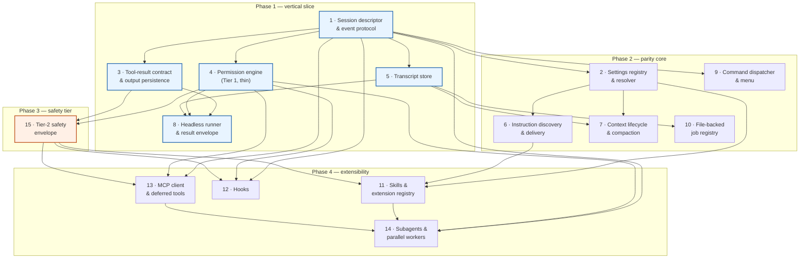

# Implementation Plan — "Keel" (working codename)

An independent, clean-room reimplementation of the observable experience of a terminal-based coding agent.

> **Status:** planning document. No source code, dependencies, infrastructure, or model calls were created to produce it.
> **Codename:** *Keel* is a placeholder. Product naming and branding are original to this project and are not derived from the reference product.
> **Evidence basis:** `agent-evidence.md` (12 areas + 2 cross-cutting), the per-area deep reports under `agent-reference-shots/areas/`, the cached official documentation under `agent-reference-shots/docs-cache/`, and the recorded protocol captures under `agent-reference-shots/`.

---

## 1. Scope

### 1.1 What this plan covers

Keel is a **terminal agent harness**: a CLI that reads a project, accepts a user instruction, drives a model through a tool-use loop, mediates every consequential action behind a permission layer, and emits a machine-readable event stream plus a durable transcript.

This plan covers the complete build of that harness across five phases, from a one-turn vertical slice to a hardened, extensible release.

### 1.2 What is in scope

| Dimension | Included |
| :- | :- |
| Surfaces | Headless/print mode, interactive terminal mode, host-as-MCP-server mode. The core is UI-agnostic and drives all three. |
| Capabilities | Agent loop, tool execution, permission mediation, project instruction discovery, file editing, search, shell execution, session transcripts, context compaction, slash commands, skills, hooks, MCP client, subagents, parallel workers. |
| Platforms | Windows (primary, first-class), Linux, macOS. |
| Languages | One core implementation plus one secondary binding. |

### 1.3 What is explicitly out of scope

- Account, subscription, or organisation-policy planes. The *shape* is stubbed with a file; the plane is not built (evidence §9.4).
- Any hosted/cloud execution surface.
- A second model provider as a shipping target. The per-role model resolver is provider-agnostic and is built; only one provider is wired.
- Visual polish of the interactive renderer. The event stream is the product; the renderer is replaceable.
- A native Windows OS sandbox. The reference product has none either. Keel ships a documented, enforced gap rather than a pretence.

### 1.4 Clean-room boundary

Keel is **original code, original assets, original branding.** Everything below is an independent design.

**Permitted as compatibility references** (interface *facts* only — names, event types, settings key names, file formats, JSON shapes, ordering rules):

- Event type and subtype names (`system`/`init`, `system`/`compact_boundary`, `assistant`/`tool_use`, `user`/`tool_result`, `result`).
- Tool names (`Read`, `Write`, `Edit`, `NotebookEdit`, `Glob`, `Grep`, `Bash`, `PowerShell`, `Task`/`Agent`, `Skill`, `ToolSearch`, `Workflow`, `EnterWorktree`/`ExitWorktree`, `ReportFindings`).
- Permission-mode names (`default`, `acceptEdits`, `plan`, `auto`, `dontAsk`, `bypassPermissions`).
- Permission rule syntax (`Tool`, `Tool(spec)`, `Tool(glob)`, `Bash(prefix)`, `Read|Edit|Write(path)`, `WebFetch(domain)`).
- Settings key names and the scoped-file layout.
- Transcript and job-registry file formats (JSONL shapes; `state.json`, `timeline.jsonl`, `roster.json`).
- The `SKILL.md` frontmatter field set and `mcp__<server>__<tool>` naming.

**Prohibited, and not performed anywhere in this project:**

- Copying, paraphrasing, or adapting the reference product's system prompts, tool-description prose, or any internal policy text.
- Decompiling, disassembling, de-minifying, or de-obfuscating any third-party binary; extracting source maps; modifying a binary. The reverse-engineering toolchain available on the build host is **not** to be invoked against any third-party artifact — a rule that binds the implementation team, not just the investigation.
- Incorporating the reference product's prompt collection into Keel's runtime or into any training corpus.
- Shipping reference-derived assets, artwork, marketing copy, or documentation text.

**Prose and design in these three documents is original.** Where the reference's *observable* wording is load-bearing (e.g. an error string that is functionally a prompt for the model), Keel writes its **own** message with the same information content and the same recovery affordances; it does not copy the reference's sentence. This is called out explicitly in the test plan's golden-transcript section, which compares *structure and behaviour*, not text.

---

## 2. Principles

**P1 — One descriptor, one envelope.** The session advertises itself exactly once, at startup, in a machine-readable manifest. The session terminates exactly once, in a typed result envelope. Every other surface (terminal renderer, JSON output, event stream, MCP server, logs) is a *rendering* of those two facts. (Evidence §9.5.3, F1.1, F1.6, F11.3.)

**P2 — Absent, not denied.** A capability the deployment cannot provide is **absent from the tool registry**, not present-and-refused. A present-but-denied capability costs every session a denial event, an error string, and a model retry loop. (Evidence F12.2, §9.5.2.)

**P3 — Fail closed on the security path; fail loud on the operator path.** A permission denial, a protected-path hit, and a destructive-command hit always refuse. A malformed configuration, an unknown model id, and an unknown effort value never silently proceed — they emit a structured diagnostic and continue with a documented, safe default. (Evidence F8.8, F7.2, F7.3.)

**P4 — A denial is data, not an exception.** A refused tool call occupies a tool-result slot, arrives as `is_error: true` with actionable text, and never terminates the turn. The operator gets a structured event; the model gets a sentence it can act on; both are projections of one decision record. (Evidence F6.1, F6.2, F8.12.)

**P5 — Never re-send committed content.** A response that dies after a tool-call block has been committed is never retried. Retrying would execute the tool twice. This is the highest consequence-per-line rule in the system. (Evidence F6.8, opportunity #29.)

**P6 — Decisions are derived, never asserted.** The permission decision, the denial message, the operator panel, and the audit record are all projections of a single *match record* (which rule fired, on which subcommand, against which path). No message is generated from a fixed string table. (Evidence F6.2, F5.5, F5.12.)

**P7 — External content is data.** Tool output, file contents, web pages, MCP responses, hook stdout, and subagent reports are untrusted input. They are delivered to the model inside labelled envelopes, never concatenated into the instruction channel, and never interpreted as a directive by the harness. (Evidence F6.14, F2.3, F10-10.)

**P8 — State on disk is plain, typed, and versioned.** Session transcripts, job directories, team task lists, and rosters are JSON on disk that a human can read, a script can poll, and a crash can be recovered from. Every coordination structure carries a `proto` version. (Evidence F3b.5, F7.5, F7.8.)

**P9 — Determinism is a feature, not a hope.** A "bare" profile reads no ambient state, so the same input yields the same output on any machine. Injectable clock, seeded randomness, and scripted-model replay are built in from the first commit, not retrofitted. (Evidence FX1.9, opportunity #39.)

**P10 — Compatibility without dependence.** Keel reproduces *observable contracts* — event shapes, ordering guarantees, error taxonomies, file formats — so that a consumer written against the documented reference behaviour keeps working. It does not reproduce implementation. Where the reference's behaviour is a defect (see the evidence's 33 limitations), Keel either fixes it and documents the divergence, or reproduces it behind a compatibility flag. Every deliberate divergence is listed in the compatibility matrix and is a conscious decision, never an accident.

---

## 3. Phasing

Five phases, preceded by a Phase 0 spike. Each has an objective, entry criteria, exit criteria, deliverables, subsystems touched, dependencies, effort estimate, and an explicit deferral list.

Effort is expressed in **person-weeks (pw)** at the stated team size in §9. All estimates assume the team has read the evidence and does not need to re-derive the contracts. **Phase 0** is the architecture-freeze spike; its scope is set by milestone **M0** in §6 and its purpose is stated in §8.4 — it exists so that the Windows shell-AST viability question, which is the plan's single largest schedule risk, is answered before Phase 1 commits to a timeline rather than after.

---

### Phase 1 — Vertical slice: one user turn, one tool call, one result

**Objective.** Prove the whole architecture end to end on the smallest interesting path, so that every later phase builds on a working spine rather than a speculative one.

The slice is: a user types a prompt → the harness emits a session descriptor → it asks a model → the model requests one tool → the harness evaluates permission → the tool runs → a tool result returns → the model produces a final answer → the harness emits a typed result envelope and writes a transcript line.

**Entry criteria.**

- The 15-subsystem decomposition in §4 is agreed and each subsystem has a named owner.
- The event-union design is agreed (type + subtype discriminators; one `type`/`subtype` pair per event; the five-way terminal subtype vocabulary fixed).
- The tool-result contract is agreed as a discriminated union (success = typed object; failure = stable-prefixed string + `is_error`; overflow = persisted-output wrapper + file path).
- The permission evaluation order is agreed in writing: **deny → allow → mode → human callback → deny-if-no-callback**, with schema-filtering and dispatch-gating kept as two separate subsystems.
- A model-provider adapter interface exists on paper: `generate(messages, tools, signal) -> stream of blocks`.

**Exit criteria.**

- `keel -p "..." --output-format stream-json` produces a well-formed event stream: exactly one `system`/`init`, an assistant turn, a `user`/`tool_result` correlated by `tool_use_id`, and exactly one `result`.
- The result envelope carries `subtype`, `is_error`, `result` (present **only** on success), `num_turns`, `session_id`, `usage`, `total_cost_usd`, `stop_reason`, `terminal_reason`, `permission_denials[]`, `subagent_stats`.
- A denied tool call produces a `system`/`permission_denied` event **and** a `user`/`tool_result` with `is_error: true`, in that order, and the turn continues.
- A bare-name deny removes the tool from the `init` manifest's `tools` array entirely.
- The transcript is valid JSONL, one typed object per line, and survives a `kill -9` mid-write without corruption of prior lines.
- The `bare` profile reads zero ambient state, verified by an assertion that the harness opens no file outside its own session directory during a run.
- The full suite runs headless in CI on the primary platform in under 4 minutes.

**Deliverables.**

- `keel` core library with the event union, the tool registry, the dispatcher, the permission evaluator (Tier 1 only), and the tool-result renderer.
- `keel -p` headless runner with `--output-format text|json|stream-json`.
- Provider adapter interface + one adapter.
- Transcript writer (JSONL, typed).
- Fake model, fake clock, fake filesystem, fake tool executor — the determinism seams, built in Phase 1 so every later phase inherits them.
- Bare profile.

**Subsystems touched.** #1 Session descriptor & event protocol · #2 Tool registry & dispatcher (thin) · #3 Tool-result contract & output persistence · #4 Permission engine (thin: deny/ask/allow, no modes) · #8 Headless runner & result envelope.

**Dependencies.** None external. Provider adapter only.

**Estimated effort.** 6 weeks elapsed · 3 engineers · **≈18 pw**.

**Explicitly deferred.** Permission modes beyond `default`/`dontAsk`; the settings registry (Phase 2 — Phase 1 uses an in-memory rule set); compaction; slash commands; skills; hooks; MCP; subagents; Tier 2 (Phase 3); the interactive renderer; the `stream-json` event vocabulary beyond `init`/assistant/user/result.

---

### Phase 2 — Breadth: the parity core

**Objective.** Fill in the parity core so that a session behaves recognisably like the documented reference across the ordinary paths: real settings resolution, real project-context discovery, real compaction, real commands, real job persistence.

**Entry criteria.**

- Phase 1 exit criteria met and the vertical slice is stable for two consecutive weeks with no protocol changes.
- The 15-key typed settings registry schema is drafted and the restriction-lattice field is defined.
- The instruction-discovery walk has a written ordering specification (root → cwd, concatenation, never override).

**Exit criteria.**

- The four scoped settings files plus the global store resolve through one generic resolver; list keys merge, scalars replace; provenance is printable for any key.
- A repo-committed settings file can tighten a security control and can never loosen one; `auto` and `bypassPermissions` set in project or local scope are ignored.
- Instruction files are discovered by the documented walk, delivered as a **user-role** attachment (not system prompt), and concatenated in root→cwd order with per-file identity preserved.
- `@path` imports expand at launch to a documented depth with an approval gate for out-of-tree paths.
- Six permission modes are implemented with the documented auto-approve and hard-deny sets, and a mode transition is visible in the status surface.
- Compaction emits a boundary event recording pre/post tokens, cumulative dropped tokens, duration, and the **UUIDs of preserved messages**.
- The command dispatcher resolves a leading slash command to one of three outcomes — local handler, model-delivered prompt, unavailable — and reports the local case in a machine-readable field so the split is testable with no model.
- A background job survives a harness restart and can be polled, listed, and reaped.
- The `init` manifest advertises the effective tool set, model, permission mode, skills, plugins, subagents, slash commands, cwd, version, and an open-set capability array.
- The event stream carries the full nine-subtype `system` vocabulary.

**Deliverables.**

- Typed settings registry + generic resolver + `explain` command + published JSON Schema.
- Instruction discovery, delivery, and `@` import expansion.
- Six permission modes with status-bar surfaces.
- Context lifecycle: budget accounting per source, summarising compaction, boundary event, thrash detector.
- Command dispatcher + fuzzy menu + local/model split.
- File-backed job registry (`state.json`, `timeline.jsonl`, `tmp/`, roster with `proto` version).
- Transcript store: typed entry union, metadata entry types interleaved, session picker index.
- Interactive renderer, first version.

**Subsystems touched.** #2 Settings registry & resolver · #5 Transcript store · #6 Instruction discovery & delivery · #7 Context lifecycle & compaction · #9 Command dispatcher & menu · #10 File-backed job registry, plus completion of #1–#4 and #8.

**Dependencies.** Phase 1.

**Estimated effort.** 10 weeks elapsed · 4 engineers · **≈40 pw**.

**Explicitly deferred.** Tier 2 protected paths and destructive-command analysis; shell AST matching; OS sandbox integration; MCP; skills; hooks; subagents; parallel workers; the plugin/packaging layer; workflow scripts; agent teams.

---

### Phase 3 — Safety tier

**Objective.** Put a non-overridable enforcement layer behind the symbolic permission layer, and close the three high-risk gaps the evidence names: the destructive-command analyser, shell-string matching, and stream-commit tracking.

This phase exists because a rule-only permission system is a rule-only permission system. The evidence is explicit that the reference product ships a symbolic layer and points users at an OS sandbox for the rest — and that on Windows, where no OS sandbox exists, the symbolic layer is the *only* network control. Keel does not ship the symbolic layer alone.

**Entry criteria.**

- Phase 2 exit criteria met.
- The Tier-2 check is architecturally separate from the Tier-1 rule engine: a distinct module, invoked after it, with no configuration path that can disable it.
- The destructive-command pattern table is authored and reviewed by the security owner (the reference's algorithm is unpublished — evidence U1 — so Keel authors its own from first principles).

**Exit criteria.**

- A protected-path table is enforced on every mutating tool and on every shell command whose AST touches a protected path; no rule, no mode, and no hook can override it.
- A destructive-command analyser runs on the parsed command AST and refuses a documented pattern set, with a user-editable extension that can only *add* patterns, never remove them.
- Shell permission matching consumes a parsed command AST, not a raw string: wrapper and `VAR=value` prefixes are stripped, compound commands are split, and every subcommand is evaluated independently.
- On Windows, the PowerShell front end canonicalises aliases before matching, so `rm` and `Remove-Item` are the same operation to the matcher.
- Stream-commit tracking is implemented and proven: a response that dies after a committed tool-call block is never re-sent, and the error states that the visible output may be incomplete.
- The "no interactive prompt possible" path denies by default and reports the denial in the envelope without failing the run.
- A tool flagged as requiring mandatory user interaction prompts on **every** call, in **every** mode, offers no persistent-approval option, cannot be bypassed by an allow rule, and is **denied** (not auto-approved) when no human can answer.
- Sandbox configuration is honoured where the platform offers one; where it does not, the gap is reported explicitly by a diagnostic command rather than silently ignored.

**Deliverables.**

- Tier-2 safety module: protected paths, destructive-command analyser, mandatory-approval tool flag.
- Shell abstraction with per-shell front ends producing a canonical command AST.
- Stream-commit tracking in the provider adapter.
- Sandbox integration layer (macOS/Linux), with a Windows fallback that documents its limits.
- Security diagnostics command: report every protected path, every analyser pattern, every mode, and every enforcement point.

**Subsystems touched.** #15 Tier-2 safety envelope, plus hardening of #3 (result contract), #4 (permission engine), #2 (settings lattice).

**Dependencies.** Phase 2.

**Estimated effort.** 6 weeks elapsed · 3 engineers + 0.5-FTE security owner (headcount 3.5) · **≈21 pw**. (The derivation, and why this figure differs from a core-engineers-only count, is in §9.4.)

**Explicitly deferred.** MCP server trust model (Phase 4 — the client does not exist yet); skill vetting (Phase 4); plugin installation; the enterprise managed-policy plane.

---

### Phase 4 — Extensibility layers

**Objective.** Add the extension surfaces — skills, hooks, MCP, subagents, parallel workers — each of which is a file-format contract with its own validation story and its own trust boundary.

Order within this phase is fixed and not interchangeable:

1. **Skills** (parser → scope resolver → budgeted listing → invocation control → template language → injected-command policy → packaging).
2. **Hooks** (event bus → runner with timeout → two-bit verdict protocol).
3. **MCP client** (four transports → scope store → approval gate → deferred tool loading → OAuth → elicitation → annotations/trust).
4. **Subagents** (worker with fresh/forked context → tool allowlist → summary-only return → report scanning).
5. **Parallel workers** (spawn modes → worktree isolation → file-backed coordination).

**Entry criteria.**

- Phase 3 exit criteria met.
- The extension registry — the machine-readable manifest of installed skills, plugins, subagents, slash commands, output styles, and memory paths — is designed as data, so each layer is a projection of it.
- The injected-command policy for skill bodies is designed and approved **before** the skill loader ships. This is the single most security-relevant item in this phase: a skill body is executable content by construction.

**Exit criteria.**

- A `SKILL.md` frontmatter parser accepts the documented field set, with the three distinct failure modes distinguished: unknown field ignored; missing frontmatter warns; unparseable YAML loads with all fields dropped and reports loudly.
- Skill discovery is an ordered list of `(scope, path)` roots with per-scope counters, and the resolver prints its own search paths.
- The model-facing skill listing is a budgeted, ordered, always-name-inclusive plain-text channel with a per-entry cap, usage-ranked truncation, an overflow warning that names the measured size and the budget, and a names+digests sidecar.
- Invocation control is two independent booleans plus a four-state override, applied uniformly to the manifest, the menu, and the model listing.
- The skill body template language expands in a documented order, in both the body and the tool-allow rules, and substituted values are never re-scanned.
- **Injected commands inside a skill body are never executed silently.** Untrusted skills are prompted or denied by default; every executed command is logged; the policy is settable from managed configuration.
- Hooks implement the three-way exit convention (0 = proceed, 2 = block, anything else = proceed-and-report), the `onFailure: "block"` fail-closed option, and separate `PostToolUse` / `PostToolUseFailure` events. A broken hook is distinguishable from a hook that said no.
- The MCP client supports four transports, three scopes, two storage files, the deferred-tool search façade, and the `mcp__<server>__<tool>` naming.
- Project-scope MCP servers are inert until explicitly approved; approval is persistent and revocable; adding a server to a repo's config re-triggers approval.
- Server-declared annotations are advisory only and never widen host trust.
- MCP failures surface on three channels: per-server status in the manifest, a typed error list, and model-facing text that explicitly says a connection failure is not proof the capability is absent.
- A subagent runs in a separate context with an enforced tool allowlist, returns a summary only, and its report is delivered inside a labelled non-authoritative envelope.
- Parallel workers are separated by git worktrees with a four-check enforcement layer (file-edit path, command cwd, git redirects, command shape) that cannot be disabled, landing **with the first parallel feature**, never after it.
- Worker coordination is file-backed: a shared task list with a claiming lock, and per-agent mailboxes.

**Deliverables.** Skill loader and validator; skill registry; hook bus and runner; MCP client with four transports; OAuth client with refresh-and-retry-once; elicitation support; subagent worker; worktree isolation layer; file-backed team protocol.

**Subsystems touched.** #11 Skills & extension registry · #12 Hooks · #13 MCP client & deferred tools · #14 Subagents & delegation, plus parallel-worker work in #14.

**Dependencies.** Phase 3 (the injected-command policy and the Tier-2 analyser both gate the skill loader).

**Estimated effort.** 10 weeks elapsed · 4 engineers + 0.5-FTE security owner (headcount 4.5) · **≈45 pw**. (See §9.4 for the derivation.)

**Explicitly deferred.** Agent teams as a first-class product (the coordination protocol is designed last, not first); workflow scripts; the enterprise managed-policy plane; the managed-MCP exclusive-control plane (the *shape* is stubbed); plugin marketplaces; account-gated tools.

---

### Phase 5 — Hardening and release readiness

**Objective.** Turn a working system into one that can be trusted unattended: performance, cross-platform parity, crash recovery, adversarial hardening, documentation, and the release gate.

**Entry criteria.**

- Phase 4 exit criteria met.
- The full conformance suite is green and the golden-transcript corpus is populated.
- The compatibility matrix is written: for every documented reference behaviour Keel reproduces, an entry; for every deliberate divergence, an entry with a rationale and a migration note.

**Exit criteria.**

- Cross-platform: Windows, Linux, and macOS CI is green; the Windows-specific constraints are documented and tested rather than discovered by users.
- Crash recovery: an interrupted session resumes from its transcript; an interrupted background job is reaped or resumed; an interrupted compaction leaves a consistent transcript.
- Resource bounds: every tool has a size ceiling and a time ceiling; every long operation has a background-promotion path; a runaway cannot exhaust disk or memory.
- The stream-commit rule is proven by an injected fault at every point in the response stream.
- The adversarial suite passes: prompt injection through every untrusted channel, path traversal, symlink escape, command injection, secret exfiltration, permission-mode escalation, malicious skill and MCP installation.
- Startup time and per-turn latency meet the stated budget on the reference hardware.
- The determinism contract is proven: the same fixture yields byte-identical normalised output on all three platforms and across ten consecutive runs.
- Documentation: the headless contract, the event vocabulary, the settings reference, the permission-rule reference, and the security model are published with a stability marker per document.

**Deliverables.** Performance work; fault-injection harness; the three-platform CI matrix; the compatibility matrix; the published documentation set; the release-candidate pipeline; the signing and provenance pipeline for shipped artefacts.

**Subsystems touched.** All 15.

**Dependencies.** Phases 1–4.

**Estimated effort.** 6 weeks elapsed · 3 engineers + 0.5-FTE security owner + 0.25-FTE technical writer (headcount 3.75) · **≈22.5 pw**. (See §9.4 for the derivation.)

**Explicitly deferred.** Anything that would require the enterprise admin plane, the account plane, or a second model provider. Features discovered during hardening are triaged to a post-release backlog rather than absorbed here.

---

## 4. Per-subsystem build order

### 4.1 The 15 subsystems

| # | Subsystem | Scope summary |
| :- | :- | :- |
| 1 | **Session descriptor & event protocol** | The `init` manifest, the event union, the capability array, the result envelope, the correlation key. |
| 2 | **Settings registry & resolver** | Typed key registry, scoped files, generic fold resolver, monotonic restriction lattice, provenance/explain, hot reload, graded diagnostics. |
| 3 | **Tool-result contract & output persistence** | The result union, the renderer, the three-tier output ladder, persisted-output files, the `<tool_use_error>` marker, the dual text/structured representation. |
| 4 | **Permission engine (Tier 1)** | Rule AST, deny→allow→mode→callback evaluation, bare-name schema removal vs scoped dispatch filter, wrapper stripping, compound splitting, the decision record. |
| 5 | **Transcript store** | JSONL typed append-only log, metadata entry types, session directory layout, cost ledger, session index and picker. |
| 6 | **Instruction discovery & delivery** | Root→cwd walk, per-file identity, user-role attachment delivery, `@` import expansion, path-scoped rule files, auto memory. |
| 7 | **Context lifecycle & compaction** | Per-source budget accounting, summarising compaction, boundary event with preserved UUIDs, thrash detector, three customisation routes. |
| 8 | **Headless runner & result envelope** | Print mode, the four independent axes, flag-combination validation, terminal subtype vocabulary, exit-code policy, the bare profile. |
| 9 | **Command dispatcher & menu** | Prefix-of-first-message parsing, three-outcome dispatch, the machine-readable local-handler field, fuzzy menu with alias semantics, mid-turn queueing. |
| 10 | **File-backed job registry** | Job directory layout, `state.json` with intent, timeline, roster with `proto` version, supervisor, reaping. |
| 11 | **Skills & extension registry** | Frontmatter parser, scope resolver, budgeted listing, invocation control, template language, injected-command policy, packaging, plugin layer. |
| 12 | **Hooks** | Event bus, runner with timeout, three-way exit verdict, allow/deny/ask/rewrite, fail-closed option, result rewriting. |
| 13 | **MCP client & deferred tools** | Four transports, three scopes, two storage files, approval gate, deferred search façade, OAuth, elicitation, annotations, host-as-server. |
| 14 | **Subagents, delegation & parallel workers** | Fresh/forked context, enforced allowlist, summary-only return, report scanning, spawn modes, worktree isolation, file-backed coordination. |
| 15 | **Tier-2 safety envelope** | Protected paths, destructive-command analyser, mandatory-approval flag, sandbox integration, stream-commit tracking, dangerous-mode interlock. |

### 4.2 Build order, dependency graph, and phase assignment

| Build order | # | Subsystem | Phase | Vertical slice? | Blocked by |
| :-: | :-: | :- | :- | :- | :- |
| 1 | 1 | Session descriptor & event protocol | 1 | **Yes — slice spine** | — |
| 2 | 4 | Permission engine (Tier 1, thin) | 1 | **Yes — slice spine** | 1 |
| 3 | 3 | Tool-result contract & output persistence | 1 | **Yes — slice spine** | 1 |
| 4 | 8 | Headless runner & result envelope | 1 | **Yes — slice spine** | 1, 3 |
| 5 | 5 | Transcript store | 1 (writer) / 2 (full) | **Yes — slice spine** | 1 |
| 6 | 2 | Settings registry & resolver | 2 | No | 1 |
| 7 | 6 | Instruction discovery & delivery | 2 | No | 2, 5 |
| 8 | 7 | Context lifecycle & compaction | 2 | No | 5, 3 |
| 9 | 9 | Command dispatcher & menu | 2 | No | 1, 11 (partial: built-in commands only) |
| 10 | 10 | File-backed job registry | 2 | No | 5 |
| 11 | 15 | Tier-2 safety envelope | 3 | No | 4, 3 |
| 12 | 11 | Skills & extension registry | 4 | No | 2, 6, 15 |
| 13 | 12 | Hooks | 4 | No | 1, 4, 15 |
| 14 | 13 | MCP client & deferred tools | 4 | No | 1, 4, 15 |
| 15 | 14 | Subagents & parallel workers | 4 | No | 1, 4, 13, 11 |

### 4.3 Dependency graph

**Reading the graph.** The five slice-subsystems (blue) form a closed loop with no dependency on anything in Phases 2–4: they depend only on each other and on the provider adapter. That is deliberate — it means Phase 1 can be built, tested, and demonstrated without a single settings file, skill, hook, or MCP server existing. Everything in the upper three tiers hangs off the slice.

The safety tier (orange) depends on the permission engine and the result contract, but **nothing in Phase 2 depends on it** — which is intentional. The Tier-2 module can be developed in parallel with the Phase-2 breadth work once the Tier-1 evaluator's interface is frozen, which it is at the end of Phase 1.

### 4.4 Why the safety tier is not earlier

It is tempting to put Tier 2 first, because the evidence calls it one of the three highest-risk, highest-value items. It is not first for three reasons.

First, **Tier 2 is a filter over Tier 1 decisions.** A protected-path check needs a stable notion of "what path does this tool touch" and "what command will this run"; those are only defined once the tool registry and dispatcher exist. Building the analyser before the tool contract would mean building it twice.

Second, **a thin Tier 1 in Phase 1 is not a shipped Tier 1.** Phase 1 is an internal prototype with a single rule source and one mode. No external user touches it. The security-relevant property — that the *shipped* system has a non-overridable layer behind the symbolic one — is a Phase 3 exit criterion, and the ordering that guarantees it is that Phase 3 is gated on Phase 2 completing, not that Tier 2 is built first.

Third, **the destructive-command analyser needs a stable command AST**, and the AST comes from the shell abstraction, which needs the dispatcher and the tool-result contract to be settled. Building the AST before the dispatcher means guessing.

What *does* move earlier: the **stream-commit tracking** rule (Phase 3 in the evidence's numbering, but implemented in Phase 1 as part of the provider adapter) and the **dangerous-mode interlock** (a second explicit opt-in before a no-prompt mode activates, plus a refusal to activate as root). Both are a handful of lines, and both are consequences that cannot be retrofitted safely — a duplicate `rm` is not fixable after the fact. The security plan lists them as day-one controls.

---

## 5. Day-one decisions

Three decisions must be made before Phase 1 code is written, because each one is expensive to reverse and each one changes the shape of everything downstream. The evidence's §9.5 names these three; the options, recommendations, and consequences below are Keel's own.

### D1 — Is the core UI-agnostic, and how hard is the boundary?

**Options.**

| Option | Description |
| :- | :- |
| **A. Core-first, boundary in code** | The tool registry, permission engine, and session store live in a library with no terminal dependency. The terminal renderer, the headless runner, and the MCP server are three drivers over it. The boundary is enforced by a module dependency rule, not by convention. |
| **B. Core-first, boundary by convention** | Same layering, but nothing mechanically prevents a core module from importing terminal code. Cheaper to build; leaks. |
| **C. Terminal-first** | Build the TUI, then extract a core later. Fastest first demo. |
| **D. Headless-first** | Build the print runner only; add other surfaces later. |

**Recommendation: A.** Additionally, the boundary is *testable*: a CI rule asserts that the core module's dependency closure contains no terminal, HTTP, or UI packages. The reference product demonstrates the shape is achievable — it serves its own tool surface over MCP while running the same loop interactively — but Keel must not rely on the reference's architecture being inferred.

**Consequence of getting it wrong.** Choosing C or D means the permission engine, the dispatcher, and the event union acquire terminal or process-lifecycle dependencies. In Phase 4, the MCP server and the headless runner then need a second implementation of the same logic, and the two drift — which produces exactly the class of bug where the interactive surface enforces a rule the headless surface does not. Choosing B means the leak is invisible until someone needs the core headless. The cost of A is one CI rule and a slight delay in the first demo (roughly one week of the three-week slice).

### D2 — Is model availability a compile-time capability matrix or a runtime error?

**Options.**

| Option | Description |
| :- | :- |
| **A. Capability matrix, evaluated at registry construction** | The tool registry is a pure function of `(provider, model, plan, flags)`. A capability the deployment lacks is never in the registry. A `doctor`-style command names every absent capability and why. |
| **B. Present-and-denied** | All tools are always in the schema; unavailable ones are refused at dispatch with an explanatory message. |
| **C. Runtime discovery** | Probe the provider at startup for what it supports. |

**Recommendation: A.** Capability absence is a *structural* fact (the deployment does not have the account, the endpoint, or the plan), not something discovered by probing. C adds a network round-trip to startup and a whole class of startup-time failures for a question whose answer is knowable from configuration. B is actively harmful: it produces a denial event, an error string, and a model retry loop on every session, and it charges a fixed tool-schema cost to every session for a tool nobody can use.

**Consequence of getting it wrong.** Choosing B costs a recurring tax on every session and produces an agent that wastes turns discovering absences. Choosing C means startup depends on network reachability, which breaks the bare/determinism profile (P9) and makes offline use impossible. Choosing A commits the team to writing the capability matrix *up front* — it is a data file that must be maintained as providers and plans change, and if it is wrong, a tool is missing or a tool is unexpectedly present. Mitigation: the matrix is a first-class, reviewable data file with a test that asserts every entry maps to a documented provider capability, and the `doctor` command surfaces drift.

### D3 — What exactly is the startup descriptor and the terminal envelope?

**Options.**

| Option | Description |
| :- | :- |
| **A. One descriptor, one envelope, everything else renders them** | The session emits exactly one machine-readable manifest at startup and exactly one typed result envelope at termination. Every other surface is a projection. |
| **B. A descriptor, and surfaces that query the live session** | The manifest advertises a starting state; surfaces query the session for current state. |
| **C. No descriptor** | Surfaces discover capabilities by asking the running process. |

**Recommendation: A**, with two refinements drawn from the evidence's own observations: the manifest carries an **open-set capability array** (strings naming features, ignored when unknown, so a client degrades gracefully against an older or newer engine), and the envelope carries a **five-way terminal subtype vocabulary** so a supervisor can distinguish "out of turns" from "out of budget" from "API error" from "execution error" without parsing prose.

**Consequence of getting it wrong.** Choosing C forces every consumer — a terminal renderer, a CI script, an IDE integration, the MCP server — into bespoke protocol. Choosing B creates a manifest that can be stale, and every consumer must handle staleness. Choosing A commits the team to the discipline that no surface may read the session's internal state directly; every surface must render from the descriptor or the event stream. That discipline is the reason the reference's own surfaces agree with each other, and it is the reason Keel's terminal renderer and headless runner cannot disagree about what happened. The cost is that the descriptor must be complete enough to build a full UI from — which means Phase 1 must nail the tool list, the mode, the server list, the skill list, the agent list, and the command list, not just a version string.

### D3a — Two smaller decisions taken at the same time

These are not on the evidence's list, but the same logic applies and both are cheaper to decide now than later.

**D3a.1 — Does the terminal subtype vocabulary live in one place?** Yes. One enumeration, referenced by the envelope, the exit-code mapping, the MCP server, and the tests. A supervisor that has to correlate four ad-hoc lists will eventually correlate them wrongly.

**D3a.2 — Is the permission decision record the single source of truth?** Yes. The prompt text, the model-facing refusal text, the operator panel, and the audit record are all projections of one match record that names the rule that fired, the subcommand that fired it, and the path that was out of bounds. This is P6, and it is the difference between a permission system that teaches and one that frustrates.

---

## 6. Milestones and gates

| ID | Milestone | Scope | Acceptance gate | What must be true to pass |
| :- | :- | :- | :- | :- |
| **M0** | Architecture freeze | Event union, tool-result union, permission evaluation order, provider adapter interface, module dependency rule | Written design review, signed by all three engineers | Every field in the event union has a documented producer and consumer. The permission order is written down in one place. The core module's dependency closure is empty of UI/network packages. |
| **M1** | Slice works | Phase 1 exit criteria | The slice runs headless in CI on the primary platform; the conformance suite for the slice passes | One `init`, one `result`; a denial produces both the operator event and the model-facing result in the right order; a bare-name deny removes the tool from the manifest; the transcript survives a mid-write kill. |
| **M2** | Slice is deterministic | Bare profile, fake model, injectable clock | The same fixture produces byte-identical normalised output across ten consecutive runs on two machines | Zero ambient reads (asserted). No wall-clock or random value reaches the transcript without going through the injected clock or the seeded generator. |
| **M3** | Settings lattice correct | Scoped resolver, restriction lattice, provenance | The settings conformance suite passes, including the 12-key lattice and the ignored-from-project-scope modes | A repo-committed file cannot loosen any security control. Provenance is printable for every key. Invalid keys produce a graded diagnostic, never a silent discard. |
| **M4** | Context delivery correct | Instruction discovery, `@` imports, subdirectory lazy load, path-scoped rules | Instruction conformance suite passes | Instructions arrive in the user role, never the system role. Root→cwd order holds. Per-file identity survives the pipeline. An import chain deeper than the cap is refused with a named error. |
| **M5** | Compaction is verifiable | Budget accounting, compaction, boundary event | Compaction conformance suite passes | The boundary event names the UUIDs of every preserved message. Cumulative dropped tokens is monotonic. A thrash pattern is detected and reported rather than looped. |
| **M6** | Commands are observable | Dispatcher, local/model split, fuzzy menu | Command conformance suite passes | Every leading slash command resolves to exactly one of three outcomes. The local case is reported in a machine-readable field. An unmatched command is reported as unavailable rather than silently sent to the model as prose. |
| **M7** | Tier 2 is not configurable | Protected paths, destructive analyser, mandatory-approval flag, stream-commit tracking, dangerous-mode interlock | Security gate: the "can Tier 2 be disabled?" test suite passes | No settings key, mode, hook, or CLI flag disables the Tier-2 module. A stream fault after a committed tool call never re-sends. A mandatory-approval tool cannot be bypassed by an allow rule and is denied when no human can answer. |
| **M8** | Shell matching is semantic | Command AST, wrapper stripping, compound splitting, Windows alias canonicalisation | Shell conformance suite passes, on all three platforms | A rule matches the *operation*, not the spelling. Every subcommand of a compound command is evaluated. A protected path is detected regardless of how the command reaches it. |
| **M9** | Skill loader is safe | Frontmatter parser, resolver, budgeted listing, invocation control, template language, injected-command policy | Extension safety gate | The three frontmatter failure modes are distinguished. Names are never dropped from the listing. Injected commands in an untrusted skill are prompted or denied, never executed silently, and always logged. |
| **M10** | Hooks fail closed when told | Hook bus, runner, verdict protocol, fail-closed option | Hook conformance suite passes | Exit 0 proceeds, exit 2 blocks, anything else proceeds and reports. A broken hook is distinguishable from a refusal. The fail-closed option makes a broken hook block. |
| **M11** | MCP is contained | Client, four transports, approval gate, deferred loading, OAuth, elicitation, annotations | MCP conformance suite passes | A project-scoped server is inert until approved; approval is revocable; a changed config re-triggers approval. Server annotations never widen host trust. A refresh retries exactly once. A connection failure is never reported to the model as "the capability is absent". |
| **M12** | Delegation is contained | Subagent worker, allowlist, summary-only return, report envelope | Delegation conformance suite passes | The subagent's tool set is exactly the allowlist. The parent receives a summary, not the raw transcript. The report arrives inside a non-authoritative labelled envelope. |
| **M13** | Parallelism is isolated | Spawn modes, worktree isolation, file-backed coordination | Parallel conformance suite passes | A worker cannot edit outside its worktree — enforced at all four points. The coordination protocol survives a crash of any single worker. |
| **M14** | Cross-platform parity | Windows, Linux, macOS | All three CI lanes green for 10 consecutive runs | The determinism contract holds on all three. Platform-specific behaviour is a documented difference, not a surprise. |
| **M15** | Adversarial pass | Injection, traversal, symlink, injection, exfiltration, escalation, DoS, malicious install | Adversarial suite green; no open critical or high finding | Every containment in the security plan's test matrix has a passing test. |
| **M16** | Release candidate | Performance, documentation, provenance, signing | Release checklist complete | Startup and per-turn latency meet budget. Every published document carries a stability marker. Every shipped artefact has provenance and a signature. The compatibility matrix is complete. |
| **M17** | Regression defence | Golden corpus, property suite, fuzzing | Suite green; suite itself meets its exit criteria | The golden corpus covers every subsystem; the property suite holds; fuzzing found no crash in the parsers over the stated budget. |

---

## 7. Definition of done

Per subsystem. "Done" means a specific list of verified behaviours — each item is a passing test or an inspected artefact, not a sentence about quality.

### 1 · Session descriptor & event protocol

- [ ] Exactly one `init` descriptor is emitted per session, before any model call.
- [ ] The descriptor lists the effective tool set, the external servers with status and source, the model, the permission mode, the resolved skills, plugins, subagents, slash commands, cwd, and a client version.
- [ ] The descriptor carries a capability array of open-set strings; a consumer that sees an unknown value does not fail.
- [ ] The descriptor is emitted *after* any startup-hook lifecycle events.
- [ ] Every event carries a type discriminator; events with sub-variants carry a subtype discriminator; no event is identified by field-sniffing.
- [ ] Every tool call carries an opaque id; every result carries the matching id; **no correlation anywhere depends on array position.**
- [ ] The result event does not end the stream: trailing observability events may follow, and a consumer that drains to EOF sees them.
- [ ] The `result` field is populated on the success subtype and omitted on every other subtype.
- [ ] Cost, usage, turn count, and session id are present on **every** result subtype.
- [ ] A serialisation round-trip of the event union is lossless for every variant.
- [ ] The core module's dependency closure contains no terminal, HTTP, or UI package; a CI rule enforces it.

### 2 · Settings registry & resolver

- [ ] Every key has a declared type, default, scope set, merge strategy, and monotonic direction.
- [ ] The resolver is generic: adding a key to the registry requires no resolver change.
- [ ] List keys merge across scopes; scalar keys replace.
- [ ] The restriction lattice applies to the designated security-sensitive keys: the most restrictive value across all scopes wins, regardless of scope precedence.
- [ ] `auto` and `bypassPermissions` specified in project or local scope are ignored, and the ignore is reported.
- [ ] Precedence is managed → CLI flag → project-local → shared-project → user; CLI flags outrank the user's own file but not managed policy.
- [ ] Environment variables are not a precedence level; each key declares its own env binding.
- [ ] Any resolved key's provenance (which file, which value, which monotonic direction) is printable.
- [ ] An invalid value produces a graded diagnostic — error (fatal for that key) or warning (degraded but usable) — never a silent discard.
- [ ] In headless mode an invalid value does not abort the run, but the diagnostic is written to **stderr** and the run's exit reflects the degradation.
- [ ] Changes are picked up without a restart; a change event fires; the effective resolution is recomputed.
- [ ] The registry is exported as a JSON Schema that validates a hand-written settings file.

### 3 · Tool-result contract & output persistence

- [ ] Every tool result is representable in **both** a text form and a structured form, and the two are projections of one value, never two independently produced strings.
- [ ] Success is a typed object; failure is a string with a stable machine-readable prefix (the exit code) plus `is_error: true`.
- [ ] A failure message is a **diagnosis**: it names the specific cause — which subcommand, which path, which rule — not a category name.
- [ ] Output overflow has three tiers with distinct limits for success and failure, and the overflow notice is wrapped in machine-parseable tags rather than prose.
- [ ] The overflow file lives inside the session directory, so it survives with the transcript and is addressable by the read tool.
- [ ] **Every** path — success, failure, denial, and overflow — returns a file pointer when the output was persisted. There is no path that loses output.
- [ ] A failure result preserves the interleaved order of stdout and stderr.
- [ ] A tool error is marked distinctly from a legitimate negative result, so a model does not conflate "not found" with "the tool crashed".
- [ ] A partial read is explicitly flagged as partial and does not satisfy a read-before-edit precondition.

### 4 · Permission engine (Tier 1)

- [ ] Evaluation order is deny → allow → mode → human callback → deny-if-no-callback, and the order is stated in one place and asserted by a test.
- [ ] Within a category, the **first** matching rule wins; there is no specificity sorting.
- [ ] Scope is not a factor: a deny in a user-scope file beats an allow in a project-scope file.
- [ ] A bare-name deny removes the tool from the schema **before** the model sees it; the manifest proves the tool is absent.
- [ ] A scoped deny keeps the tool in the schema and blocks matching calls at dispatch, in **every** mode.
- [ ] Schema filtering and dispatch gating are separate subsystems with separate tests.
- [ ] Rule syntax covers the six tool-specific forms; path matching is gitignore-style with `~` expansion and absolute-path support.
- [ ] Wrapper prefixes and `VAR=value` assignments are stripped before a command rule is matched.
- [ ] A compound command is split, and every subcommand is evaluated independently.
- [ ] Allow-list membership is an approval grant, not a capability filter: unlisted tools remain available and fall through.
- [ ] If no human callback is registered, the decision is **deny**.
- [ ] The decision record carries decision, source, and reason type, and the denial record carries the full attempted input.
- [ ] The prompt text, the model-facing refusal text, the operator panel, and the audit record are all projections of one match record.

### 5 · Transcript store

- [ ] The transcript is JSONL: one typed object per line, append-only.
- [ ] Metadata entry types are interleaved with conversation entries and are distinguishable by type.
- [ ] A partially written final line does not corrupt earlier lines; a reader skips a trailing incomplete line.
- [ ] The session directory name is a deterministic function of the working directory.
- [ ] The cost ledger accumulates cost, tokens, API duration, tool duration, **and lines added/removed**.
- [ ] A per-model usage record carries the context window, max output tokens, canonical model name, provider, and a cost-basis flag that can be `unknown`.
- [ ] A session index supports a searchable, grouped picker over sessions.
- [ ] Session identity is caller-supplied, and a collision with an in-use id is refused.
- [ ] Resumption restores conversation state from the transcript alone.
- [ ] A resumption that names an unknown session produces one of the documented error paths, each distinguishable.

### 6 · Instruction discovery & delivery

- [ ] Discovery walks from the filesystem root down to the working directory.
- [ ] All discovered files are **concatenated**, never overridden; ordering is root → cwd, with the local variant after the shared one within a directory.
- [ ] Instructions are delivered in the **user role**, after the system prompt, as an attachment — never inside the system prompt.
- [ ] Each file retains its own identity (path, scope, type) through the whole pipeline.
- [ ] A subdirectory instruction file is loaded **on demand**, the first time a file in that directory is read or written, and not before.
- [ ] A shell read of a single file counts as a read for the purpose of triggering subdirectory instruction load.
- [ ] `@` imports expand at launch to a documented maximum depth; a deeper chain is refused with a named error.
- [ ] An out-of-tree import requires an explicit approval record.
- [ ] An import cycle is detected and refused.
- [ ] Path-scoped rule files are injected on matching file access, as their own attachment type, not at launch.
- [ ] Auto memory is per-repository, shared across worktrees, and truncated at whichever of the line cap or byte cap comes first.

### 7 · Context lifecycle & compaction

- [ ] The budget accounting classifies five sources distinctly, each with its load timing and impact.
- [ ] Skill and tool **descriptions** load at session start; skill **bodies** load on invocation.
- [ ] Compaction replaces older turns with a summary and retains recent exchanges.
- [ ] The boundary event records trigger, pre-tokens, post-tokens, cumulative dropped tokens, duration, the tool surface at compaction time, and the preserved segment.
- [ ] The preserved segment names the **UUIDs of the messages that survived**; a client can re-read exactly those messages.
- [ ] The cumulative dropped-token counter is monotonic across the session.
- [ ] The post-compaction chain is re-parented onto the surviving tail, so the transcript graph stays coherent.
- [ ] Reduction is content-sensitive, not a fixed percentage.
- [ ] Three customisation routes exist: a project-instruction section the compactor reads, a pre-compaction hook that distinguishes manual from automatic, and a manual compaction command.
- [ ] Persistent rules live in a file re-injected every request, because summarisation loses early conversational instructions.
- [ ] A thrash pattern (compaction immediately followed by a refill) is detected and reported, not looped.

### 8 · Headless runner & result envelope

- [ ] Four independent axes are supported: invocation, input format, output format, termination.
- [ ] Output formats are text, json (exactly one object), and stream-json (newline-delimited events whose last is the same envelope).
- [ ] Flag-**combination** validation happens before any model call; an invalid combination exits 1 with no provider traffic.
- [ ] The terminal subtype vocabulary has one member per terminal condition, and the exit-code mapping is derived from it.
- [ ] A semantic failure is reported in-band via `is_error` and a subtype; the process exit code remains a coarse signal.
- [ ] The `bare` profile reads no ambient state — no hooks, skills, custom commands, subagents, plugins, MCP servers, auto memory, or project instructions — and this is asserted, not assumed.
- [ ] In bare mode, no credential store is read and no trust dialog appears.
- [ ] The bare profile is deterministic: identical input yields identical output on any machine.
- [ ] stdin is a first-class prompt channel with a size cap and a timeout warning that does not fail the run.
- [ ] Caller-supplied session ids are honoured exactly; a duplicate is refused with a distinct error.
- [ ] Background work at exit is bounded by a ceiling and waits for completion up to it.

### 9 · Command dispatcher & menu

- [ ] A command is recognised only as a **prefix of the first user message**; trailing text is its arguments.
- [ ] Up to the documented number of skills can be chained in one message, with the trailing text passed to each.
- [ ] Every command resolves to exactly one of three outcomes: local handler, model-delivered prompt, unavailable.
- [ ] The local-handler outcome is reported in a machine-readable field, so the split is testable with no model.
- [ ] A local handler consumes **zero** model turns and zero API time.
- [ ] An unmatched command is reported as unavailable rather than being sent to the model as prose.
- [ ] The available command set is machine-readable at session start, in two lists: those that reach the model and those that render locally.
- [ ] The menu matcher ignores separator characters and matches from the start of the name or from a word within it.
- [ ] An unknown name yields a "did you mean" suggestion derived from the same matcher.
- [ ] A command issued mid-turn is queued and runs after the turn, except for the documented set that runs immediately.
- [ ] Built-in commands and skills share one namespace with one matcher and one alias table.

### 10 · File-backed job registry

- [ ] A job lives in a directory with a state file, a timeline file, and a scratch directory.
- [ ] The state file persists the natural-language **intent**, a generated-or-user name, and its source.
- [ ] The state file persists the launch-time model selection so a job can be respawned onto the same model after an upgrade.
- [ ] Both the original session id and the resume session id are stored, so a respawned job links back to its transcript.
- [ ] The roster is a plain JSON file with a `proto` version and an updated-at timestamp.
- [ ] `agents --json` returns a documented field set and is the supported scripting interface.
- [ ] A crash of the supervisor leaves the roster recoverable; a stale roster is detected and reaped.
- [ ] Job status distinguishes interactive from background kinds, and busy/waiting/idle/working/blocked/done/failed/stopped states.

### 11 · Skills & extension registry

- [ ] Frontmatter accepts the documented field set; booleans accept the documented truthy and falsy spellings in any case.
- [ ] An unknown frontmatter field is ignored silently.
- [ ] Missing frontmatter loads with no fields and produces a warning.
- [ ] Unparseable YAML loads the skill with **all** fields dropped and produces a loud error saying so.
- [ ] Discovery is an ordered list of `(scope, path)` roots with per-scope counters; the loader prints its search paths.
- [ ] The loaded set and the resolved set are distinct: a skill present in two scopes is counted twice and resolved once.
- [ ] Scope precedence is applied at name resolution, not at load time.
- [ ] The project scope is an ordered array of directories, nearest first, with the parent's still searched.
- [ ] A path-scoped skill is stored outside the unconditional listing and activates on matching file access.
- [ ] The model-facing listing is plain text, one line per skill, budgeted, ordered, and **names are never dropped** — only descriptions.
- [ ] Overflow drops descriptions from the least-used skills first and warns with the measured size, the budget, and two named remedies.
- [ ] The listing carries a names array and a digests array so it can be diffed and resent incrementally.
- [ ] Invocation control is two independent booleans plus a four-state override, applied uniformly to the manifest, the menu, and the model listing.
- [ ] A skill the model may not invoke returns a refusal that explicitly tells the model not to work around it by other means.
- [ ] The template language expands `$ARGUMENTS`, indexed and named placeholders, and the environment placeholders, in a documented order.
- [ ] Substitution applies to the body **and** to the tool-allow rules.
- [ ] A substituted value is never re-scanned.
- [ ] **Injected commands in a skill body are never executed silently.** Untrusted skills are prompted or denied; every execution is logged; the policy is settable from managed configuration; output is never re-scanned.
- [ ] A skill folder with a plugin manifest becomes a plugin with a deterministic identifier; path containment is strict.

### 12 · Hooks

- [ ] The documented hook event types all fire.
- [ ] A pre-tool hook can allow, deny, ask, and rewrite.
- [ ] A post-tool hook can block and can rewrite the tool result.
- [ ] The verdict convention is: exit 0 proceeds, exit 2 blocks, any other exit proceeds and reports.
- [ ] On exit 2, the hook's stderr is the blocking reason.
- [ ] On a non-blocking failure, the **first line** of stderr is the notice.
- [ ] Unparseable JSON from a hook is a non-blocking error on exit 0 and a blocking error on exit 2.
- [ ] The fail-closed option makes a **broken** hook block; the default makes it proceed-and-report.
- [ ] Post-tool and post-tool-failure are distinct events.
- [ ] A hook timeout is enforced and produces the same verdict treatment as a crash.
- [ ] A hook that says no is distinguishable in the audit record from a hook that is broken.

### 13 · MCP client & deferred tools

- [ ] Four transports are supported: http, sse, stdio, webSocket.
- [ ] Three scopes map onto two storage files, and the mapping is documented.
- [ ] A project-scope server is inert until explicitly approved; approval is persistent and revocable.
- [ ] A change to the server list re-triggers approval for the changed entry.
- [ ] Tool names are `mcp__<server>__<tool>`, with a distinct form for plugin-provided servers.
- [ ] MCP tools are **not** in the initial schema; they load on demand through the search tool.
- [ ] The search tool's result shape names matches, the query, and the total deferred count.
- [ ] Server-declared annotations are advisory; they never widen host trust.
- [ ] A tool flagged as requiring user interaction prompts on every call in every mode, offers no persistent-approval option, cannot be bypassed by an allow rule, and is denied when no human can answer.
- [ ] A token refresh retries the request **exactly once** — never a loop.
- [ ] An explicitly configured authorisation header is authoritative; the client does not silently fall back to an OAuth flow.
- [ ] OAuth metadata discovery is used, and a metadata URL override must be https.
- [ ] The client secret is stored in the OS credential store, never in the configuration file.
- [ ] Elicitation supports form mode and URL mode; URL mode hands the URL to the OS through a channel not subject to an argument-length cap.
- [ ] A failure in one server does not take down the others, and does not take down the run.
- [ ] Failures surface on three channels: per-server status in the descriptor, a typed error list, and model-facing text that states a connection failure is not proof of absence.
- [ ] The host can serve its own tool surface over MCP; the unsupported method returns the protocol's not-found error.

### 14 · Subagents, delegation & parallel workers

- [ ] A subagent starts in a **separate context window**.
- [ ] Its tool set is **exactly** the declared allowlist — nothing more is exposed.
- [ ] Fork mode starts with a copy of the parent conversation; non-fork starts empty.
- [ ] The parent receives a **summary only**, never the raw child transcript.
- [ ] The child's intermediate tool calls do not appear in the parent's context.
- [ ] The report is delivered inside a labelled non-authoritative envelope stating it is model output with no user authority.
- [ ] The report is scanned for instruction-shaped content before delivery.
- [ ] Spawn depth and concurrency are bounded by named, documented, overridable limits.
- [ ] Exceeding the depth limit fails with a distinct message; background subagents are stopped.
- [ ] The failure taxonomy distinguishes refused (we chose not to spawn), killed (terminated), and failed (errored).
- [ ] Partial output is never lost in any of the four degradation paths.
- [ ] Parallel workers editing files are separated by git worktrees.
- [ ] The four-check enforcement layer — file-edit path, command cwd, git redirects, command shape — is enforced and **cannot be disabled**.
- [ ] The coordination protocol is file-backed: a shared task list with a claiming lock, and per-agent mailboxes.
- [ ] A crash of any single worker leaves the shared state recoverable.

### 15 · Tier-2 safety envelope

- [ ] The Tier-2 module is a separate, non-configurable code path invoked after the rule engine.
- [ ] No settings key, permission mode, hook decision, CLI flag, or configuration file can disable it.
- [ ] The protected-path list is enforced for file tools and for shell commands that touch a protected path.
- [ ] The destructive-command analyser runs against the parsed command, not the raw string.
- [ ] The analyser's pattern set is user-extensible, and user extensions can only **add** patterns.
- [ ] The analyser's active pattern set is printable.
- [ ] The analyser runs **after** the rule engine, so a rule that would allow a destructive command cannot suppress the refusal.
- [ ] Stream-commit tracking prevents re-sending a response that committed any content.
- [ ] The mid-response error states that the visible output may be incomplete.
- [ ] Pre-response failures are still retried, within the documented budget.
- [ ] The retry taxonomy is provider-independent and separates retryable from terminal failures; terminal failures consume no retries.
- [ ] A dangerous mode requires a second, separate explicit opt-in before it activates.
- [ ] A dangerous mode refuses to activate as root.
- [ ] Sandbox configuration is honoured where the platform offers a sandbox; where it does not, a diagnostic names the gap.

---

---

## 8. Build order rationale

### 8.1 The argument in one paragraph

The build order is **riskiest-first within a spine that stays demonstrable**. The spine is the slice: descriptor → permission decision → tool result → envelope → transcript. Everything else hangs off it. The three genuinely risky items — the permission evaluator, the Tier-2 safety layer, and shell-command semantic matching — are pulled as early as they can be *specified* and as late as they can be *implemented* without guessing: the permission evaluator's interface is frozen in Phase 1, its full semantics land in Phase 2, and the Tier-2 layer lands in Phase 3 behind it. The one item with catastrophic consequence-per-line — stream-commit tracking — is pulled into Phase 1 regardless of its nominal home, because a duplicate deploy cannot be undone by a later fix.

### 8.2 Why this order and not another

**Why the slice comes first, rather than the settings registry.** The evidence's own dependency ordering puts the tool registry first and the settings registry second, on the reasoning that the permission engine reads its rules from the settings resolver. Keel splits that differently: the *registry* (a pure function producing a descriptor) and the *resolver* (a scoped fold) are different things, and the slice needs only the registry. The resolver is a Phase 2 concern because a resolver with one source is not a resolver. Building the resolver first means the first demo is a configuration system with no agent in it — a system whose only observable output is "here is my settings" — which does not stress-test anything that later work depends on.

**Why the permission evaluator is in the slice.** Because the slice is *one tool call*, and the tool call must be permission-checked. There is no version of a vertical slice where the tool runs unmediated: the moment permission is added, the shape of the decision record (and therefore of the denial message, the audit entry, and the operator panel) is fixed by the slice. Retrofitting permission onto a working tool-execution path is a rewrite of the dispatcher's return type.

**Why the tool-result contract is in the slice, before the context lifecycle.** Because every later feature consumes tool results. The persisted-output ladder, the dual text/structured representation, the error marker, and the "never lose output" rule are all decided here. The context lifecycle then treats the result as a known quantity.

**Why the transcript store is in the slice.** Because the slice's determinism and crash-recovery claims are made *about the transcript*. A vertical slice that cannot resume is not a slice; it is a demo.

**Why compaction is Phase 2, not Phase 1.** Compaction is a consequence of long sessions, and long sessions need the transcript, the instruction pipeline, and the budget accounting to exist. Building it first means building a compactor against a guessed conversation shape.

**Why the command dispatcher is Phase 2 rather than Phase 1.** The dispatcher is the mechanism by which permissions, MCP, skills, subagents, and session management become reachable. It needs the extension registry's shape to exist, even if the registry is initially empty. In Phase 1 the slice runs the prompt directly; in Phase 2 the dispatcher takes over that role. The dispatcher's three-outcome design is validated in Phase 2 with built-in commands only, before the extensibility layers add a second population of names to it.

**Why the job registry is Phase 2.** The background-execution contract has three parties — a start event, progress events, and a completion notification — and it needs the event vocabulary and the transcript. It is also the natural place to introduce the file-backed coordination pattern that the parallel workers reuse in Phase 4, so doing it in Phase 2 means Phase 4 reuses a proven pattern rather than inventing one.

**Why Tier 2 is Phase 3 rather than Phase 2.** See §4.4. The Phase-2 breadth work is not exposed to users; the Phase-3 gate is where the product first ships to anyone outside the team. Tier 2 must be behind the symbolic layer *before* that ship, and it must not consume the Phase-2 team's time.

**Why skills come before MCP, and hooks before subagents.** Each of these is a file-format contract with its own trust boundary, and each introduces a way for *content* to influence *execution*. Skills come first because they define the extension registry — the manifest of installed extensions — that the later layers project into. Hooks come before subagents because a hook is the narrowest, most local form of the same problem: an external program that can veto or rewrite an action. Solving the hook trust model first means the subagent and MCP trust models inherit a settled pattern for "external code that can influence decisions".

**Why MCP comes before subagents.** A subagent needs the tool registry to be extensible at runtime (it may be given an MCP tool), and the deferred-tool search façade is the mechanism for that. Building MCP first means the subagent's allowlist can be expressed over a registry that already includes deferred tools.

**Why worktree isolation lands with the first parallel feature.** Retrofitting isolation means auditing every write path that already exists. The evidence is unambiguous here. Keel builds the four checks in the same phase as the first spawn mode, and the checks are not optional.

**Why agent teams are last.** A team is the only mechanism where workers talk to each other, and therefore the only one whose coordination protocol must be *designed* rather than adapted. Subagents, the agent view, and workflows all have a single parent, and the coordination model is simpler by an order of magnitude. Keel does not attempt it until the single-parent patterns are proven.

### 8.3 The riskiest-first argument, stated precisely

Three subsystems carry disproportionate security risk relative to their implementation cost. All three are specified entirely by public documentation, and all three are the places where a naive reimplementation produces a **security defect** rather than a functional gap.

| Item | Why it is high-risk | Where it lands | Mitigation |
| :- | :- | :- | :- |
| Permission evaluator | A rule engine with the wrong evaluation order fails open in a way that is invisible in ordinary use. "Deny first, first match, no specificity sorting, scope-independent" is four separate properties, each of which can be got individually wrong while the others pass. | Interface frozen Phase 1; full semantics Phase 2; adversarial suite Phase 5 | A dedicated conformance suite that tests each property in isolation and in combination; a differential comparison against the documented reference behaviour on identical fixtures; the "can Tier 2 be disabled?" test suite. |
| Tier-2 safety | A protected-path check that is configurable, or a destructive-command analyser that runs *before* the rule engine, is a check that a rule can suppress. | Phase 3, gated | Architectural, not incidental: a separate module with no configuration surface, invoked after the rule engine, with the "not configurable" property asserted by a test that enumerates every settings key and every flag. |
| Shell semantic matching | String matching on a command is a security hole on Windows, where `rm` and `Remove-Item` are the same operation and where wrappers are trivial to add. | Phase 3 | Per-shell front ends producing a canonical AST; the matcher consumes the AST; alias canonicalisation table; differential fixtures for the alias and wrapper cases. |

A fourth item — stream-commit tracking — is not complex but has the highest consequence: a duplicate side effect. It is implemented in Phase 1, inside the provider adapter, because the adapter is where the commit boundary lives, and because no later change can undo a duplicate execution.

### 8.4 What would reorder it

The build order is a hypothesis about dependency and risk, not a law. These are the specific findings that would change it, and what changes.

| Trigger | Reordering consequence |
| :- | :- |
| The provider adapter's streaming semantics turn out to deliver a partial response in a way that makes commit-tracking ambiguous (e.g. a transport that cannot tell "stream ended" from "stream died") | The commit boundary moves *into* the transport layer and the adapter interface gains an explicit `committed: bool` contract. This would not change phase order but would move stream-commit tracking to Phase 1's first week rather than its third. |
| A second model provider is required before Phase 2 completes | The per-role model resolver moves from Phase 2 to Phase 1 and gains a second adapter. This costs roughly one week and does not disturb the slice. |
| The Windows shell AST proves infeasible with an available parser (i.e. no library can parse PowerShell robustly) | The Tier-2 phase grows by 4–6 weeks and the Windows launch is delayed behind macOS/Linux. **This is the single largest schedule risk in the plan.** Mitigation is a spike in Phase 0 to establish parser viability before Phase 1 starts. |
| The security review concludes that the Tier-2 module must be in the shipped Phase-1 prototype because external users will get early access | Tier 2 moves to Phase 1. This requires compressing Phase 1 to 4 weeks or accepting a longer slice. It is the right trade if and only if external access is real. |
| The evidence gap on the destructive-command algorithm (U1) cannot be closed by first-principles authorship and the security owner judges the risk of shipping our own pattern set too high | The destructive-command analyser is replaced by a conservative deny-by-default policy for shell commands matching a broad "could be destructive" shape, with a user allow-list. Less capable, strictly safer, and cheaper to build. |
| The transcript format proves to be a migration liability (e.g. a consumer we care about expects a different shape) | The transcript writer is isolated behind a versioned codec with a converter, at a cost of roughly one week in Phase 2. This is why the transcript lands in Phase 1 with the slice but is versioned from the first commit. |
| The event union turns out to need a field that only the interactive renderer produces | The union gains an optional field with a documented "present only in interactive mode" rule. No phase change; the descriptor's completeness discipline absorbs it. |

---

## 9. Resource plan

### 9.1 Assumption

**Assumption A1.** The team is **4 engineers** for the duration, with a **security owner** at roughly 0.5 FTE from Phase 3 onward, and a **technical writer** at roughly 0.25 FTE from Phase 4 onward. Phase 1 uses 3 engineers; the fourth joins at the start of Phase 2.

**Assumption A2.** The team has read the evidence base and does **not** need to re-derive the contracts. The 12 areas, the capability tables, and the docs-cache extracts are the specification. Roughly two engineer-weeks of the total budget are allocated to reading and to the architecture review, and that is included in the estimates below.

**Assumption A3.** One model provider is available for development, and the provider adapter interface supports at least one alternative. Development does not depend on a specific vendor's availability guarantees; the conformance suite uses the fake model for the overwhelming majority of cases.

**Assumption A4.** No billable model calls are made in the automated test suite. The suite runs against the fake model and the fake tool executor. A small, explicitly-budgeted "live smoke" lane runs nightly against one provider and is not part of the pull-request gate. This keeps the test suite free and deterministic, which is a prerequisite for the CI sharding and runtime budgets in the test plan.

**Assumption A5.** Three target platforms are supported from Phase 5 onward; during Phases 1–4 the primary platform is exercised continuously and the others are exercised in nightly lanes. The evidence notes that only Windows was exercised in the investigation, so the Unix and macOS behaviour is doc-only — the team must be prepared for surprises, and the nightly lane exists to find them early rather than at Phase 5.

### 9.2 Roles

| Role | Headcount | Owns | Phases |
| :- | :-: | :- | :- |
| **Core/runtime engineer** | 1 | Event union, dispatcher, tool registry, provider adapter, transcript store, determinism seams | 1–5 |
| **Policy engineer** | 1 | Settings registry and resolver, permission evaluator, command dispatcher, context lifecycle | 1–5 |
| **Safety engineer** | 1 (shared with extensibility from Phase 4) | Tier-2 envelope, shell AST front ends, sandbox layer, injection defences | 3–5 |
| **Extensibility engineer** | 1 (from Phase 2) | Skills, hooks, MCP client, subagents, parallel workers, plugin layer | 2–5 |
| **Security owner** | 0.5 | Threat model, control review, destructive-pattern authorship, adversarial suite sign-off, incident readiness | 3–5 |
| **Technical writer** | 0.25 | Headless contract, event vocabulary, settings and rule reference, security model publication | 4–5 |

**Deliberately not staffed:** a dedicated front-end engineer. The interactive renderer is a projection of the event stream, and Phase 5 explicitly defers visual polish. Staffing a renderer specialist before the event stream is stable would optimise the wrong layer.

### 9.3 Tooling

| Category | Choice | Rationale |
| :- | :- | :- |
| Language | A statically-typed language with strong subprocess, filesystem, and JSON support, plus good cross-platform process control | The harness is a process orchestrator; the hard parts are filesystem semantics, process lifecycle, and byte-level file handling (encoding refusals, exact-match edits). A language with excellent string and byte handling and first-class cross-platform process APIs. |
| Runtime | One core implementation; a second-language binding to the core via a local IPC boundary | A second in-process binding would require the core to have a stable C-ABI-compatible surface, which is a real constraint on the implementation language. An IPC boundary is more expensive per call but far cheaper to maintain, and the call frequency (once per turn, not per token) does not justify an FFI surface. |
| Package manager | Lockfile-pinned, with provenance recorded for every dependency | See the security plan's supply-chain policy. |
| Test framework | One unit/contract framework, one property-based framework, one golden-diff harness | Three tools, not seven. |
| Model fake | An in-repo scripted-model replay harness | A dependency would be a supply-chain liability and would not give the control the determinism seams need. |
| CI | Hosted CI with three platform lanes, sharded, with a nightly lane | See the test plan's CI section. |
| Profiling | A sampling profiler and a filesystem tracer | The harness's performance is dominated by subprocess and I/O latency, not CPU. |
| Secret scanning | A pre-commit and CI scanner for the transcripts and logs | The harness writes user data to disk by design; the scanner is the guard. |

### 9.4 Effort summary

**How the effort number is derived.** Effort is `elapsed weeks × the phase's staffed headcount`, summed over the five phases, plus Phase 0. There is **no part-time discount**: the security owner and the technical writer are counted at their full FTE fraction as *additional* people on top of the core engineers, because their work is not a fraction of an engineer's week — it is a fraction of a *person*. A 0.5-FTE security owner on a 6-week phase contributes 3 pw of capacity, not 3 pw of work done by one of the three engineers. This is the convention the numbers below use, and it is stated here because the previous version of this table used a different convention and did not reproduce.

| Phase | Elapsed | Core engineers | Support staff | Headcount | Effort (person-weeks) | Derivation |
| :- | :-: | :-: | :-: | :-: | :-: | :- |
| 0 — Architecture freeze + spike | 2 weeks | 3 | — | 3 | **6** | 2 × 3 |
| 1 — Vertical slice | 6 weeks | 3 | — | 3 | **18** | 6 × 3 |
| 2 — Parity core | 10 weeks | 4 | — | 4 | **40** | 10 × 4 |
| 3 — Safety tier | 6 weeks | 3 | 0.5 sec | 3.5 | **21** | 6 × 3.5 |
| 4 — Extensibility | 10 weeks | 4 | 0.5 sec | 4.5 | **45** | 10 × 4.5 |
| 5 — Hardening | 6 weeks | 3 | 0.5 sec + 0.25 tw | 3.75 | **22.5** | 6 × 3.75 |
| **Total** | **40 weeks elapsed** | — | — | — | **≈152.5 pw** | sum of the six products |

**Reading the elapsed column.** The elapsed phases sum to 2 + 6 + 10 + 6 + 10 + 6 = **40 weeks**, but the *calendar* is shorter, because the same paragraph below documents a one-week Phase 2 / Phase 3 overlap. The overlap is **already reflected in the effort total above** — the safety engineer's Phase 3 effort is counted in Phase 3 even though that person starts during Phase 2's tail, so the 40 weeks is a *person-time* figure and the calendar figure is **39 weeks** once the one-week overlap is taken. Do not read 40 as "40 weeks of calendar". This is the distinction that a previous draft of this table got wrong by treating "40 weeks" as the calendar when it was the sum of elapsed phase durations.

**Reconciliation with the phase bodies.** The per-phase effort statements in §3 now read Phase 1 ≈18 pw, Phase 2 ≈40 pw, Phase 3 ≈21 pw, Phase 4 ≈45 pw, Phase 5 ≈22.5 pw — **146.5 pw** across the five phases — and the table above sums to **152.5 pw** including Phase 0's 6 pw. The two therefore agree exactly: **146.5 + 6 = 152.5**, and every per-phase figure in §3 equals the corresponding row of the table above.

**How this was arrived at, because the previous version of this section was wrong.** An earlier draft of this table carried Phases 3–5 as 19.5 / 43 / 20 pw, totalling 146.5 pw, while the §3 phase bodies carried 18 / 40 / 18 pw, totalling 134 pw for the same phases. The two conventions differed in two places at once, and neither was derivable from anything the document stated:

1. **A part-time discount was applied to the wrong side.** The earlier table multiplied elapsed weeks by the *core engineer* count and then added a fractional uplift for the security owner and technical writer, producing 19.5 / 43 / 20. That convention is not reproducible from the stated arithmetic — 6 weeks × 3 engineers is 18, and no reading of the roles table produces 19.5. The corrected convention is the one stated above: **elapsed weeks × staffed headcount**, with support staff counted as additional people at their FTE fraction, because their hours are real hours that must be paid for and cannot be absorbed by a core engineer.
2. **The 146.5 figure was being quoted as a total while excluding Phase 0.** 146.5 was the sum of the six table rows *including* Phase 0's 6 — but the §3 bodies sum to 134 for Phases 1–5 and 140 with Phase 0. The two numbers were being compared as if they covered the same set of phases.

The reconciled figures are **21 / 45 / 22.5 pw** for Phases 3 / 4 / 5, of which **12.5 pw (8.2% of 152.5 pw) is support-staff capacity** — 3 pw of security-owner time in Phase 3, 5 pw in Phase 4, and 4.5 pw of combined security-owner and technical-writer time in Phase 5. A reader planning this project needs the number that includes the security owner, because the security owner's hours are neither free nor absorbable.

**Verification.** `_check_effort.py` re-derives this table from the stated rule, re-parses the §3 phase bodies, and checks the two against each other and against the stated contingency. It exits non-zero if they disagree. The check is reproducible with `PYTHONIOENCODING=utf-8 python -I _check_effort.py`.

**Contingency.** +15% on Phases 3–5 (≈13.3 pw on 88.5 pw) held against: the Windows shell-AST viability question, unknown behaviours the evidence lists as unresolved, and the ordinary friction of a first release. Phase 1 carries no contingency because it is deliberately scoped to be predictable — if Phase 1 slips, the scope of the slice shrinks, not the timeline. **With contingency, the plan's cost is ≈165.8 pw.** The contingency is not included in the 152.5 pw figure and must not be quoted as if it were.

**Critical path.** Phase 1 → Phase 2 → Phase 3 → Phase 4 → Phase 5, with no compression available in the middle. Phase 2 and Phase 3 overlap by one week (the Tier-2 module's interface is frozen at the end of Phase 1, so the safety engineer can start during Phase 2's tail). The Windows shell-AST spike in Phase 0 is the earliest possible warning of the largest schedule risk.

**What this estimate does not include.** It is an *engineering* estimate for the harness only. It contains **no** model-training cost, **no** GPU cost, **no** data-pipeline cost, and **no** cost for the evaluation runs described in `benchmark-and-evaluation-plan.md`. Those are costed separately in `compute-feasibility.md` §12 and are **not** part of the 152.5 pw. Anyone quoting "the project costs 152.5 person-weeks" is making a claim about the harness only, and must say so.

---

## 10. Rollback and deprecation policy

Early decisions that turn out wrong must be cheap to undo. This section states how, before they are made.

### 10.1 General rules

**R1 — Version every on-disk artefact.** Transcripts, job directories, team task lists, rosters, and the settings registry all carry a format version from the first commit. A format change ships with a reader for the previous version.

**R2 — Never rewrite history in place.** A format migration writes a new artefact alongside the old and records the mapping. The old file is retained until the migration is proven.

**R3 — Public contracts move through a stability ladder.** Every published document and every externally consumed interface carries a marker: `experimental` → `beta` → `stable`. A contract may only be *removed* after it has been `stable` for one release and after a deprecation notice has been published with a machine-readable removal marker.

**R4 — A migration tool ships with every breaking change.** No breaking change ships without a converter that a user can run.

**R5 — Feature flags are the rollback mechanism.** Each day-one decision has a flag. The flag's default is the *recommended* state; the flag is what a rollback uses.

### 10.2 Per-decision rollback plan

| Decision | Risk if wrong | Rollback mechanism | Detection | Cost to roll back |
| :- | :- | :- | :- | :- |
| **D1 — UI-agnostic core** | The core acquires terminal dependencies and the MCP/headless surfaces need reimplementation. | The module-dependency CI rule fails the build if a core module imports a UI package. The rule is the *mechanism*, not a flag — a violation is caught at PR time, before merge, so the rollback is "delete the offending import", not "rewrite the core". | CI rule failure; the first attempt to add an MCP or headless driver that finds the core unusable. | Low. The rule catches it in weeks, not months. |
| **D2 — Capability matrix** | The matrix is wrong: a tool is wrongly absent (the agent cannot do something) or wrongly present (the agent tries and gets a denial). | The matrix is a data file, versioned and hot-reloadable. A wrong entry is a one-line correction with no rebuild. A **safety-first** mode exists in which a wrongly-absent tool is restored at the cost of a denial event, so the failure mode is degraded-but-working rather than impossible. | The `doctor` command lists every absent capability and its reason; a coverage report diffs the matrix against the provider's documented capability list. | Very low. |
| **D3 — One descriptor, one envelope** | The descriptor is incomplete, and a surface cannot be built from it. | The descriptor is additive: new fields are added without breaking existing consumers. A consumer that ignores an unknown field still works. The **result envelope** is harder, because a consumer may switch on the subtype — so the subtype vocabulary is append-only, and a consumer must treat an unknown subtype as "some non-success terminal condition", not as success. | The Phase 1 exit criterion "a consumer can build a full UI from the descriptor" is the test; a UI-mockup exercise in Phase 1 catches incompleteness at the cheapest possible moment. | Low for the descriptor. Medium for the envelope — which is why the subtype vocabulary is append-only and the exit-code mapping is derived from it rather than hard-coded elsewhere. |
| **Bare profile semantics** | The bare profile turns out to skip something a user needed, and users reach for the non-bare path, breaking determinism. | The bare profile is a flag; the default remains non-bare for interactive use. The determinism guarantee is documented per profile, and the headless documentation recommends the deterministic profile for scripting while keeping the fuller profile available for interactive use. | Users report "the agent did not see my CLAUDE.md" in bare mode; the profile's skipped-item list is printed by a diagnostic command. | Very low. |
| **JSONL transcript format** | A consumer we care about expects a different shape. | A versioned codec with a converter, from commit one. The reader accepts version *n* while the writer emits version *n+1* during a transition window. | The converter's round-trip test fails on a real captured transcript. | Medium (~1 week) — the reason this is called out separately. |
| **Event union discriminators** | A needed event variant does not fit the discriminator set. | The union is open: a new `type`/`subtype` pair is additive. The one thing that is *not* extensible is the terminal subtype vocabulary, so that is append-only with an explicit unknown-subtype handling rule. | A surface cannot represent a state it observes; caught by the UI-mockup exercise in Phase 1. | Low. |
| **Permission evaluation order** | The order is wrong — a broad allow shadows a narrow deny, or a rule engine fails open. | This is the *hardest* to roll back because permission semantics are baked into saved user configuration and into audit records. Mitigation is not a flag but a **migration**: if the order changes, the saved rules are rewritten by a converter, and the audit record format carries the evaluation-order version it was produced under. | The adversarial suite; a differential comparison against the documented reference behaviour. | High — which is why the order is specified in one place, asserted by a test per property, and gated behind M3 before it ships. |
| **Tier-2 module's placement** | Tier 2 is invoked at the wrong point in the pipeline. | Tier 2 is invoked **after** the rule engine by construction, so the only question is whether it runs before or after other Tier-1-adjacent steps. Its invocation point is one function call in one place, with a test that pins it. | The "can Tier 2 be disabled?" suite; the ordering test. | Low. |
| **Capability-array shape** | The open-set capability strings prove too coarse or too fine. | The array is additive; a capability is removed only through the deprecation ladder (R3), and removal is a no-op for consumers that ignore unknown values — except for removal of a value a consumer *depends on*, which requires the R3 ladder. | A consumer cannot feature-detect something it needs. | Very low. |

### 10.3 What "deprecation" means here

A deprecated interface is still implemented and still tested for one release beyond its notice. The notice names the replacement and the removal version. For the settings registry, a deprecated key continues to resolve to its documented value and emits a diagnostic naming the replacement key. For the event union, a deprecated subtype continues to be emitted for one release and is then removed. For the transcript format, the reader outlives the writer by one release.

**The one thing that is never deprecated:** the Tier-2 safety module. There is no deprecation path for "the protected-path check is going away". If the team concludes the safety envelope is wrong, it is replaced by a stronger envelope in the same release, with the same non-configurable property.

---

## 11. What we deliberately do not build

Mapped to the evidence's §9.4, with Keel's own reasoning.

| Not built | Phase | Why | What we do instead | What would change our mind |
| :- | :- | :- | :- | :- |
| **Enterprise managed settings / organisation policy plane** | 5+ | Requires an admin plane, a deployment story, a policy language, and an admin UI — all of which are separate products. The evidence places this in "not first" for exactly this reason. | The **shape** is stubbed with a file: a managed-scope settings file is read, its precedence is honoured, and it is honoured monotonically (it can only restrict). A managed MCP file is read and its exclusive-control semantics are implemented. Both are real code paths with real tests. What is missing is the *distribution* mechanism. | An actual enterprise deployment requirement, at which point the file-based shape becomes the distribution target. |
| **Remote control / cloud sessions / subscription authentication** | Not planned | These are account-plane features. They depend on a first-party account system Keel does not have. | The capability matrix marks them absent, so they never enter the tool registry. This is the *correct* architecture for absence, not a stub: a tool that is present-and-denied costs every session a denial event and a retry loop. A `doctor` command states that these capabilities are unavailable because the deployment lacks an account plane. | A first-party account system becoming available. |
| **A second model provider as a shipping target** | Not planned | Every additional provider multiplies the adapter surface, the capability matrix, the cost ledger's pricing knowledge, and the conformance matrix — for zero user-visible benefit until the second provider is actually different. | The **per-role model resolver** is built and is provider-agnostic: roles (main, small/fast, background, subagent, classifier, advisor) each resolve independently, and a second adapter can be added without touching the resolver. The evidence's finding that a harness needs its own cheap model for classification and title generation is the reason the roles exist. | A second provider that offers a capability the first one structurally cannot (a local model, a model with a different tool-calling format, an on-premise deployment). Then the adapter count goes to two — but the resolver is already right. |
| **Full visual polish of the interactive renderer** | 5 (partial) | Function over form. The event stream is the product; the renderer is a projection of it. Polishing a renderer whose input contract is still moving is wasted work. | The renderer is built early enough to be usable in Phase 2 and is *exportable* — a session's rendered output can be retrieved for a session id, so the renderer is an observable output rather than a black box. Visual polish is a Phase 5 activity and is explicitly lower priority than the adversarial suite. | User research showing the interactive surface is the primary interface for the target audience, in which case polish moves earlier and the headless surface's polish drops. |
| **A native Windows OS sandbox** | Not planned | The reference product does not have one either. The evidence records that the OS sandbox is macOS-only (Seatbelt) and Linux-only (bubblewrap + a network proxy); on native Windows there is none, and the symbolic permission layer is the only network control. Building one that is not a true kernel-level boundary would be worse than not having one, because it would create a false sense of containment. | Keel integrates the platform sandbox where one exists (macOS/Linux) and, on Windows, compensates with: the command-AST matcher (Phase 3), the destructive-command analyser, a documented network-egress allow-list enforced at the tool layer, and an explicit diagnostic that names the gap. **The gap is documented, not papered over.** | A credible Windows containment primitive (AppContainer, a hypervisor-based jail, or a shipping equivalent) becomes available and is independently reviewed. Until then, the honest gap is the correct answer. |
| **Agent teams as a first-class product** | Not planned (5+ at earliest) | The only mechanism where workers talk to each other, and the only one whose coordination protocol must be designed rather than adapted. Every other parallelism surface has a single parent and a simpler coordination model. | The **file-backed coordination primitives** are built in Phase 4 because the parallel workers need them: a shared task list with a claiming lock, and per-agent mailboxes. The *team* product — a lead agent that assigns and supervises — is not built. | The single-parent surfaces are proven and the coordination protocol shows no gaps when scaled beyond a handful of workers. |
| **The plugin marketplace** | Not planned | A marketplace is a distribution platform: a registry, a trust model, a signing story, an update channel, and a review process. That is a product in itself. | The **plugin packaging layer** is built (a skill folder with a plugin manifest becomes a plugin with a deterministic identifier, and path containment is strict), along with a local install path and a **validator that reports findings without pretending to enforce them**. The validator's output explicitly says which findings it did not enforce — the reference's own limitation here is a lesson we adopt rather than repeat silently. | An ecosystem exists that needs a distribution channel. |
| **Dynamic workflow scripts** | Not planned | A sandboxed script runtime that fans out across subagents is a second execution environment with its own security model, its own journal format, and its own failure taxonomy — and it depends on the subagent and parallel-worker layers being solid first. | The subagent and parallel-worker layers are built, and a workflow script would be a consumer of them rather than a parallel invention. | The subagent layer is stable and a concrete workflow need appears that cannot be expressed as a sequence of subagent calls. |
| **Full parity of the ~110 documented slash commands** | 5 (selected) | The reference's command table is largely a set of UI affordances over subsystems Keel has. Parity for its own sake adds surface area with no contract value. | The **dispatcher, the matcher, the alias table, the local/model split, and the machine-readable command manifest** are built to full fidelity — that is the contract. Individual commands are added as their subsystems exist. The command set is discoverable from the manifest, so a consumer can render a palette without a hard-coded list. | A specific command is demanded by a specific user. |
| **A general-purpose "agent view" TUI** | 5 (partial) | The evidence's own note: a session browser is an index over the transcript directory. | The **index** is built (Phase 2) with a machine-readable listing contract — the roster JSON and the session picker index. The TUI over it is a renderer, built when there is more than one session to browse. | — |

---

## 12. Dependency-risk table

Risks that arise from Keel's *own* dependencies — chosen libraries, chosen platform mechanisms, chosen provider assumptions — rather than from the product design.

| # | Dependency | Failure mode | Early-warning test | Fallback |
| :- | :- | :- | :- | :- |
| R-01 | **A cross-platform PowerShell command parser** (for AST-based command matching) | The parser mis-parses a command, so a destructive command is not recognised, or a benign command is falsely refused. On Windows this is a *security* failure, not a cosmetic one. | A differential corpus of ≥2,000 commands — canonical PowerShell, aliases, pipelines, redirections, here-strings, sub-expressions, `&&`/`||`, and encoded-command forms — each with an expected operation set. Run the parser against the corpus and require zero mis-parses of the operation set. Run it weekly in CI as a fuzz lane. | Fall back to a **conservative lexical matcher**: a denylist of operation *names* plus a structural check (any command whose operation set includes a destructive primitive, however spelled, is refused unless explicitly allowed). This is weaker than an AST but strictly safer than string-prefix matching, because the fallback errs toward refusal. Ship the AST where it is available and the lexical fallback elsewhere, and name the mode in the diagnostic output. |
| R-02 | **A cross-platform process-execution layer** (spawn, capture, timeout, background promotion, kill-tree) | A timeout does not kill the process tree, so an orphaned child keeps writing files after the tool returns. Or the kill races the result, so a completed command is reported as killed. | A suite that spawns a shell which forks a grandchild, times out, and asserts that *both* are gone within a bounded window; and a suite that asserts a command completing exactly at the timeout boundary is reported with the correct status (one of completed or timed-out, never both, never neither). | Use the platform's own job-object / process-group primitive (Windows job objects, POSIX process groups) with a per-platform wrapper, and treat the OS primitive as the source of truth. Where a platform lacks one, refuse to background a command and say so. |
| R-03 | **An OS-level sandbox on macOS and Linux** | The sandbox silently degrades to no sandbox — a "safe" configuration running unsandboxed. The evidence records the reference product's own control for exactly this: a setting that fails if the sandbox is unavailable. | A test that requests the sandbox with the fail-closed option and asserts a **hard refusal** when the sandbox cannot start; and a nightly lane that asserts the sandbox is actually engaged by attempting a write to a protected path from inside a sandboxed command and requiring it to fail. | Ship the fail-closed option **on by default**, and ship the "sandbox unavailable" state as a loud diagnostic. Where no sandbox exists (native Windows), the symbolic layer is the only control and the diagnostic says so explicitly. |
| R-04 | **The model provider's streaming transport** | The transport cannot distinguish "the stream ended" from "the stream died", so the commit boundary is ambiguous — and getting it wrong re-executes a tool. | Fault injection at every point in the response stream: terminate the connection after each byte boundary and assert that a committed tool call is never re-sent and an uncommitted one is retried. | Wrap the transport so that the commit boundary is decided by *content the harness has emitted*, not by transport events. If the provider's transport cannot support that, buffer one complete content block before emitting it — a coarser commit granularity is strictly safer than a finer one. |
| R-05 | **A JSON Schema validator for the settings registry** | Validation is slow enough to be felt at startup, or it silently coerces a value (turning a string `"false"` into a boolean, which can flip a security control). | A startup benchmark with a large settings file; and a coercion test asserting that a stringly-typed boolean is **rejected**, not coerced. | Hand-written validators generated from the registry's own type declarations, with a strict "no coercion" rule. The published JSON Schema remains as an artefact for external tooling, but it is not on the runtime path. |
| R-06 | **A glob/path matcher** (gitignore-style, with `**`, `~` expansion, absolute paths) | A path rule matches a path it should not, or fails to match one it should — the classic over-broad-match bug. | A matcher differential suite with ≥1,000 path/pattern pairs including `**` at segment boundaries, trailing-slash directories, symlink-resolved paths, Windows drive letters, UNC paths, and case-insensitivity on Windows. | Two matchers: a conservative one (refuses to match anything it is unsure about, so a deny rule fails closed) and a permissive one for allow rules (fails open, so an allow never over-matches). The permission engine uses the conservative matcher for deny and the permissive one for allow. |
| R-07 | **An exact-match file-edit primitive** | The edit silently normalises something — trailing whitespace, line endings, encoding — so a match that should have succeeded misses, or one that should have missed succeeds. | A matrix of edit fixtures varying only in trailing whitespace, CRLF vs LF, BOM presence, and a single space of indentation, asserting exact-match semantics (no trimming, no coercion). | Byte-level search over the raw file content, with the file read as bytes and the needle as bytes. If a file's encoding cannot be decoded, refuse to edit it (the reference's own refusal behaviour for non-UTF-8 files) rather than coercing. |
| R-08 | **The credential store** (OS keychain / secure file) for MCP OAuth secrets | A secret is written to a world-readable location, or a secret is written into a configuration file that gets committed. | A test that asserts no secret appears in any settings file, transcript, log line, or job state file; plus a filesystem-permission assertion on the secret file. | Use the OS credential store where one exists. Where it does not, use an encrypted file with a user-supplied passphrase, and refuse to store the secret at all rather than storing it in plaintext. A configuration-file secret is a hard error. |
| R-09 | **A dependency's transitive tree** (supply chain) | A transitive dependency carries a vulnerability or a malicious post-install script. | A lockfile-diff check in CI that fails the build when the tree changes without a recorded provenance review; a periodic dependency audit; a build that installs with lifecycle scripts disabled. | Pin to a minimal dependency set; prefer platform and standard-library mechanisms over third-party libraries wherever the cost is acceptable; vendor a dependency into the repository with a recorded licence and provenance note when the dependency is critical and small. |
| R-10 | **The provider's tool-calling format** | A tool-call schema is not round-trippable — a typed parameter comes back as a string, or a required parameter is dropped — and the call fails at parse time rather than at validation time. | A round-trip property test: for every tool schema, generate arguments at the schema's boundary (arrays, numbers, booleans, nested objects, empty strings, unicode) and assert the parsed call equals the generated arguments. | Validate at the boundary and normalise defensively, but **reject** rather than coerce when a type does not match — coercing is how a `false` becomes a `"false"`. Report the mismatch as a tool error the model can act on, and (as the reference's observed behaviour does) tell the model the schema was not in the discovered-tool set, because that is the usual cause. |
| R-11 | **The filesystem's handling of symlinks and junctions** (Windows) | A path check resolves through a symlink to a protected path *after* the check, so a symlink in the working directory escapes the sandbox. | A suite that creates a symlink (and a Windows junction) pointing outside the working directory and asserts that a write through it is refused by the *resolved* path, not the literal one. | Resolve the real path before every boundary check, and compare the resolved path against the allowed roots. On Windows, resolve junctions explicitly. Where resolution itself fails, refuse the operation rather than allowing it. |
| R-12 | **The terminal renderer** (ANSI, resize, wide characters, non-UTF-8 locales) | The renderer corrupts output, or a resize mid-run leaves the terminal in a broken state. | A golden-terminal suite: a recorded byte stream of a rendered session replayed against the renderer, compared byte-for-byte after normalising the cursor-control sequences. | Keep the renderer behind the event stream entirely, so that a renderer defect degrades the display and never the transcript or the machine-readable output. The headless surface is the reference implementation of correctness; the renderer is the reference implementation of nothing. |
| R-13 | **Git, for worktree isolation** | A worktree cannot be created (dirty tree, detached head, a worktree already present), and a worker silently writes to the main tree — defeating the isolation the whole parallel feature depends on. | A suite that asserts a worker cannot write to the main tree's path, and a suite that runs every isolation check against a deliberately misconfigured worktree and requires a **refusal**, not a fallback to the main tree. | Where worktree creation fails, the spawn is **refused** with a distinct error. Falling back to the main tree is never acceptable: it converts a parallel feature into a data race. |
| R-14 | **The clock and the randomness source** (for determinism) | A wall-clock read or a random value leaks into the transcript, so the golden corpus becomes flaky and the determinism contract is unverifiable. | A CI check that greps the production code for direct clock and random reads outside the injected seams, enforced as a lint rule; plus the byte-identical golden test. | Every clock read and every random draw goes through an injected interface that the test harness controls. A lint rule fails the build on a direct call. |
| R-15 | **The `--json-schema` / structured-output contract** | A structured output that does not match the requested schema is returned as prose, and a downstream consumer silently parses garbage. | A property test that generates schemas across the JSON Schema feature space, requests each, and asserts the returned value validates against it. | Validate the returned value against the schema before returning it; on mismatch, return a distinct terminal subtype rather than a best-effort value. |

---

## 13. Compatibility matrix (summary)

A working summary; the full matrix is a Phase 5 deliverable.

| Observable behaviour | Keel | Notes |
| :- | :- | :- |
| `system`/`init` descriptor with the documented field set | Reproduced (field names) | Keel's own field set; names match for compatibility. |
| Event type/subtype vocabulary | Reproduced | Append-only. |
| Tool names and the `mcp__<server>__<tool>` scheme | Reproduced | Names are interface facts. |
| Permission mode names and semantics | Reproduced | Plus a dangerous-mode interlock the reference lacks. |
| Permission rule syntax and evaluation order | Reproduced | |
| Settings key names, scoped files, precedence | Reproduced | Keel's registry is smaller than the reference's 245 keys — the evidence could not enumerate them (U3/U4), so Keel implements the keys it can specify and grows the registry by data. |
| Result-envelope field names and the terminal subtype vocabulary | Reproduced | |
| Transcript JSONL shape and session directory layout | Reproduced | Keel's entry types are its own; the metadata entry types are compatible. |
| `SKILL.md` frontmatter field set | Reproduced | |
| Hook event names and the three-way exit convention | Reproduced | |
| The three-tier output ladder and the persisted-output wrapper | Reproduced **with one deliberate improvement** | The reference's failure path returns no file pointer, losing a failing build's output. Keel returns a pointer on **every** path. This is a documented divergence. |
| The `AGENTS.md`-suppressed-by-`CLAUDE.md` behaviour | **Not reproduced** | The reference silently drops a user's instructions. Keel merges, or errors loudly on the collision. Documented divergence; the reference's own limitation list flags this. |
| Diagnostics on stdout in print mode | **Not reproduced** | Keel writes diagnostics to stderr only, so stdout is always machine-parseable. Documented divergence; the reference's own limitation list flags this. |
| Invalid settings silently ignored in headless mode | **Partially reproduced** | Keel proceeds (so a broken config does not fail a CI job) but **emits a diagnostic to stderr** and the run's exit reflects the degradation. Documented divergence; the reference's own limitation list flags this. |
| Silent `` !`cmd` `` execution in skill bodies | **Not reproduced** | Keel prompts or denies for untrusted skills and always logs. Documented divergence. |
| No specificity sorting in rule evaluation | Reproduced | Keel keeps the fail-closed-by-construction property, and documents the shadowing consequence prominently. |
| Sandbox absent on native Windows | Reproduced as a **documented gap** | Keel integrates the sandbox where one exists and names the gap where it does not. |
| A no-prompt mode activated by a single flag | **Not reproduced** | Keel requires a second explicit opt-in and refuses to activate as root. Documented divergence. |

---

## 14. Open items this plan does not resolve

Recorded so they are not silently dropped. Each maps to an unresolved question in the evidence.

| Item | Why it is open | Plan disposition |
| :- | :- | :- |
| The exact set of the reference's settings keys | The evidence names 245 keys across 17 topical sections but could not enumerate them (U3, U4). | Keel implements the keys it can specify from the documentation and grows the registry as a data file. The registry's design makes growth a data change. |
| The exact destructive-command pattern set | The reference's algorithm is unpublished (U1). | Keel authors its own from first principles under security-owner review, with a user-extensible additive set. A conservative fallback is available. |
| The compaction selection heuristic | The reference records *what* survived, not *why* (U10, U18). | Keel implements a content-sensitive heuristic of its own and exposes the preserved UUIDs, which makes the outcome auditable regardless of the heuristic. |
| The auto-mode classifier | The reference's decision procedure is undocumented (U2, U19). | Keel's `auto` mode either uses its own classifier with an explicit, documented confidence contract, or does not ship in Phase 2. The capability is marked absent rather than silently present. |
| Permission-prompt routing from a background subagent | Undocumented in the reference (U27). | Keel routes a background worker's request to the parent session through an explicit, documented channel; if that channel cannot be built reliably, background workers are **refused** any gated call rather than being auto-approved. |
| The worktree enforcement checks in detail | Documented as existing and non-disableable, but not enumerated (U24). | Keel authors its own four checks against the same four points and does not need the reference's specifics to be safe. |
| The glob-matcher's exact semantics | Both conditional skills and path-scoped rules depend on it, and the reference's semantics are unknown (U31). | Keel specifies its own matcher semantics explicitly and tests them differentially against the documented activation points. |
| Per-role model routing for a second provider | Not needed at this scope. | The resolver is provider-agnostic and built; the second provider is out of scope. |

---

*End of the implementation plan. Companion documents: `test-plan.md`, `security-plan.md`.*
